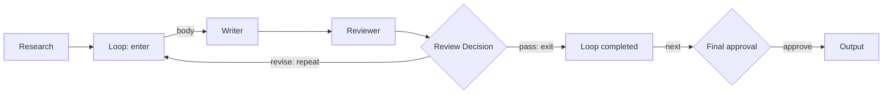

# Corral — 제품·실행 스펙 v0.1

> **Controlled autonomy. Visible collaboration. Deliberate steering.**  
> D&D로 AI 팀을 설계하고, 규칙 안에서 자율 협업하게 하며, 진행 중에도 적용 범위와 시점을 확인하면서 개입하는 로컬 우선 도구.

| 문서 관리 | 값 |
|---|---|
| 기준일 | 2026-10-14 |
| 상태 | 구현 착수용 설계안. 제품 기능 구현·통합 검증은 아직 수행하지 않음 |
| 소유자 | Bell |
| 개발 방식 | SDD(Spec-Driven Development) + TDD(Test-Driven Development) |
| 기준 자료 | 리뷰어 MVP v1.1 PDF [B1] + 대화에서 확정한 D&D·포트폴리오·실시간 개입 요구 |
| 관련 문서 | [구현 플랜](Corral-Implementation-Plan-v0.1.md), [기술 설계](docs/Technical-Design.md), [의존성과 출처](docs/Dependencies-and-Sources.md), [ADR](docs/Decisions.md) |

## 0. 이 문서의 결정 권한과 읽는 순서

**사용자가 확정한 목표 → 본 제품 스펙 → 기능별 수용 기준 → 기술 계약 → 구현 태스크** 순서로 해석한다. 라이브러리 편의 때문에 D&D·협업·스티어링을 제외해서는 안 된다. 테스트가 실패한다는 이유로 명세를 묵시적으로 약화하지 않는다.

[B1]의 범위·구조·용어를 출발점으로 삼되, 아래의 보완은 **이번 문서에서 새로 내린 설계 결정**이다. 외부 프로젝트가 이미 이 통합 기능을 제공한다는 주장이 아니다. 라이브러리 사실과 확인 날짜는 별도 출처 문서에 분리했다.

| 구분 | 처리 |
|---|---|
| 그대로 유지 | 첫 MVP D&D, 4종 노드, 협업 메시지, 동적 자식 실행, 제한된 검토 루프, 텍스트 산출물, 전체·개별 취소, 실행 중 구조 고정 [B1 §1·3·4·7] |
| 구체화 | 상태 소유자=Run Coordinator, SQLite의 영속 이벤트·투영을 한 트랜잭션에서 확정, LangGraph/Pi는 실행 어댑터 |
| 명시적 수정 | 일반 지시는 전체 정지 없이 접수 가능. 실제 전달은 다음 요청 경계. 강제 방향 변경은 일시정지/취소 후 처리 |
| 명시적 수정 | 작업 상태에 실패·취소, 실행 상태에 대기열·일시정지 중·취소 중을 추가 |
| 명시적 수정 | 모든 메시지에 산출물 버전을 요구하지 않고, 질문·답변·제출별 필수 참조를 다르게 정의 |
| 명시적 수정 | 실행 전 검증을 3종에 한정하지 않고, 지원 명세의 스키마·참조·포트·권한 검증까지 포함 |
| 명시적 수정 | 산출물 인과를 생성 시각이 아닌 요청 스냅샷·입력 버전으로 연결 |
| 유지하되 후속 일정 명시 | Local/Jev는 MVP 직후 v0.2의 독립 마일스톤. 자동 최적화·Hybrid 정책 평가와 분리 |

## 1. 제품 목표와 사용자

### 1.1 첫 MVP가 증명할 것

사용자가 **코드나 YAML 편집 없이** 조사·작성·검토 팀을 구성한다. 조사자가 자식 에이전트를 호출하고, 작성자가 조사자에게 질문하며, 검토 반려가 다음 반복의 수정 작업으로 이어진다. 사용자는 그 도중 지시·미래 모델 설정·한도를 바꾸거나 일부 작업을 멈출 수 있다. 화면에서 각 변경의 접수·적용·결과 연결을 확인한다.

세 가지 제품 질문을 동등하게 검증한다.

1. **설계:** 내가 만든 노드·연결·역할 설정이 실제 실행을 바꾸는가?
2. **협업:** 작업·질문·자식 실행·산출물의 연결을 이해할 수 있는가?
3. **개입:** 바꾼 지시가 누구에게 언제 적용되는지 신뢰할 수 있는가?

### 1.2 대상과 환경

주 대상은 자신만의 LLM 에이전트 팀을 구성하려는 개발자·파워유저다. Bell의 프런트엔드 포트폴리오로서 편집 UX, 실시간 상태 관리, 접근성, 성능, 오류 복구 설계를 드러낸다. 코딩 전용 제품으로 제한하지 않지만, MVP 실사용 시나리오는 조사→작성→검토 하나로 검증한다.

**배포 형태:** 데스크톱 브라우저 + 로컬 Node.js 서버 + SQLite. 클라우드 계정과 설치형 데스크톱 셸은 필수가 아니다. 워크스페이스당 활성 Run은 1개로 제한하되, 과거 Run은 여러 개 보관한다. 이는 이번 MVP의 자원·UI 범위 결정이다. 다수 에이전트의 병렬 작업은 한 Run 안에서 지원한다.

**포트폴리오 모드:** 동일한 편집기·상태 투영·Reins를 사용하되 실행 어댑터만 결정론적 mock으로 바꾼 정적 웹 데모를 제공한다. 실제 LLM처럼 가장하지 않으며 `Demo / Simulated agents`를 항상 표시한다.

### 1.3 성공과 비성공

성공은 단순히 최종 문서가 나오는 것이 아니다. 사용자가 화면으로 “이 버전이 왜 생겼는가”, “지금 누구를 기다리는가”, “내 지시는 전달되었는가”, “남은 추가 실행은 얼마나 허용되는가”에 답할 수 있어야 한다.

멀티에이전트가 단일 에이전트보다 항상 싸거나 정확하다는 목표는 두지 않는다. 비용·지연·품질 개선은 실제 비교 실험으로 별도 평가한다. ‘모델의 내면을 모두 보여준다’는 표현을 쓰지 않는다. 표시하는 것은 요청·응답·도구·작업·메시지·설정 등 관측 가능한 기록이다.

## 2. 이름·단위·UI 용어의 확정

### 2.1 은유는 제품 이해를 돕는 곳에만 사용한다

**Corral은 제품명인 동시에, 팀·작업 그래프·도구 권한·공유 예산을 감싸는 실행 경계다.** Loop와 같은 의미로 사용하지 않는다. 팀 하나가 여러 번 반복될 수 있으므로 팀의 경계와 반복 제어는 분리해야 한다.

MVP의 캔버스 전체가 하나의 Corral이다. 그 안에 Loop 영역과 Agent·Decision·Output을 배치한다. 여러 Corral을 중첩하거나 통째로 드롭하는 재사용 Subflow는 v0.3 이후로 둔다. 이렇게 하면 이름 때문에 다섯 번째 실행 노드나 새로운 중첩 런타임이 생기지 않는다.

| 제품/UI 용어 | 코드의 정식 타입·단위 | 의미와 경계 |
|---|---|---|
| **Corral Studio** | `apps/studio` | 설계·실행·협업·개입을 제공하는 웹 앱 |
| **Corral** | `CorralDefinition` | 하나의 팀, 그래프, 권한, 상한을 묶는 저장 가능한 정의 |
| Workspace | `Workspace` | Corral 정의·자료·실행 이력을 보관하는 로컬 디렉터리 |
| Canvas | `CanvasLayout` | 노드 좌표·크기·선택·뷰포트. 실행 의미와 분리 |
| Agent | `AgentNode` / `AgentRole` | 노드는 배치, Role은 책임·프롬프트·허용 도구의 정의 |
| Loop | `LoopNode` / `LoopIteration` | 반복 범위와 특정 회차. Corral의 별명이 아님 |
| Decision | `DecisionNode` | 규칙·검토 결과·사람 승인 분기 |
| Run | `CorralRun` | 특정 정의 버전과 입력으로 시작한 실행 한 번 |
| Agent execution | `ExecutionInstance` | 특정 역할의 실제 실행 시도. 노드와 1:N |
| Task | `Task` | 목표·담당·완료 기준을 가진 업무. 실행 시도와 구분 |
| **Reins** | `ReinsPanel` | 선택한 실행/노드/Run의 제어 패널 이름 |
| **Steer** | `SteeringDirective` | 새로운 지시를 앞으로의 모델 요청에 전달하는 조작 |
| Run settings change | `RunPatch` | 해당 Run의 미래 실행에만 적용되는 설정 변경 |
| Approval | `ApprovalRequest` | 특정 작업·버전·변경 제안에 대한 사람의 결정 |
| Task Board | `TaskProjection` | 공유 작업판. `Hitching Post`로 API를 부르지 않음 |
| Artifacts | `ArtifactVersion` | 제출물·초안·검토 결과의 불변 버전 |
| Timeline | `RunEvent` | 실행·메시지·개입의 시간순 기록 |
| Collaboration | `CollaborationMessage` | 질문·답변·제출의 업무상 교환 |

`Wrangle`는 소개 문구의 동사로만 사용한다. UI에는 `Steer`, `Pause`, `Resume`, `Cancel`, `Change settings`, `Approve`, `Reject`처럼 행동이 분명한 라벨을 쓴다. `Reins mode`처럼 별도의 숨은 조작 모드를 만들지 않는다. `Trough`·`Hitching Post`는 문서/DB/API의 정식 이름으로 채택하지 않는다.

**패키지와 CLI:** 모노레포 내부에서 `@corral/core`, `@corral/react` 등을 사용한다. npm scope, `corral` 실행 파일명, 도메인·상표의 독점 사용 가능 여부는 확인하지 않았다. 내부 패키지는 `private: true`로 시작하며 공개 발행 직전에 충돌을 확인한다. 이 문서는 이름을 확보했다는 의미가 아니다.

## 3. 범위

### 3.1 MVP 필수

| 영역 | 필수 제공 |
|---|---|
| 편집 | 실제 노드 D&D·연결·삭제·속성 편집·저장·불러오기·복제·Undo/Redo |
| 그래프 | Agent / Decision / Loop / Output. 검토 Loop 1개, 중첩 없음. 실행 입력은 Corral 설정 |
| 협업 | 고정 담당 작업, 질문·답변·결과 제출, 명시된 상대 역할, 동적 자식 호출 |
| 산출물 | Markdown/일반 텍스트와 구조화된 JSON 검토 결과. 불변 버전·diff·읽은 버전 기록 |
| 관찰 | 설계 그래프의 상태 겹침, 실제 실행 트리, 협업 로그, 대기 대상, 사용량 |
| Reins | 실행 중 지시 접수, 전체 pause/resume, 전체·개별 cancel, 미래 설정 변경, 승인·반려 |
| 제한 | 공유 호출·토큰·소환·깊이·질문·시간 제한, 신규 효과 실행 전 검사 |
| 연결 | Pi agent-core + pi-ai. OpenAI 구독 OAuth(ChatGPT 로그인)로 시작하며 같은 provider 안에 서로 다른 모델 프로필 2개 ([CR-001](docs/change-requests/CR-001-openai-oauth-first.md)) |
| 저장 | 정의·자료·실행 로그·산출물·변경 기록. 실행 종료 후 외부 호출 없는 재열람 |
| 품질 | mock 통합 시나리오, 실모델 계약 스모크, 접근성·부하·취소 경합 테스트 |
| 공개 데모 | API 키 없는 모의 팀. D&D와 Reins에 실제로 반응하는 데모 |

개인 하네스 확장 범위: 역할별 Pi 표준 스킬·신뢰한 네이티브 확장([CR-018](docs/change-requests/CR-018-pi-standard-harness.md)), broker 코딩 도구·자동 검증·제한된 개선([CR-019](docs/change-requests/CR-019-harness-verification.md)), 제한된 항목 반복·MCP·codemode·LSP 변경 제안([CR-020](docs/change-requests/CR-020-harness-composition.md)). 관리 경로는 Coordinator가 허가·기록하며, 네이티브 확장 코드의 직접 filesystem/network/process 효과는 통제하지 않는다. OS 격리를 제공한다고 표시하지 않는다.

### 3.2 이번 MVP에 넣지 않을 것

실행 중 노드 추가/삭제/재연결, 임의 역할 생성, 자유로운 병렬 그래프와 `join:any`, 다중 사용자 편집, 다른 사람의 원격 에이전트, A2A, 임의 셸 실행과 동일 작업 복사본의 동시 수정, 프로세스 재시작 후 자동 재개, 임의 시점의 외부 작업 재실행, 중첩 Corral/Subflow, 자동 판단 라우팅, Local/Jev 판정의 요청 적용과 Hybrid, LiteLLM, 과거 산출물의 직접 수정은 제외한다.

[CR-021](docs/change-requests/CR-021-role-reasoning-apply.md)의 수동·자동 추론 적용은 후속 승인 범위다. v0.2의 관찰 전용 `reasoning_effort` 판정은 요청을 바꾸지 않으므로 위 제외와 별개로 §13과 [CR-003](docs/change-requests/CR-003-admission-hooks-effort-observe.md)에서 다룬다.

브라우저 재접속은 지원한다. 이는 **살아 있는 로컬 실행에 다시 연결하는 것**이며, 죽은 실행을 살리는 crash resume이 아니다.

일반 작업 도구는 검색·문서 읽기·산출물 쓰기 3계열이다. 질문·소환·제출 등은 별도의 **협업 프로토콜 도구**다. 3종 도구라는 표현으로 협업에 필요한 인터페이스를 숨기지 않는다.

## 4. Studio 정보 구조와 UX

### 4.1 화면

| 경로(제안) | 화면 | 주요 동작 |
|---|---|---|
| `/` | Workspace | Corral 목록, 실행 이력, 환경·모델 연결 상태 |
| `/corrals/:id/edit` | Canvas | 노드 팔레트, 연결, 속성, 오류 패널, 실행 전 미리보기 |
| `/runs/:runId` | Run | 그래프, 실행 트리, Task Board, Timeline, Artifacts, Reins |
| `/runs/:runId?execution=:id` | 선택 실행 상세 | 입력·모델·도구·대기 이유·적용 지시·산출물 |
| `/runs/:runId?artifact=:id` | 버전 상세 | 본문·diff·원천 입력·검토·관련 개입 |
| `/settings/models` | Model profiles | 서버에서 해석되는 프로필, 기능·로그인/키 상태. OAuth 로그인·로그아웃. 자격 증명 원문 표시 없음 |
| `/demo` | Public demo | 모의 실행임을 표시. 로컬 파일·네트워크·실모델 호출 없음 |

캔버스는 중앙, 팔레트/실행 트리는 왼쪽, 속성/Reins는 오른쪽, 협업 기록은 하단 또는 탭으로 구성한다. 좁은 화면에서는 탭 전환을 제공하되, MVP의 주 사용 환경은 1280px 이상 데스크톱이다. 1280px 미만에서도 핵심 버튼이 가려져서는 안 된다.

### 4.2 D&D의 완료 조건

팔레트에서 Agent를 드롭할 수 있고, 포트 연결에 따라 실제 순서가 달라져야 한다. 템플릿의 모델 값만 바꾸는 화면은 D&D 완료로 인정하지 않는다. 빈 캔버스에서 유효한 최소 `Agent→Output`을 만들고 저장·실행할 수 있어야 한다.

연결 드래그 중 유효한 대상 포트와 거절 이유를 표시한다. 연결 후 검증도 같은 계약을 사용한다. nodeId는 복제 시 새로 발급하고, 레이아웃 이동은 정의 hash를 변경하지 않는다. 프롬프트·모델·권한 변경은 정의 revision을 변경한다.

`Undo`는 편집기의 아직 실행되지 않은 정의/레이아웃 변경만 되돌린다. 실행 취소, 외부 API 결과, 이미 제출한 산출물을 되돌리는 기능이 아니다.

### 4.3 실행 화면

설계 노드가 여러 회차/자식 호출에 대응하므로 “이 노드=실행 하나”라고 표시하지 않는다. 노드에 활성/대기/완료 인스턴스 수를 집계하고 클릭하면 목록을 연다. 실행 트리는 실제 부모·자식 관계를 표시하고, 협업 메시지는 별도 연결 관계로 보여준다.

완료율은 근거 없이 73% 등으로 계산하지 않는다. 단계명, Loop 회차, 완료된 필수 작업 수, 현재 활성 모델 요청 수를 보여준다. 텍스트 스트리밍과 제어 상태 배지는 서로 독립적으로 갱신한다.

### 4.4 Reins UX

제어 패널 상단에 **대상 / 적용 시점 / 영향 범위**를 항상 표시한다. 선택한 실행의 취소를 Run 전체 취소와 같은 위치·문구로 혼동시키지 않는다. 전체 취소는 상단의 고정 동작, 개별 취소는 선택 항목의 조작이다.

예시: `Target: Writer · execution w-02` → `Delivery: next model request` → `Scope: this execution only`.

설정 변경은 `Current → Proposed` diff와 이미 소비한 예산·미래 대상 수를 보여준 뒤 확인한다. 적용 불가/기한 만료/취소로 미전달 상태도 성공 상태와 동일한 수준으로 보이게 한다.

## 5. 그래프의 실행 의미

### 5.1 네 노드

| 노드 | 설정 | 실행 결과 |
|---|---|---|
| Agent | roleId, invocation, 입력 바인딩, 출력 계약, 모델 프로필, 도구/협업 허용 목록 | Task와 ExecutionInstance를 만들고 제출물을 다음 단계에 전달 |
| Decision | `review` / `approval` / 제한된 `rule` 중 하나 | 이름이 있는 분기 결과. 임의 JavaScript 평가 없음 |
| Loop | 본문 노드, 진입/반복/완료 포트, 자동 회차 상한 | 특정 회차 입력으로 본문 실행. 반복 판단은 구조화 결과만 사용 |
| Output | 제출할 버전의 바인딩, 최종 승인 여부 | 필수 작업·판정·승인 검증 후 최종 버전 확정 |

Agent의 `invocation`은 `scheduled` 또는 `callable`이다. callable은 실제 그래프 순서에서 자동 실행하지 않으며, 다른 Agent가 허용된 관계로 호출할 때만 실행한다. 팔레트상 새 노드 종류가 아니라 Agent의 속성이다.

### 5.2 연결 종류

**Control edge:** 다음 단계 실행을 뜻한다. Agent/Decision/Loop/Output의 정해진 포트 사이에 연결한다.

**Capability link:** `delegate` 또는 `question`을 허용하는 관계다. 실행 순서를 뜻하지 않는다. 별도 선 모양·핸들·레이어로 표시한다. 실제 호출은 Timeline과 실행 트리에 별도로 나타난다. 허용된 선이 있다는 이유만으로 호출됐다고 표시하지 않는다.

이벤트 스트림과 데이터 산출물의 연결을 control edge에 혼합하지 않는다. 입력 바인딩은 해당 노드 속성에서 선택한다. 범용 타입 설계기는 없지만, `text`, `notes`, `draft`, `review` 등 지원 계약의 호환성 검사는 한다.

### 5.3 Loop 포트 규약

Loop에는 외부 진입 `enter`, 본문 시작 `body`, 내부 재시도 `repeat`, 내부 통과 `exit`, 외부 다음 단계 `next` 포트를 둔다. 본문에 포함된 노드는 `loopId`를 가진다. 중첩 Loop는 금지한다.



위 그림의 `Loop completed`는 설명을 위한 상태이며 별도 편집 노드가 아니다. 실제 정의에서는 Decision의 pass가 같은 Loop의 exit 포트로 들어간다. compiler는 이 순환을 **회차 1회 실행 함수 + 상한 검사**로 변환한다. 임의 DFS로 화살표를 따라 무한 순환시키지 않는다.

### 5.4 실행 전 검증

스키마/버전·중복 ID·존재하지 않는 참조·지원하지 않는 노드·포트 방향·출력 포트의 중복 control 연결·진입점/종료점·도달 가능성·Loop 외 순환·본문 경계 침범·누락 상한·허용 목록·입력 생산자·review 계약·모델 기능 호환을 검사한다. callable 노드는 control edge가 없어도 유효한 capability 경로가 있으면 고립으로 판정하지 않는다.

runtime에서도 같은 한도·권한을 재검사한다. 편집기 검증은 신뢰 경계가 아니다. 버전이나 필드를 이해하지 못하는 import는 조용히 무시하지 않고 오류로 반환한다.

## 6. 대표 협업 시나리오

1. 사용자가 Research, Writer, Reviewer, Review Decision, Loop, Final Approval, Output을 연결한다. Research가 Research Helper를 호출할 수 있도록 capability link를 만든다.
2. Run 시작 시 정의·프롬프트·허용 도구·모델 해석·입력 자료의 스냅샷을 고정한다.
3. Research가 Helper 두 개를 병렬 소환한다. 부모는 자식 대기 상태지만 모델 실행 슬롯을 점유하지 않는다.
4. 두 결과를 읽고 Research가 `notes@1`을 제출한다. 단순 초안 쓰기가 아니라 제출이 완료돼야 Writer에 전달한다.
5. 회차 1의 Writer가 특정 근거에 관해 Research 역할에 질문한다. 이미 끝난 Research 실행을 몰래 다시 열지 않고, 질문에 답할 새 작업·응답 실행을 생성한다.
6. 응답자가 답변과 필요한 근거 버전을 제출한다. Writer가 `draft@1`을 제출하고 Reviewer가 그 정확한 버전을 검토한다.
7. `review@1`이 revise이면 수정 작업을 만들고 다음 회차에 `draft@1`과 `review@1`을 전달한다.
8. 사용자가 Writer 노드의 미래 프롬프트에 “1차 자료만 근거로 사용”을 추가한다. 완료 기준도 바꾸는 경우 별도의 criteria 패치를 확정한다. 그 이후의 요청 스냅샷에 포함된 ID가 기록된다.
9. Writer는 `draft@2`, Reviewer는 **이번에 작성된** `draft@2`에 대한 `review@2`를 만든다. 이전 review 입력과 현재 review 출력을 섞지 않는다.
10. 통과한 특정 버전을 사용자가 최종 승인하면 Output이 확정된다. 취소·한도·실패 경로는 같은 정의의 별도 실행 테스트로 검증한다.

이 시나리오에서 모델이 반드시 첫 회차에 반려하고 두 번째에 통과할 것이라고 가정하지 않는다. 고정 데모/테스트는 MockAdapter로, 실제 LLM은 별도의 품질 평가로 검증한다.

## 7. 협업과 산출물 계약

### 7.1 Task와 실행 시도

Task 담당 역할은 한 명이다. 동시에 활성화된 ownerExecutionId도 최대 하나다. 동일한 Task를 재시작하더라도 이전 실행을 덮어쓰지 않고 attemptNo를 증가시킨 새 ExecutionInstance를 연결한다. 자동 재할당·경매·작업 훔치기는 제공하지 않는다.

작업 상태는 `queued / in_progress / blocked / submitted / completed / failed / cancelled`다. submitted는 산출물을 냈다는 사실, completed는 해당 Task의 완료 계약을 충족했다는 사실이다. 그래프 전체의 검토 통과나 Run 성공과 같은 의미가 아니다.

### 7.2 협업 메시지

| 타입 | 필수 필드 | 선택 필드 | 종료 규칙 |
|---|---|---|---|
| question | taskId, senderExecutionId, targetRoleId, questionId, body, deadline | artifactRefs | 답변/취소/타임아웃으로 반드시 종결 |
| answer | questionId, responderExecutionId, taskId, body | evidenceRefs | 열린 질문 하나에 최종 답변 하나. 중복은 멱등 처리 |
| submission | taskId, executionId, artifactVersionIds | comment | 자신이 소유한 작업의 허용 산출물만 제출 |

사람의 지시는 동일한 실행 감사 체계에 남지만 agent answer로 위장하지 않는다. `actor.kind=user`의 별도 command/directive다.

`question`은 허용 관계를 검사한 뒤 새로운 응답 Task를 만든다. 그 Task는 질문을 보낸 실행의 소유 하위 작업이므로 취소 전파 경계가 명확하다. 대상 역할의 다른 활성 실행에 임의로 대화를 끼워 넣지 않는다. 질문 생성도 spawnCount와 depth에 포함한다. depth는 control graph 깊이가 아니라 **동적으로 생성한 실행 계보**를 센다.

### 7.3 대기와 교착

모델 호출 permit은 모델 통신 동안만 점유한다. `ask`, `await_tasks`로 기다리는 부모는 permit을 반환한다. resident worker 수의 한도와 모델 동시성의 한도를 분리한다.

대기 관계는 `{kind, targetIds, since, deadline, reasonCode}`로 저장한다. 신규 wait edge가 순환을 만들면 실패 결과를 반환한다. 새 인스턴스를 계속 만드는 질문 사슬은 단순 순환 탐지로 잡히지 않을 수 있으므로 총 질문/소환/깊이/시간 제한도 병행한다.

### 7.4 산출물

`artifactId + version`은 불변이다. 같은 이름이어도 두 병렬 작업의 결과는 taskId 또는 artifactId로 구분한다. 전역 `notes-part@latest`에 두 helper가 덮어쓰지 않는다.

write는 새 버전을 저장하고 submit은 작업의 공식 출력을 확정한다. 취소된 시도의 미제출 버전은 `unsubmitted/abandoned`로 남길 수 있으나 다음 control 단계에 자동 전달하지 않는다. 생성된 산출물을 취소 때문에 삭제하거나 이전 버전으로 둔갑시키지 않는다.

노드 시작 시 입력 참조를 해석하고 고정한다. 바인딩은 `run_input`, `task_output`, `previous_iteration_output`, `question_answer`, `explicit_version`만 지원한다. 데이터 전달의 세부 형식은 기술 설계 및 예제 JSON을 따른다.

### 7.5 검토

검토 결과에는 `targetArtifactVersionId`, `criteriaVersionId`, `verdict: pass|revise|inconclusive`, `issues[]`, `evidenceRefs[]`를 요구한다. revise에는 최소 하나의 수정 사유가 필요하다. 형식 오류·대상 버전 불일치·기준 버전 불일치는 pass로 처리하지 않는다.

일반 Steer는 완료 기준을 자동 변경하지 않는다. 사용자가 별도의 기준 변경을 확정하면 CriteriaRevision을 새로 만든다. 일반 작성 방식 지시와 완료 기준 수정은 UI에서 구분한다. 기존 검토는 삭제하지 않고 `review_stale` 표시 후 다음 허용 회차의 재검토를 요구한다. 기준 변경은 Loop 종료 전까지만 가능하며 Final Approval 이후에는 새 Run이 필요하다.

## 8. Reins — 실시간 개입 명세

### 8.1 조작과 적용 경계

| 명령 | 기본 대상 | 적용 경계 | 하지 않는 일 |
|---|---|---|---|
| `steer.enqueue` | 선택 실행 1개 | 다음 모델 요청의 컨텍스트 확정 시점 | 진행 중 응답의 내용을 순간 수정 |
| `run.pause` / `run.resume` | Run 전체 | 신규 효과 접수를 막고 진행 중 요청·도구 정리 후 안전 경계 | OS/프로세스 중단 후 복구 |
| `execution.cancel` | 선택 실행 + 소유 후손 | 신규 효과 차단 후 Abort·종료 확인 | 자동 재할당·이미 수행한 외부 작업 롤백 |
| `run.cancel` | 전체 Run | 모든 활성 범위의 취소 정리 | 즉시 cancelled로 표시 |
| `execution.restart` | 취소된 미완료 Task의 실행 시도 | 기존 시도 종료 확인 후 새 실행 | 완료한 노드를 과거 시점에서 재실행 |
| `run.patch` | nodeId의 미래 활성화 또는 Run 상한 | 명시한 경계 이후 | 실행 중 그래프 구조·도구 권한 확대 |
| `approval.resolve` | 특정 approvalId | 승인 대상 revision 일치 시 한 번 | 예산을 늘리지 않고 승인만으로 우회 |

재시작은 부모가 아직 해당 필수 작업을 기다리고 있고, 그래프가 이미 그 작업 이후로 진행하지 않은 경우만 허용한다. 조건을 만족하지 않으면 새 Run 또는 다음 검토 회차를 사용한다. 재시도는 같은 taskId, 새 executionId이며 이전 결과와 지시를 명시적으로 연결한다.

### 8.2 지시 전달 상태

`accepted → queued → attached_to_request → delivered`를 기본으로 한다. `delivered`는 해당 입력을 포함한 요청을 로컬 transport가 시작했다는 뜻이며 모델이 이해/준수했다는 뜻이 아니다. 요청 전 취소는 `not_delivered`, 대상 종료는 `expired`, 검증 실패는 `rejected`다. 응답 전 네트워크 단절은 `delivery_unknown`으로 남길 수 있다.

두 지시가 같은 요청에 포함되면 순서와 두 ID를 기록한다. MVP에서는 이미 접수한 지시를 과거 기록에서 삭제하지 않는다. 방향을 정정하려면 새로운 명시적 상쇄 지시를 보낸다. 대기 지시 자체의 철회 UI는 후속으로 두되, 취소/종결로 인한 미전달 상태는 표시한다.

### 8.3 설정 패치

설정 변경 대상은 `roleId` 전체가 아니라 **선택한 nodeId의 미래 Execution 활성화**가 기본이다. 같은 Role을 다른 노드에서 재사용해도 그 노드는 바뀌지 않는다. callable 노드 변경은 이후 그 노드를 호출하는 응답/자식 실행부터 적용한다.

Loop 회차의 최초 상한은 `LoopNode.maxIterations` 한 곳에 둔다. `loop_limit` 패치가 해당 nodeId의 다음 회차 진입부터 이를 덮는 run-only 값을 만든다. 전역 limits에 같은 maxIterations를 중복 저장하지 않는다.

한 Run에는 baseDefinitionHash와 단조 증가 controlRevision이 있다. 패치는 이전 revision과 대상·시점·변경 키를 포함한다. 허용 키는 모델 프로필, 역할 프롬프트, 루프 자동 회차, 소환·호출·토큰 예산뿐이다. 권한·연결·노드·도구 구현 변경은 거절한다.

실행 전체의 토큰/소환 한도는 즉시 미래 admission부터 적용한다. 사용량은 초기화하지 않는다. 설치 정책의 hard cap을 넘기는 변경은 현재 Run에서 허용하지 않는다.

### 8.4 안전한 일시정지

pause 접수 시 새 모델 호출·새 도구·새 Task 소환의 admission을 닫는다. 이미 시작한 모델/도구는 유한 timeout 안에 마무리하거나 사용자 요청에 따라 취소한다. 질문/자식 대기 중인 worker는 안전 경계로 간주할 수 있으며 답변이 올 때까지 전체 정지가 지연되어서는 안 된다.

Run이 실제 `paused`가 되는 조건은 **활성 외부 효과가 0이고, 모든 worker가 경계 또는 종결 상태**인 것이다. `pausing` 동안 지시 접수·취소·로그 열람·예산 변경은 허용한다. 정상 실행 작업은 정지한다. pause와 resume은 멱등 명령이다. resume은 자동 승인을 뜻하지 않는다.

### 8.5 취소의 완료와 한계

취소 의도 접수 직후 대상 scope의 새 admission을 차단한다. 이미 admit된 요청은 취소가 전달될 때까지 잠시 살아 있을 수 있다. 원격 공급자 내부의 처리·청구까지 중단되었음을 보장하지 않는다.

모든 소유 후손 worker, backend tool 요청, 대기 promise가 종료 또는 취소 결과로 정리돼야 `cancelled`를 확정한다. timeout 후 worker를 강제 종료하면 `forced` 여부를 기록한다. 종료 확인을 못한 경우 완료라고 숨기지 않고 `termination_unconfirmed` 실패로 표시한다. 늦게 도착한 사용량은 정산 기록으로만 추가하고 Task/Run을 부활시키지 않는다.

부분 취소로 필수 Task가 사라지면 `awaiting_user`로 이동한다. 선택지는 **새 시도로 다시 시작** 또는 **Run 취소**다. “없어도 성공한 것으로 진행”은 MVP에 없다. 질문 응답 작업을 취소한 경우에는 질문자에게 구조화된 취소 결과를 전달한다.

### 8.6 인과 기록

산출물에는 생산 modelCallId, contextSnapshotId, 실제 전달된 directiveIds, 적용 configRevision, 읽은 입력 버전 ID를 연결한다. 이것은 **프로그램이 관측한 데이터 경로**이며 특정 문장이 어느 지시 때문에 생겼는지에 대한 심리적 인과를 증명하는 것은 아니다.

사용자 지시가 10:01에 접수됐어도 10:00에 시작한 요청의 10:02 결과에 그 지시를 직접 원인으로 붙이지 않는다. 다음 요청에 실제로 포함된 시점부터 직접 적용 연결을 만든다. 간접 전달은 산출물 참조 경로로 별도 표시한다.

## 9. 제한·예산의 초기값

아래 값은 **이번 계획에서 정한 출발 설정**이며 성능 측정이나 비용 최적화 결과가 아니다. 상한을 올릴 수 있더라도 기록·누적 사용량·hard cap은 유지한다.

| 항목 | 기본값 | hard cap / 조절 |
|---|---:|---|
| 캔버스 노드 수 | 최대 20 | MVP 고정 |
| Loop 수·중첩 | 1 / 중첩 없음 | MVP 고정 |
| Loop 자동 회차 | 2 | 사용자 패치로 10까지 |
| 동적 위임 깊이 | 2 | MVP 고정. 최초 scheduled agent=0 |
| 동시 모델 요청 | 3 | MVP 고정. 대기는 슬롯 사용 안 함 |
| 실행당 동적 생성 | 12 | 사용자 패치로 32까지. 질문 응답 생성 포함 |
| 실행당 모델 요청 | 40 | 사용자 패치로 100까지. 실패·재시도 포함 |
| 총 출력 토큰 예산 | 64,000 | 사용자 패치로 256,000까지. 알려진 지원 모델만 강제 |
| 요청별 출력 토큰 상한 | 4,096 | 모델 기능과 잔여 예약 예산 안에서 결정 |
| 실행당 질문 | 6 | 고정. 한 실행의 열린 질문 최대 1개 |
| 질문 대기 | 120초 | user pause 동안 논리 대기 타이머를 멈추되 전체 wall deadline은 계속 |
| 모델/문서 도구 timeout | 180초 / 30초 | 취소 정리 timeout 별도 10초 |
| 전체 wall deadline | 60분 | 사람 대기 포함. 만료하면 신규 실행 차단·정리 |
| 산출물/입력 문서 | 버전당 UTF-8 1 MiB | workspace 총량 제한 별도 |
| 무진전 | 6턴 | 단순 메시지 왕복은 진전으로 간주하지 않음 |
| 추론 강도 판정 호출(v0.2, 관찰 전용) | Run당 모델 요청 상한과 같음 | hard cap 100. 모델 호출·토큰 예산과 별도로 센다. 도달하면 판정만 멈춤 ([CR-003](docs/change-requests/CR-003-admission-hooks-effort-observe.md)) |
| 판정 timeout | local 1초 / external 3초 | 초과는 판정 실패로 기록하고 요청에는 영향 없음 |

예산은 요청 전 예약하고 종료 후 실제 usage로 정산한다. 취소 등으로 실제 usage가 없으면 예약량을 임의로 0으로 환급하지 않고 미확인 항목으로 남긴다. 모델이 엄격한 토큰 상한을 지원하지 않으면 UI가 이를 hard cap으로 주장해서는 안 된다.

금액은 확인된 모델 단가 스냅샷이 있을 때만 추정하며, provider 청구서와 같은 값이라고 부르지 않는다. 캐시 읽기/쓰기, 입력/출력/추론 토큰 등 공급자가 반환한 범주를 중복 집계하지 않도록 provider별 usage normalization 테스트를 둔다.

## 10. 기록·보안·비기능 요구

### 10.1 저장과 재열람

SQLite에 정의 revision, 레이아웃, 실행 이벤트, Task/Execution 투영, 입력 스냅샷, 산출물, 개입과 승인, usage를 저장한다. 텍스트 산출물도 같은 DB 트랜잭션에서 저장하여 로그만 남고 본문이 사라지는 이중 쓰기를 피한다.

프로세스 재시작 시 남아 있는 running/paused Run은 `interrupted`로 확정한다. 자동 provider 호출·outbox 재전송은 하지 않는다. 기록을 읽는 동작에는 모델·검색 키가 필요하지 않다. 입력·프롬프트 스냅샷을 포함하지 않은 내보내기는 완전한 재구성 파일이라고 부르지 않는다.

### 10.2 기본 보안

localhost만 bind하더라도 임의 웹페이지의 요청을 신뢰하지 않는다. 시작 시 발급한 세션, Host/Origin 검사, 상태 변경 요청의 CSRF 방어, rate/size 제한을 적용한다. API 키와 OAuth 토큰은 backend 환경/서버 측 credential store에서만 읽으며 Corral JSON·SQLite·클라이언트 번들·이벤트 payload·export·로그에 저장하지 않는다. OAuth 로그인은 provider 자체 흐름에서 사용자가 완료한다([CR-001](docs/change-requests/CR-001-openai-oauth-first.md)).

외부 decision provider(v0.2)는 live Run에서 workspace의 명시적 opt-in이 있을 때만 쓴다. mock Run·공개 데모·CI에서는 시작 시 거절한다. 보내는 입력은 정해진 특징 값과 UTF-8 1,500자 이하 발췌로 제한하고, 전송 전에 그 사실을 effect로 기록한다. 이벤트·export에는 발췌 본문 대신 hash만 남긴다([CR-003](docs/change-requests/CR-003-admission-hooks-effort-observe.md)).

MVP worker에는 read/write shell 도구가 없고, 승인된 원격 모델 요청 외 기능은 Coordinator RPC를 거친다. 프로세스 분리는 정리·장애 격리를 위한 것이며 완전한 보안 sandbox라고 주장하지 않는다.

문서 읽기는 workspace의 등록된 documentId 또는 검증된 HTTPS sourceId만 받는다. 임의 로컬 경로를 받지 않는다. 외부 URL은 SSRF 검증과 크기/타입/redirect 제한을 거친다. Markdown 출력은 HTML 실행 없이 렌더링하고 위험한 URL을 막는다. 원격 이미지 자동 로드는 기본 비활성화한다. [S24]

### 10.3 접근성·성능 목표

표시 상태는 색만으로 구분하지 않는다. 이름·아이콘·텍스트를 함께 사용한다. 키보드로 노드 추가/선택/이동/연결/삭제 및 Reins를 사용할 수 있고, 긴 한국어·일본어 지시 입력 중 IME Enter가 전송을 일으키지 않는다.

측정 목표는 출시 시 검증할 수치이지 이미 달성한 성능이 아니다. production build, 고정된 브라우저·화면·테스트 장비를 기록한다. 20개 설계 노드, 100개 과거 실행 인스턴스, 10,000개 이벤트, 초당 50개의 수신 프레임 부하에서 로컬 제어 접수 p95 200ms, 영속 이벤트 반영 p95 300ms를 목표로 한다. 실제 모델 응답 시간은 제외한다. 캔버스 드래그 중 이벤트 증가로 지속적인 전체 재렌더가 생기면 실패다.

## 11. 수용 기준과 출시 경로

| AC | 검증할 장면 | 연결 요구 |
|---|---|---|
| AC-01 | 빈 캔버스에서 노드를 드롭·연결하고 설정 폼만이 아닌 실제 흐름 변경을 실행 | CAN-001, CAN-004 |
| AC-02 | 저장/불러오기/복제 및 레이아웃 이동 시 실행 정의 hash 불변 | CAN-002, CAN-005 |
| AC-03 | 조사자의 두 자식과 depth 2 손자가 실행 트리에 표시 | RUN-002, RUN-004 |
| AC-04 | Writer 질문→응답 작업→답변이 작업·버전 참조로 연결 | COL-002, COL-003 |
| AC-05 | draft@1 반려→다음 회차 draft@2→draft@2 검토를 정확히 연결 | ART-002, ART-003 |
| AC-06 | 화면만으로 대기 이유·원천 입력·생성 경로·usage를 확인 | OBS-001, OBS-004 |
| AC-07 | Loop/소환/모델 호출/토큰 상한이 조용히 넘어가지 않음 | RUN-006 |
| AC-08 | 진행 중 지시는 접수되지만 이전 요청의 결과에는 적용됐다고 표시하지 않음 | RNS-001, RNS-002, RNS-010 |
| AC-09 | 미래 노드 모델·프롬프트 변경이 기존 실행/템플릿을 덮지 않음 | RNS-006, RNS-009 |
| AC-10 | 상한 증가·감소 시 누적값·예약량 유지 및 신규 admission 정책 반영 | RNS-007 |
| AC-11 | pause 중 신규 실행 없음, resume 이후 정상 계속, 자동 승인 없음 | RNS-003 |
| AC-12 | 전체 취소가 후손과 backend 도구를 정리하며 종료 전 완료 표시 없음 | RNS-004, SEC-004 |
| AC-13 | 개별 취소로 질문자/부모가 무한 대기에 남지 않음 | COL-004, RNS-004 |
| AC-14 | 조건부 재시작이 새 실행 ID를 사용하고 기존 완료 노드를 재실행하지 않음 | RNS-005 |
| AC-15 | 중복 명령·승인·늦은 결과·설정 revision 충돌을 올바르게 처리 | DEV-001, RNS-008 |
| AC-16 | SSE 재접속·탭 재열기 후 같은 투영. backend 재시작 후 자동 외부 호출 없음 | OBS-002, RUN-007 |
| AC-17 | 악성 import/권한 없는 도구/로컬 접근 URL/렌더링 스크립트 차단 | SEC-001~003 |
| AC-18 | 실제 모델 프로필 두 개(OpenAI OAuth, CR-001)의 요청·usage·취소 계약 스모크 | DEV-004, OBS-004 |
| AC-19 | 키 없는 공개 데모와 키보드/IME·부하 시험 | DEV-005, UX-001, UX-002 |
| AC-20 | 요구→테스트→태스크 추적과 모든 필수 품질 게이트 통과 | DEV-003, DX-002 |

정상 완료·전체 취소·개별 취소·예산 소진은 각각 독립된 실행으로 검증한다. 하나의 Run이 성공하면서 동시에 중간 취소까지 완성해야 한다는 모순된 수용 기준을 만들지 않는다.

## 12. CLI와 개발자 경험

아래는 구현할 CLI 계약이다. **현재 이미 설치 가능한 명령이라는 뜻이 아니다.**

```bash
corral dev                         # 로컬 Studio와 제어 서버
corral dev --demo                  # 모의 실행 프로필
corral validate workflow.corral.json
corral run workflow.corral.json --input brief.md --watch
corral inspect <run-id>            # 저장 기록 열람, 외부 호출 없음
corral export <run-id> --redact     # 공개 가능한 기록 묶음
```

CLI 실행도 같은 Coordinator를 사용한다. 승인 대기 시 --watch 터미널과 Studio 중 어느 쪽에서든 동일한 approvalId를 해결할 수 있다. headless에서 사람이 없는데 승인을 자동 허용하지 않는다. SIGINT는 전체 취소 요청이며, CLI가 사라졌다고 서버에 남은 Run을 모르고 방치하지 않도록 명시적 detach 옵션을 별도 설계한다.

## 13. 이후 확장

v0.2는 **Local/Jev의 수동 교체 가능한 DecisionProvider**를 구현한다. 질문 종류·후보·응답 검증이 같은 범위에서만 전환하고, 성능 우열이나 자동 절감은 별도 평가한다. 첫 질문 종류는 모델 요청별 `reasoning_effort`(후보 `low | medium | high | xhigh`)이며 **관찰 전용**으로 시작한다. 판정은 기록만 하고 요청 permit·예산·worker 요청을 바꾸지 않는다. CR-021은 역할별 수동 설정과 로컬 turn/tool-step 자동 판정의 요청 전 적용을 추가한다. 기존 off/observe 계약은 유지한다([CR-003](docs/change-requests/CR-003-admission-hooks-effort-observe.md), [ADR-025](docs/Decisions.md)). v0.3은 Corral 중첩/재사용과 더 넓은 그래프, 이후는 외부 AgentAdapter/A2A·LiteLLM·crash resume을 다룬다. 모델 연결은 Pi가 지원하는 provider·인증 방식 전체로 확장한다. Anthropic 구독 OAuth는 Anthropic 정책상 제외하고 API 키로 지원한다([CR-001](docs/change-requests/CR-001-openai-oauth-first.md)).

현재 스펙의 MVP 게이트를 후속 기능으로 대신하지 않는다. 비용 최적화가 없더라도 D&D와 협업·Reins를 검증하면 MVP는 성립한다.

---

**구현상 세부 계약은 [Technical-Design.md](docs/Technical-Design.md), 요구사항 전체는 [requirements.json](contracts/requirements.json), 테스트 설계는 [Test-Strategy.md](docs/Test-Strategy.md)에 있다.**

### 리소스 관리 확장

[CR-022](docs/change-requests/CR-022-resource-management.md)에 따라 설정에서 스킬·Hook·MCP 추가·편집·선택·제거/복구를 제공한다. 실행 자산은 불변이며 설치·신뢰·선택·적용을 분리한다.
