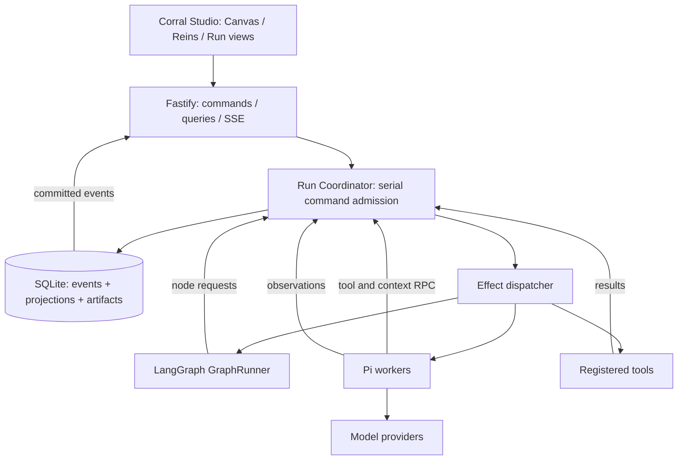
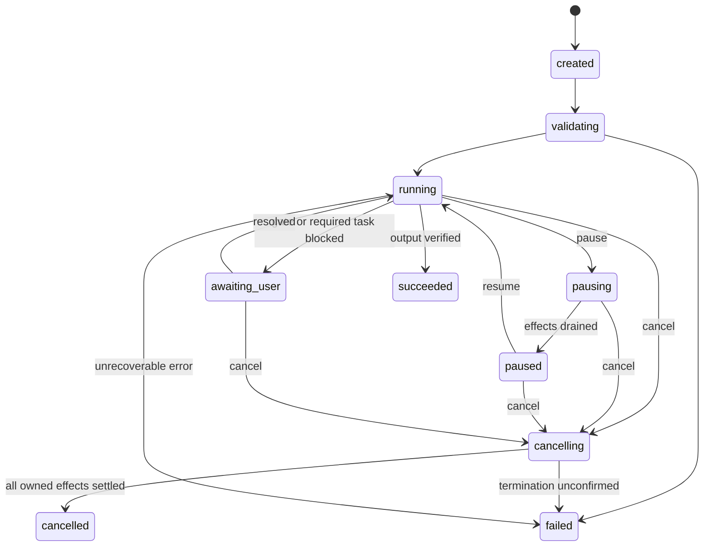

# Corral — 기술 설계 v0.1

> 이 문서는 제품 스펙을 구현 가능한 책임·데이터·전이·통신 계약으로 분해한 설계안이다. 라이브러리 조합의 동작을 검증했다는 보고서가 아니다. 아래 인터페이스는 Corral이 구현할 포트이며, 실제 Pi/LangGraph API를 그대로 인용한 코드가 아니다.

## 1. 아키텍처 결정

**React/Vite/React Flow + Fastify + Run Coordinator + LangGraph.js 어댑터 + Pi agent-core worker + SQLite**를 채택한다. LangGraph와 Pi는 제품 상태의 독립 소유자가 아니다. XState·Redux·Temporal·Redis·LiteLLM을 동시에 추가하지 않는다.

LangGraph는 검증된 정적 control flow를 순회하고 노드 실행을 Coordinator에 요청한다. Task·메시지·개입·예산·산출물·Run terminal 상태는 Coordinator가 확정한다. LangGraph의 실행 반환은 성공의 제안이며, 필수 Task·승인·활성 후손 검증 없이 Run을 성공시킬 수 없다.

MVP에서는 LangGraph의 영속 checkpointer와 `interrupt()`에 제품의 스티어링을 맡기지 않는다. 제품의 pause/approval은 Coordinator의 취소 가능한 경계 대기다. 그래프 state에는 runId, 참조 ID, 제어 결과만 두고 대화·메시지·Task 보드를 복제하지 않는다. 재시작 후 실행 복구가 없으므로 이 경계가 가능하다. LangGraph의 interrupt는 재진입 시 노드 앞부분을 다시 실행할 수 있어, 장수 Pi 세션의 중간 정지를 동일시하지 않는다. [S05]

### 1.1 구성도



### 1.2 상태 소유 표

| 데이터 | 쓰기 권한 | 캐시/사본 | 금지 |
|---|---|---|---|
| 정의·레이아웃 | DefinitionService 트랜잭션 | 편집기 draft | live Run에 draft를 직접 덮기 |
| Run/Task/Execution/Approval | Coordinator | SQL projection, UI projection | Pi/GraphRunner가 직접 terminal 확정 |
| event seq·controlRevision | Coordinator | UI watermark | timestamp로 seq 대체 |
| 외부 요청 permit·예산 예약 | Coordinator | worker의 단회성 permit | worker가 자식 예산 새로 만들기 |
| 대화 컨텍스트 | 요청 전 Coordinator가 스냅샷 확정, Pi는 실행용 사본 | Pi 세션 | 과거 요청 snapshot 수정 |
| 스트리밍 텍스트 | worker 관측 → 스트림 채널 | UI buffer | 토큰 delta로 도메인 완료 추론 |
| 산출물 본문·버전 | ArtifactService, Coordinator tx 내부 | 읽기 전용 UI | 동일 version UPDATE |

이벤트 로그가 영속 이력의 기준이며, 현재 상태용 SQL projection은 같은 트랜잭션에서 갱신한다. 별도 event store 서비스나 분산 CQRS 플랫폼은 도입하지 않는다. projection을 replay해 동일 상태가 되는지 검사한다.

## 2. 모노레포와 의존 방향

```text
corral/
  apps/
    studio/                 # React/Vite. Node/Pi/DB import 금지
    server/                 # Fastify, 세션, REST/SSE
  packages/
    contracts/              # Zod schema, types, errors, generated JSON Schema
    core/                   # Coordinator, limits, tasks, messages, pure reducers
    runner-langgraph/       # 정적 control-flow lowering과 node callback
    adapter-pi/             # parent/worker 프로토콜, Pi API mapping
    storage-sqlite/         # SQL migrations, RunStore·Corral repository (ADR-021)
    react/                  # Canvas/Reins/RunView의 내부 재사용 컴포넌트
    testkit/                # clock/id/agent/search/store test doubles
    cli/                    # corral dev/run/validate/inspect/export
  specs/                    # feature spec, acceptance.feature, traceability
  tests/{unit,contract,integration,e2e,live,performance}/
  examples/{research-team,fixtures}/
  docs/{adr,dependencies,runbooks}/
```

`contracts ← core ← adapter/runner/storage/server`의 방향을 지킨다. contracts/core는 DOM·React에 의존하지 않는다. `@corral/react`는 contracts와 frontend용 순수 selector만 참조한다. DB 구현이 runtime 밖으로 흘러나오지 않도록 Repository 포트를 사용한다.

패키지는 초기에 내부 workspace만 사용한다. 공개 SDK 버전 호환성을 약속하거나 매 패키지를 npm에 배포하지 않는다. package names는 발행 가능 여부 미확인이다.

## 3. 식별자·revision·시간

| 필드 | 의미 |
|---|---|
| `corralId` | 저장한 정의의 안정 ID |
| `definitionRevision` | 의미 있는 정의 편집 순번 |
| `definitionHash` | 정규화한 정의·내장 프롬프트의 SHA-256 |
| `layoutRevision` | 좌표·크기 등 화면 편집 순번, definitionHash와 독립 |
| `runId` | 실행 한 번 |
| `controlRevision` | 사용자가 패치/개입 정책을 변경할 때의 revision. token delta마다 바뀌지 않음 |
| `runSeq` | 모든 영속 RunEvent의 순서, Run 내부에서 단조 증가 |
| `nodeId` / `roleId` | 배치한 노드 / 역할 정의 |
| `taskId` | 완료 대상 업무 |
| `executionId` / `attemptNo` | 실제 시도 / 동일 업무의 시도 번호 |
| `parentExecutionId` | 취소·소유 계보, 루프 그룹 깊이와 무관 |
| `iterationId` / `iterationNo` | 검토 반복의 실행/회차 |
| `modelCallId` / `toolCallId` | 요청/도구 실행. retry는 새 ID |
| `commandId` | 클라이언트가 생성하는 멱등 명령 ID |
| `effectId` | 외부 효과의 단회 실행 ID |
| `contextSnapshotId` | 그 요청이 실제로 사용한 입력·지시·설정 |
| `directiveId` / `patchId` | 자연어 지시 / 설정 변경 |
| `criteriaVersionId` | 완료 기준의 불변 버전 |

ID는 주입 가능한 UUID 생성기로 만들고 순서는 ID가 아니라 runSeq로 판단한다. wall 시각은 ISO UTC, timeout은 monotonic clock을 사용한다. UI에서 로컬 시간으로 변환한다. 테스트는 Clock/ID provider를 주입한다.

정규화는 객체 키 정렬·정의용 배열의 안정 순서·UTF-8 직렬화를 명세한다. `NaN`, 함수, undefined, 날짜 객체 같은 JSON 외 타입은 거절한다. 레이아웃·사용자 secret·실행 시각을 definitionHash에 넣지 않는다. 실제 provider/model ID와 단가·기능 해석은 RunSnapshot에 별도로 고정한다.

## 4. 정의와 compiler

### 4.1 JSON이 canonical format

기본 확장자는 `.corral.json`이다. D&D 에디터가 이 정의를 생성한다. YAML은 MVP의 필수 입력이 아니다. 코드로 정의를 만들 수 있지만 그것이 유일한 설계 방식이 되어서는 안 된다.

정의에는 `schemaVersion, id, name, entryNodeId, input, roles, nodes, controlEdges, capabilityLinks, limits`를 둔다. layout은 별도 JSON이다. prompt는 MVP에서 정의 안의 문자열로 저장한다. 나중에 파일 참조를 도입할 경우 Run 시작 시 본문까지 snapshot해야 한다.

역할: `id, prompt, modelProfile, allowedWorkTools, outputContract`. Agent node는 `roleId, invocation, inputBindings, outputName, loopId?`를 가진다. 동일 역할의 여러 노드를 구분해 patch를 적용할 수 있다.

### 4.2 compiler 파이프라인

`JSON parse → version/schema validation → references/ports validation → capability reachability → Loop-boundary validation → input binding validation → IR lowering → plan summary`.

IR은 `AgentStep / DecisionStep / ReviewLoop / OutputStep`와 정적 연결이다. 사용자가 넣은 코드/함수를 eval하지 않는다. rule은 `review_verdict`, `required_tasks_submitted`, `human_approval`의 enum으로만 선택한다. 수식 언어는 MVP 밖이다.

Loop 본문은 `loopId`로 묶는다. 외부 edge는 enter/next, 내부 종료는 repeat/exit만 허용한다. 이 경계를 통과하지 않는 외부↔본문 연결은 거절한다. 각 본문 경로는 Loop로 반환하거나 명시적으로 실패한다. `repeat`가 자동 회차 상한을 넘어가면 새 본문을 호출하기 전에 Approval을 생성한다.

GraphRunner의 node callback은 `requestExecution(runId,nodeId,iterationId)`를 요청한다. 동일 계획 활성화가 실수로 재진입해도 activationKey의 unique 제약으로 Task를 중복 생성하지 않는다. LangGraph node retry는 MVP에서 비활성화하고 재시도는 Corral의 시도·예산 계약으로만 처리한다.

### 4.3 일반 분기와 병렬의 범위

root에서는 정적 Agent 순서, 승인/검토 분기, Output을 지원한다. 임의 DAG의 모든 fan-out/fan-in 의미는 지원하지 않는다. 병렬성은 명시적 동적 child tasks와 전체 합류(`all`)에서 제공한다. 지원하지 않는 연결은 에디터에서 생성되더라도 검증 오류로 막는다.

이 제한은 “그림은 자유롭게 그리고 실행은 다른 방식으로 한다”는 뜻이 아니다. **지원하는 연결 의미를 UI에 드러내고 그 범위 안의 편집은 모두 실행**한다.

## 5. Coordinator 명령 처리

### 5.1 원자적 경계

Run당 직렬 command mailbox를 둔다. 한 명령 처리에서 네트워크/worker completion을 await하지 않는다. 오래 걸리는 작업은 effect로 넘기고, 완료 관측은 새 command로 돌아온다.

```text
1. 세션/actor/대상/명령 스키마 확인
2. commandId + payloadHash 조회: 동일 재전송은 기존 receipt 반환
3. expectedControlRevision / target epoch 확인
4. 순수 decide(state, command) → events + effect intents + receipt
5. SQLite transaction:
   command 기록, seq 배정, events INSERT,
   projection 적용, artifact 본문 INSERT, effect intents INSERT
6. commit 성공 후 UI로 영속 events를 publish
7. commit된 effect만 dispatcher에 전달
8. effect result를 새 observation command로 처리
```

commit 실패 시 외부 효과를 시작하지 않는다. storage가 쓰기 불가면 admission을 닫고 활성 효과를 best-effort 취소한다. 영속 기록을 남길 수 없는데 정상 계속하지 않는다.

### 5.2 event와 command

command는 의도, event는 확정된 사실, effect는 프로그램 밖에서 수행할 일이다. `cancel_requested`는 사실이지만 `cancelled`와 다르다. 모델이 “완료”라고 말한 메시지는 관측이며 Task completion 확정 명령을 대체하지 않는다.

`commandId`가 같고 payload가 다르면 HTTP 409 `IDEMPOTENCY_CONFLICT`. controlRevision이 오래되었으면 409 `STALE_CONTROL_REVISION`. 취소는 같은 scope에 멱등이며 급한 전체 취소를 불필요한 revision 충돌로 막지 않는다. 대상 runId/executionId 존재·권한은 반드시 검사한다.

### 5.3 외부 효과의 보장

로컬에서 `effect.admitted`를 확정하는 순간이 신규 실행 허용의 선형화 지점이다. 취소 fence 이후 대상 scope의 새 effect를 admit하지 않는다. 취소 이전에 이미 허가된 worker 요청의 실제 network 시작 관측이 나중에 도착할 수 있으므로 시간순 start 이벤트만으로 위반을 오판하지 않는다.

분산 공급자의 ‘정확히 한 번 실행’은 보장하지 않는다. timeout으로 성공 여부가 불명확한 요청을 조용히 자동 재시도하지 않는다. 읽기 성격의 안전한 요청에만 명시된 재시도 정책을 적용하고 매번 새 modelCallId/예산을 기록한다.

crash 이후 pending effect를 자동 재발행하지 않는다. 실행 기록용 effect intent는 남기지만 recovery 정책은 Run interrupted다. 향후 crash resume을 도입할 때 별도 설계해야 한다.

### 5.4 Admission gate와 observer

모델 요청·도구 승인·도구 실행 검사는 Coordinator 생성 시 등록한 gate 목록으로 수행한다([ADR-024](Decisions.md), [CR-003](change-requests/CR-003-admission-hooks-effort-observe.md)).

| stage | 시점 | 기본 gate (등록 순서) | 거절 결과 |
|---|---|---|---|
| `model.request` | 모델 슬롯을 잡기 전 | `no_progress@1`(사용자 승인 요구) | `limit.reached` 후 승인 대기, 반려 시 실행 실패 |
| `model.admit` | 슬롯을 잡은 뒤 | `budget@1` | 슬롯 반환, `limit.reached` |
| `tool.pre_boundary` | 안전 경계 대기 전 | `question_open@1` | reply는 `observation.late` + `TARGET_TERMINAL`, 그 밖은 `tool.blocked` |
| `tool.authorize` | 경계에서 제안 시 | `role_allowlist@1`, `limits@1` | `tool.blocked`, 필요 시 `limit.reached` |
| `tool.execute` | 실행 직전 재검사 | `role_allowlist@1`, `limits@1` | 실행 거절 |

`role_allowlist`는 도구 이름·인자 형식·capability link·소유·읽기 범위를, `limits`는 위임 깊이·spawn·상주 용량·질문 수·산출물 크기를 본다. 도구마다 형식·권한 검사가 한도 검사보다 먼저였으므로 둘로 나눠도 검사 순서는 그대로다. 예산 예약량(maxOutputTokens)은 gate가 아니라 Coordinator가 계산하며, budget gate가 빠진 설정에서도 예산을 넘는 요청은 admit하지 않는다.

gate는 읽기 전용 view를 받는 동기 순수 함수다. 첫 거절에서 멈추고, 예외는 `POLICY_ERROR` 거절이다. view는 깊은 읽기 전용 proxy이며 쓰기는 예외가 된다. commit된 사실은 frozen이라 proxy는 같은 종류의 빈 shadow를 감싸고 실제 값을 읽어 온다(frozen 속성에 다른 객체를 돌려줄 수 없는 Proxy 불변식 때문). observer(`model.prepared`, `model.finished`, `tool.finished`)는 commit 뒤 비동기로 실행되며 Coordinator가 fence를 확인한 sink로만 기록한다. 안전 경계·슬롯·승인 생성·ID·commit은 gate가 아니다. 기본 집합은 리팩터 전 golden 이벤트 열(`packages/core/test/golden/`)과 바이트 단위로 같아야 한다.

## 6. Run·Execution·Task 상태

### 6.1 Run

`created → validating → running`. 일반 제어 상태는 `running / pausing / paused / awaiting_user / cancelling`. 종료 상태는 `succeeded / failed / cancelled / interrupted`.

Run 상태를 자식들의 단순 OR로 만들지 않는다. 일부 자식이 메시지를 기다리고 다른 자식이 실행 중이면 Run은 running이다. 모든 진행이 승인에 막혔을 때 awaiting_user다. pausing/cancelling은 명시적 사용자 명령의 상태이며 자동 추론하지 않는다.



프로세스 종료 후 비종료 상태에서 interrupted로 전이하는 복구 규칙은 별도이며 diagram의 정상 경로와 구분한다. 이미 종료한 Run은 재시작되지 않는다.

### 6.2 Execution

`queued / ready / active / waiting_children / waiting_message / waiting_approval / pausing / paused / cancelling / succeeded / failed / cancelled`.

`active`와 함께 `activity=model|tool|finalizing`을 표시한다. 논리 생명주기와 현재 활동을 구분하면 tool-start 이벤트 하나 때문에 전체 Task 상태가 뒤집히는 일을 피할 수 있다. UI 표시 상태는 두 필드를 조합한다.

WaitingOn에는 `kind, targetIds, reasonCode, since, deadline, required`를 둔다. 단순한 자유문장만 저장하지 않아 재접속·로컬라이징·취소 전달에 사용할 수 있게 한다.

### 6.3 Task

Task는 역할 소유와 실행 시도 소유를 구별한다. `assignedRoleId`는 고정, `activeExecutionId`는 시도마다 바뀔 수 있다. 작업이 blocked인 이유는 부모의 질문·승인일 수 있다. Task를 cancel하면 그 Task의 active attempt와 소유 후손을 cancel한다.

명시적 restart는 cancelled/failed인 시도에 대해 부모가 아직 기다리고 있고 control flow가 그 Task 뒤로 진행하지 않은 경우만 허용한다. 같은 Task의 두 active attempt가 생기지 않도록 DB transaction에서 CAS한다. 자동 owner 반환이나 다른 역할로의 재할당은 없다.

## 7. Pi Adapter와 worker 프로토콜

### 7.1 채택 범위

Pi의 **agent-core + pi-ai**를 사용한다. coding-agent의 셸·파일 도구·프로젝트 확장 자동 로더는 사용하지 않는다. 현재 확인한 agent-core 1.2.0은 request 준비, 도구 전후 훅, 이벤트, 취소 연결점을 제공한다. 정확한 호출 순서는 잠근 버전의 소스로 contract test한다. [S06]

parent 서버는 authoritative 상태를, child worker는 하나의 Pi 실행 컨텍스트와 provider 연결을 가진다. child process는 정리·장애 격리용이며 신뢰할 수 없는 플러그인을 안전하게 실행하는 sandbox는 아니다. worker에는 요청에 필요한 provider 자격 증명(API 키 또는 host가 갱신한 OAuth access token)과 런타임 설정만 전달하며, refresh token은 host 밖으로 보내지 않는다([CR-001](change-requests/CR-001-openai-oauth-first.md)). 실모델 연결은 최소 localhost 세션·Origin/Host 검사를 먼저 갖춘 상태에서만 활성화하며, P8까지 인증 없는 공개 live endpoint를 임시 운영하지 않는다.

### 7.2 Corral 포트

```ts
interface AgentAdapter {
  start(input: AgentStartInput, host: AgentHost): Promise<AgentHandle>;
}
interface AgentHandle {
  requestPause(): Promise<void>; // 경계 도달은 별도 observation
  cancel(reason: string): Promise<void>;
  waitForSettlement(): Promise<Settlement>;
}
interface AgentHost {
  prepareModelRequest(input: RequestProposal): Promise<RequestPermit>;
  invokeTool(input: ToolProposal): Promise<ToolOutcome>;
  observe(event: AgentObservation): Promise<void>;
}
```

지시 큐는 worker 내부의 유일한 비가시 상태로 두지 않는다. Coordinator가 directive 상태를 보관하고 request permit을 발급할 때 실제 요청 snapshot을 확정한다. Pi의 steering hook은 이 확정된 지시를 전달하는 수단이지 command 성공의 근거 자체가 아니다.

### 7.3 요청 생명주기

`request.proposed → admission/budget/context snapshot → worker dispatch → response stream → finalized usage/message → tool proposals → next request`.

도구 호출 순서는 첫 MVP에서 인스턴스 안에서는 sequential로 고정한다. 여러 child worker는 병렬 실행한다. 이 선택으로 지시 전달·대기·취소의 경계를 단순화한다. 병렬 tool batch의 전체 구현은 후속 작업으로 둔다.

`beforeToolCall`보다 `tool_execution_start`가 먼저 올 수 있으므로 Pi start를 곧바로 `tool.executing`으로 변환하지 않는다. `tool.requested`, `tool.allowed|blocked`, `tool.started`, `tool.finished`를 Corral에서 따로 정의한다. 차단된 도구에 실행 성공 기록이 생기지 않는 것이 P0의 필수 계약 테스트다. [S06]

### 7.4 IPC

worker→host는 `prepare_request`, `invoke_tool`, `observe`, `settled`; host→worker는 `permit`, `tool_result`, `pause`, `cancel`을 제공한다. 각 프레임에 protocolVersion, executionId, requestId를 넣고 schema 검증한다. 실행자의 instanceId나 권한을 모델이 보내는 인자로 신뢰하지 않는다. 해당 worker 채널의 바인딩으로 결정한다.

stderr와 stdout을 프로토콜로 혼용하지 않는다. 구조화 IPC 채널을 쓰고 diagnostic log는 별도로 수집·마스킹한다. worker의 예기치 않은 exit는 실패 관측이며 active Task를 조용히 completed로 바꾸지 않는다.

### 7.5 취소와 강제 종료

cancel은 먼저 Coordinator의 admission fence를 기록하고, worker에 Abort를 전달하며 backend tool fetch도 abort한다. 10초 안에 정리되지 않은 worker는 종료시킨다. child의 child를 worker가 직접 만들지 않고 모든 spawn을 host가 수행하므로 후손 registry가 완전해야 한다.

worker가 killed라도 원격 서비스의 실제 처리 완료 여부는 모를 수 있다. usage를 unknown으로 남기고 명확한 오류 상태를 제공한다. Pi 전체 API와 결합이 지나치게 커지면 adapter contract를 유지한 채 더 낮은 pi-ai 경계로 내리는 ADR을 열 수 있지만, 자동으로 자체 LLM loop를 추가하지 않는다.

## 8. 스케줄링·협업 프로토콜

### 8.1 슬롯

모델 호출 semaphore와 tool 호출 semaphore를 구분한다. 준비 대기 중 Task나 child 종료를 기다리는 parent가 모델 슬롯을 잡지 않는다. 예산 예약은 슬롯 admission과 같은 직렬 경로에서 처리하되, 오랫동안 semaphore를 기다리는 작업에 무제한 예산을 미리 묶지 않는다.

resident worker는 총 활성/대기 instance 12개로 제한한다. 동적 spawn/ask는 자식 worker 용량을 먼저 원자적으로 예약하고, 부족하면 전체 요청을 `RESOURCE_CAPACITY`로 거절한다. 부모를 먼저 waiting으로 바꾼 뒤 worker를 무기한 queue에 넣지 않는다. 모델 호출 permit 대기는 FIFO queue로 처리해도 되지만 resident process 용량 대기와 혼동하지 않는다. spawn batch는 용량 예약 전 일부만 생성하지 않는다. 기다리는 부모가 process 슬롯을 채워 자식을 시작할 수 없게 되는 반례를 테스트한다.

### 8.2 프로토콜 도구

| 도구 | 입력 요약 | 서버 측 효과 |
|---|---|---|
| `spawn_subagents` | targetNodeId + task brief 목록 | 허용 link·depth·총량 검사 후 child Task/Execution 생성 |
| `await_tasks` | 소유 child taskId 목록 | all 완료 또는 구조화된 실패/취소 결과 |
| `ask` | 허용 targetNodeId, body, 관련 버전 | Question + response Task 생성 후 답변 대기 |
| `reply` | questionId, body, evidence | 열린 질문/담당 검증 후 단회 응답 |
| `read_artifact` | scope 안의 artifactId/version | 해석된 버전과 read event |
| `submit_result` | 허용 artifactVersionIds | 입력·출력 계약 검증 후 공식 출력 확정 |

일반 도구는 `search`, `read_document`, `write_artifact`. 역할에 필요한 protocol tool만 노출한다. 모델은 runId/owner/depth/budget 값을 생성하지 않는다. 서버가 context에서 채운다.

### 8.3 질문 응답

질문 한 번당 새 응답 Task를 생성한다. responder에게 전체 팀 대화가 아니라 질문·명시한 근거·해당 Role prompt만 전달한다. 질문자의 자식 실행으로 기록하며 callable target node의 설정을 적용한다. 이미 끝난 researcher 세션을 재사용하지 않는 이유는 컨텍스트·취소 소유권을 단순화하기 위해서다.

`reply`가 먼저, cancel이 나중에 확정되면 답변 결과는 보존하되 이후 Task 상태 정책을 적용한다. cancel/timeout이 먼저 확정되면 늦은 reply는 `message.reply_ignored` 감사 기록으로만 남긴다. 동일 답변을 두 번 submit해도 질문자가 두 번 깨어나지 않는다.

### 8.4 진행 없음

새 메시지 자체는 진전이 아니다. 완료한 child task, 새 제출 산출물, 승인 해결, 검토 기준의 충족 변화를 관측한다. 동일 내용 hash의 연속 산출물은 경고다. 자동 판단이 잘못될 수 있으므로 no_progress는 강제 성공/실패보다 `awaiting_user`로 보내고, wall deadline과 호출 hard cap은 별도로 유지한다.

## 9. Context·산출물·검토

### 9.1 ContextSnapshot

snapshot은 `executionId, modelCallId, rolePromptHash, configRevision, criteriaVersionId, orderedDirectiveIds, orderedMessageIds, resolvedArtifactRefs, modelProfileResolution, toolsHash, inputSummaryHash`를 포함한다. 실제 요청 메시지는 로컬 private 기록으로 보관하되 기본 공개 export에는 포함하지 않는다.

directive 내용은 snapshot에서 역추적 가능해야 한다. 스냅샷은 새 모델 호출마다 불변으로 만든다. provider가 입력을 처리했다는 확정이 없으면 delivered/unknown 구분을 남긴다. 모델이 실제로 지시를 지켰다는 증거는 별도의 평가다.

### 9.2 버전 바인딩 규칙

| binding | 해석 시점 | 예시 |
|---|---|---|
| run_input | Run 시작 | 사용자가 입력한 brief |
| task_output | 지정 선행 작업의 제출 완료 | reviewer가 이번 writer의 draft를 읽음 |
| previous_iteration_output | 다음 회차 시작 | writer가 직전 draft/review를 읽음 |
| explicit_version | 명령/정의에서 지정 | 검토 대상 draft@1 |
| question_answer | 답변 확정 | 질문자의 다음 컨텍스트 |

반복 시작의 pin은 **이전 회차에서 넘어오는 값**에만 적용한다. 이번 회차 writer의 새 출력은 reviewer 시작 시 task_output으로 별도 해석한다. 전역 latest에 의존하지 않는다. 허용된 API에서 latest를 받더라도 조회 시점에 실제 버전으로 고정해 read event에 남긴다.

### 9.3 제출·완료·사용자 승인

`write_artifact`가 만들어낸 초안은 바로 control flow에 노출하지 않는다. `submit_result`가 출력 계약을 통과해야 Task의 공식 output이 된다. reviewer Task의 제출이 유효한 review schema여도 그 verdict가 pass인지 별도로 판단한다.

Final Approval은 draftVersionId + reviewVersionId + criteriaVersionId를 묶은 대상을 가진다. 기준 patch는 Loop가 아직 종료되지 않은 상태에서만 허용하며 다음 회차 기준으로 적용한다. pending 기준 변경이 있으면 옛 기준 pass로 Loop를 종료하지 않고 다음 회차 진입 확인으로 이동한다. 이미 Loop가 종료되어 Final Approval에 도달했다면 기준 변경은 `CRITERIA_CHANGE_REQUIRES_NEW_RUN`으로 거절한다. 완료한 그래프 구간을 몰래 되돌리지 않는다. Loop 내부의 승인 요청은 기준 변경 시 stale로 바꾸고 새 대상 snapshot으로 다시 만든다. UI에서 ‘승인’만 눌러 새 버전이 자동 포함되지 않는다.

## 10. 예산·patch·경합

### 10.1 예약 장부

예산은 `spentKnown + reserved + spentUnknown`으로 구분한다. 요청 permit 발급 시 perCallMaxOutput을 예약하고, 공급자가 usage를 반환하면 실제 사용으로 정산한다. 미확인 취소는 보수적으로 예약분을 unknown에 이동한다. 나중에 같은 modelCallId의 usage가 확인되면 한 번만 정산한다.

환급과 추가 사용 반영은 같은 트랜잭션에서 처리한다. modelCallFinished 이벤트 재전송이 비용을 두 번 더하지 않는다. input/cached/reasoning tokens는 공급자 의미가 다르므로 rawUsage와 normalizedUsage를 함께 저장한다. 모든 토큰 수를 무조건 합산해 청구 토큰이라고 부르지 않는다.

금액 예약은 보조 정책이다. rate card가 없으면 금액은 null과 이유를 반환한다. 출력 토큰 한도만 확실히 지원되는 프로필이라면 그 한도와 모델 요청 수로 통제하고 금액 hard guarantee를 주장하지 않는다.

### 10.2 패치 충돌

패치에는 `expectedControlRevision`, `scope`, `effectiveBoundary`, `changes`를 포함한다. 같은 node의 prompt를 동시에 수정한 두 명령은 하나만 먼저 확정하고 나머지는 conflict로 돌려준다. 단일 사용자라도 탭 두 개에서 충돌할 수 있다.

queued execution의 설정 freeze는 `execution.activated` 시점이다. 생성되었어도 아직 활성화하지 않은 미래 실행은 patch 적용 대상이다. active execution은 모델/role config가 고정되며 새 자연어 directive만 다음 request로 받을 수 있다.

### 10.3 경합 표

| 경합 | 먼저 확정된 사실 | 다음 처리 |
|---|---|---|
| steer vs request prepare | snapshot 먼저 | 지시는 그다음 요청 대상 |
| steer vs execution finish | finish 먼저 | TARGET_TERMINAL, 새 작업/다음 회차 안내 |
| cancel vs tool completion | cancel 먼저 | 감사·usage만 허용, Task 부활 금지 |
| reply vs question timeout | timeout 먼저 | late reply ignored |
| approve vs criteria patch | patch 먼저 | STALE_APPROVAL |
| budget decrease vs admission | admission 먼저 | 이미 예약한 요청 유지/명시 cancel. 사용량 초기화 금지 |
| restart vs 늦은 이전 결과 | restart epoch 먼저 | 이전 epoch 결과는 감사만, 새 시도 오염 금지 |
| D&D template edit vs live Run | 별개 definition revision | Run base snapshot 불변 |

## 11. SQLite 데이터 모델

DB는 로컬 디스크에 둔다. 네트워크 파일시스템의 WAL 지원을 가정하지 않는다. `foreign_keys=ON`, WAL, 적절한 busy timeout, 강한 동기화 설정을 명시하고 실제 driver 테스트를 한다. SQLite의 트랜잭션/WAL 기능을 사용하되, 외부 모델 호출까지 DB 원자성이 확장된다고 해석하지 않는다. [S20–S22]

| 테이블 | 핵심 필드·제약 |
|---|---|
| corrals | id, name, current_revision |
| definition_versions | corral_id + revision UNIQUE, definition_hash, canonical_json |
| layouts | corral_id + layout_revision, definition_revision, layout_json |
| documents | id, source, content_hash, text_body, imported_at, owner_scope |
| runs | id, base_definition_hash, snapshot_json, status, control_revision, last_seq, process_epoch |
| commands | run_id + command_id UNIQUE, payload_hash, receipt_json |
| run_events | run_id + seq UNIQUE, event_id UNIQUE, type, entity refs, cause_ids_json, payload_json |
| executions | id, run_id, node_id, role_id, task_id, attempt, parent_id, epoch, config_revision, status |
| tasks | id, run_id, assigned_role_id, active_execution_id, status, output_refs_json, revision |
| messages | id, type, task_id, sender_id, target_id, question_id, body, status |
| artifact_versions | artifact_id + version UNIQUE, task_id, author_id, content_hash, text_body, lineage_json |
| directives | id, target_scope_json, status, content, receipt_seq, delivery_model_call_id |
| run_patches | id, run_id, control_revision UNIQUE per run, before_after_json, effective_scope |
| approvals | id, target_snapshot_hash, status, resolved_by, resolution_command_id UNIQUE |
| model_calls | id, execution_id, permit_id UNIQUE, context_snapshot_id, lifecycle, raw_usage_json |
| budget_ledger | reservation_id UNIQUE, model_call_id, amounts, status |
| effect_intents | effect_id UNIQUE, owner_scope, epoch, kind, status, payload_ref |
| context_snapshots | id, execution_id, model_call_id UNIQUE, canonical_json, hash |

외래키와 UNIQUE로 가능한 불변식을 DB에서도 강제한다. 변경 가능한 현재 상태 테이블은 events로 재구성 가능해야 한다. 스키마 마이그레이션은 버전별로 검증하며, 실제 사용자 DB에 `push`로 즉흥적인 구조 변경을 하지 않는다.

## 12. HTTP·SSE 계약

### 12.1 API 표

| Method / path | 입력·결과 | 제약 |
|---|---|---|
| GET `/api/v1/health` | 버전·기능·process epoch | secret 없음 |
| POST `/api/v1/session/bootstrap` | 일회성 local bootstrap token → 세션 | localhost/Origin 검증 |
| GET/POST `/api/v1/corrals` | 목록/새 정의 | schema validation |
| GET/PUT `/api/v1/corrals/:id` | 정의 저장·불러오기 | If-Match definition revision |
| PUT `/api/v1/corrals/:id/layout` | 레이아웃 저장 | 독립 layout revision |
| POST `/api/v1/corrals/validate` | 정의 → 오류·실행 계획 요약 | 실행 효과 없음 |
| POST `/api/v1/runs` | corralId + definitionRevision + 입력 + mode + commandId | run 생성 멱등성·한 개 active 제한 |
| GET `/api/v1/runs/:id/snapshot` | projection + lastSeq | 일관된 DB snapshot |
| GET `/api/v1/runs/:id/events?after=N` | SSE 또는 JSON page | 커서·순서 보장 |
| POST `/api/v1/runs/:id/commands` | typed command → receipt | commandId 필수 |
| GET `/api/v1/runs/:id/commands/:commandId` | 결과 재조회 | 응답 유실 복구 |
| GET `/api/v1/runs/:id/artifacts/:id/versions/:n` | immutable body+metadata | 범위·접근 확인 |
| POST `/api/v1/documents/import` | text/Markdown/허용 URL | size·URL 정책 |
| POST `/api/v1/runs/:id/export` | redacted archive | private transcript는 별도 opt-in |

HTTP 202는 명령을 접수했다는 뜻일 뿐 적용 완료가 아니다. receipt에는 `acceptedSeq, status, target, requestedBoundary, appliedRevision?, deliveryIds?, rejection?`를 반환한다. UI는 확정 event 또는 receipt 조회로 상태를 갱신한다.

실행 제어에 optimistic success UI를 사용하지 않는다. 버튼은 전송 직후 pending으로 바뀌되, 실제 paused/cancelled 배지는 서버의 확정 사실을 따른다.

### 12.2 SSE 재연결

영속 domain event에는 SSE `id`로 runSeq를 사용한다. snapshot을 읽어 watermark N을 받고 `after=N`으로 구독한다. replay 쿼리와 live 구독 사이 누락이 없도록 서버가 구독 버퍼를 만든 뒤 high watermark까지 DB에서 전송하고 버퍼를 중복 제거한다.

UI는 중복 seq를 무시하고 기대 seq에 gap이 있으면 복구 쿼리를 한다. 알 수 없는 schemaVersion을 받으면 표시를 중지하고 갱신 필요를 알린다. snapshot의 seq보다 오래된 이벤트를 적용하지 않는다.

텍스트 delta는 별도의 비영속 `stream_frame`이며 modelCallId+chunkIndex로 구분한다. 기본 replay의 기준은 최종 메시지 스냅샷이다. 모든 토큰을 SQLite 이벤트로 저장하지 않는다. 스트림 gap에는 최종 메시지 조회로 복원하고, 근거 없는 텍스트를 이어 붙이지 않는다.

slow client queue가 상한을 넘으면 무제한 메모리 축적 대신 연결을 끊고 재동기화를 요청한다. domain event는 DB에서 다시 읽을 수 있고, delta는 최종 텍스트로 복구한다.

## 13. 프런트엔드 상태·상호작용

### 13.1 데이터 소유

Zustand의 editor store는 draft definition/layout, 실행 projection store는 정규화된 read model, Reins store는 form/pending command, stream store는 진행 중 텍스트를 가진다. TanStack Query는 정의 목록·과거 기록·문서 상세 같은 요청 캐시를 맡는다. 동일한 live Run의 진실을 Query와 Zustand 두 곳에서 독립적으로 변경하지 않는다.

React Flow controlled nodes/edges는 definition+layout의 selector 결과다. drag 이벤트는 위치 store를 갱신하고 드래그 끝에 persist한다. model delta가 nodes 배열을 통째로 새로 만들지 않는다. Run overlay는 nodeId별 작은 selector를 구독한다. [S02, S08]

### 13.2 컴포넌트

`CorralCanvas`, `NodePalette`, `AgentNodeView`, `DecisionNodeView`, `LoopGroupView`, `OutputNodeView`, `ConnectionInspector`, `ValidationPanel`, `ExecutionTree`, `WaitingReasonLink`, `TaskBoard`, `MessageThread`, `ArtifactDiff`, `ReinsPanel`, `DirectiveReceipt`, `BudgetInspector`, `ApprovalCard`를 분리한다.

처음부터 공개 UI 라이브러리가 되는 것은 아니지만 `packages/react`에 제품용 컴포넌트와 Storybook story를 둔다. 노드의 안/밖 선택 상태, 길어진 이름, 대기/취소/오류, 좁은 폭, keyboard focus를 각각 story로 만든다.

### 13.3 렌더링·레이아웃

Canvas를 대형 채팅 메시지 렌더링과 분리한다. Timeline/실행 트리는 TanStack Virtual을 사용해 가상화하고, 전체 트리 flatten은 memoized selector로 계산한다. 이벤트는 16~50ms 단위로 화면 반영을 모을 수 있지만 영속 순서와 제어 receipt를 누락하지 않는다.

자동 레이아웃은 초기 MVP 필수가 아니다. 사용자가 정한 위치를 실행 이벤트 때문에 재배치하지 않는다. 필요하면 후속 ELK adapter로 확장하되 graph compiler와 결합하지 않는다. React Flow Pro 전용 예제 코드를 제품의 필수 의존성으로 두지 않는다. Undo/Redo·멀티선택은 공개 API와 자체 command history로 구현한다.

### 13.4 접근성

드래그 이외에 `Add node` 메뉴와 source/target 선택 방식의 연결 대안을 둔다. 키보드 focus와 그래프 선택을 구별하며 Reins에서 Escape 시 원래 실행 항목으로 복귀한다. 상태 설명은 aria-live에 매 token마다 읽히지 않게 중요 전이만 알린다.

IME composing 동안 Enter는 전송·저장·노드 단축키를 실행하지 않는다. 색과 애니메이션은 보조이며 prefers-reduced-motion에서 흐르는 선 애니메이션을 끈다. 자동 접근성 검사만으로 접근성을 모두 보장한다고 보고하지 않는다. [S03, S18]

## 14. 보안 경계와 자료 읽기

모델 provider와 검색 API는 고정된 설정의 endpoint만 사용한다. 사용자 문서 본문이나 모델 응답에서 endpoint/key를 바꾸게 하지 않는다. model profile은 server side capability registry로 해석하고 client export에는 secret ref도 최소화한다.

local bootstrap token은 최초 연결에서만 사용하고 로그/URL query에 장기 secret을 남기지 않는다. UI·API same-origin을 기본으로 하며 CORS wildcard는 금지한다. state-changing request는 session+CSRF+Origin 검증을 수행한다. DNS rebinding을 고려해 Host allowlist를 둔다.

외부 문서 fetch는 HTTPS, URL canonicalization, 모든 A/AAAA 주소 검사, private/link-local/loopback/metadata 차단, 리다이렉트 hop마다 재검사, 실제 연결 주소 pinning, 응답 크기·압축 해제 크기·time limit, 허용 MIME을 적용한다. 사용자가 승인한 URL이어도 네트워크 안전 검증을 건너뛰지 않는다. [S24]

MVP 자료는 등록한 text/Markdown와 안전하게 추출한 HTML text다. PDF·Office parser·OCR는 제품 runtime에는 넣지 않는다. source import 과정에서 script·외부 리소스를 실행하지 않는다. jsdom/Readability를 사용하면 resource loading과 script execution을 켜지 않으며 파서 기능이 보안 sandbox를 대체하지 않는다.

기본 검색은 mock corpus에 동작한다. 실제 검색은 SearchProvider 뒤에 Brave Search API 하나를 연결한다. 이는 OSS 라이브러리와 별개인 외부 서비스이며 사용자 키·이용 비용이 필요할 수 있다. 서비스 가격·무료량을 제품에 하드코딩하지 않는다. 추후 self-hosted 검색 adapter를 붙일 수 있지만 MVP에 새 검색 서버 설치를 강제하지 않는다. [S25]

## 15. 확장 포트와 보류 기준

`DecisionProvider`는 이번 단계에서 플러그인 시스템으로 만들지 않고, DecisionNode에서 결과를 받는 작은 내부 포트만 유지한다. v0.2에 동일 질문 계약의 `Local`/`Jev` adapter를 넣는다. Node.js↔Python 실행 경계를 지금부터 강제하지 않는다.

v0.2 첫 질문 종류는 `reasoning_effort` v1이다([ADR-025](Decisions.md)). 이것은 Decision 노드의 `DecisionPolicy`와 별개인 `DecisionProvider` 계약이며, provider는 질문 종류·버전·privacy·timeout을 선언하고 Coordinator는 선언하지 않은 질문을 보내지 않는다. 판정은 `model.request_prepared` commit 뒤 observer가 실행하고 `decision.requested/observed/failed`로만 기록한다. 모드는 `off | observe`이며 Run 시작 시 고정한다. 요청 적용, ONNX 모델, Jev adapter는 후속 CR이다.

`GraphRunner`와 `AgentAdapter`는 분리한다. LangGraph가 맡는 순회와 Pi가 맡는 모델/도구 세션을 변경해도 public command/event contract가 변하지 않게 한다. 다만 adapter 교체만으로 모든 프레임워크 내부를 관측할 수 있다고 약속하지 않는다.

기술 스파이크 실패 시 순서는 **계약 재확인 → 해당 adapter만 수정 → ADR로 기반 변경 검토**다. 상태 계약을 약화하거나 D&D를 제외하는 것은 해결책이 아니다.
