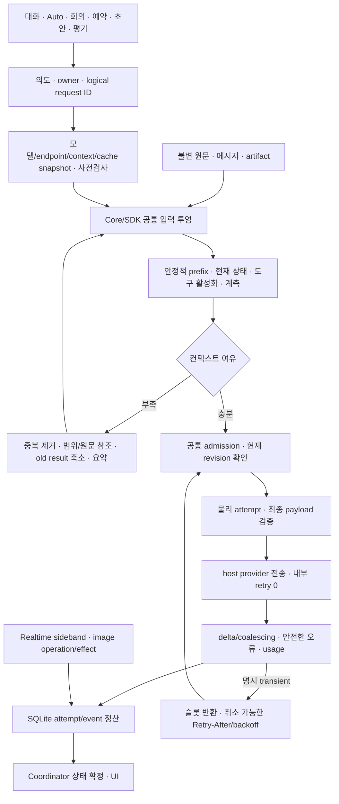

# Corral LLM 인프라 현대화 구현·검증 — 2026-10-24

기준선은 Corral `401bdf463efab4784cb25c686867ed18f2c5379c`다. 구현은 이 기준선 위의 CR-052 작업 트리이며, 실행 소스와 의존성의 SHA-256 원장을 함께 보존한다. Linux x64, Node 24.19.0, pnpm 10.30.3, TypeScript 6.0.3, Pi 1.3.0, Vitest 5.0.4에서 검증했다. 승인·구현·개별 환경 검증·출시 승인은 서로 다른 상태다. 이번 기록은 배포/merge 승인이 아니다.

## Chooser 슬롯 대기·응답 timeout 분리 — 2026-10-24

C-180 / TC-LLM-002-F의 후속 수정으로 아래 정산 보완에서 발견한 자동 팀 선택 생략을 해결했다. 30초 응답 timer는 admission을 통과한 뒤 실제 공급자 호출 직전에 시작하고 해당 물리 요청이 끝나면 해제한다. 슬롯 대기·Retry-After·재시도 슬롯 재획득은 응답 시간에 포함하지 않는다. 각 재시도의 응답 제한은 30초이며 기존 재시도 횟수·오류 분류·명시적 취소는 유지한다. 새 대기 시간 제한이나 설정은 추가하지 않았다.

수정 전 실패한 3개 반례가 수정 후 통과했다. 가상 시계로 60초 슬롯 대기 뒤 29,999ms 만에 도착한 팀 선택을 유지하고, 대기 중 취소에는 provider 호출·Run·미확인 예약이 생기지 않으며, 긴 Retry-After 뒤에도 다음 물리 요청의 응답 시간을 보장한다. 실제 전송 후 30초 무응답 fallback과 늦은 usage 정산 회귀도 통과했다.

관련 7파일 75개 테스트, Server 타입·계약·문서 검사 결과는 [이번 후보 검증](evidence/chooser-timeout-validation.json)에 기록한다. 이 검사 범위에서 추가 응답 퇴화는 발견하지 않았다. 전체 suite·설치판·실제 공급자 A/B는 다시 실행하지 않았으며 아래 과거 결과의 후보 ID를 바꾸지 않았다.

## Chooser 정산 보완 — 2026-10-24

C-180 / TC-AUTO-003-H/N, TC-LLM-002-H/N/F의 연결 누락을 수정했다. 256토큰 상한을 복원하지 않고, 기존 attempt 원장의 실제 출력 허용량과 사용량으로 물리 요청별 Run 예약·정산을 만든다. 재시도는 각각 기록하며, 전송 payload를 준비하지 못한 대기 취소는 모델 예약을 만들지 않는다. 사용량이 없는 완료 응답과 공급자가 명시한 0을 구분한다. 늦은 usage는 Coordinator에서 원래 예약만 정산하며 완료 응답·산출물·과거 snapshot을 바꾸지 않는다.

프롬프트와 text 검사에 같은 4,096 UTF-8 byte 상수를 사용하고, 미사용 256토큰 상수와 CR-024의 낡은 주석을 제거했다. 기존 원장과 Coordinator 저장 경로를 재사용하며 새 의존성·DB schema·전송 프로토콜은 추가하지 않았다. 원장 없는 비관리형 호출은 보고된 사용량만 기록하며, 미확인 예약을 상수로 만들어 내지 않는다.

관련 8파일 86개 테스트, Core·Server 타입 검사, 계약·문서 검사를 확인했다. [당시 후보 검증](evidence/chooser-accounting-validation.json)은 아래 Oracle 후보·설치판·live A/B 증거와 별개다. 이 보완 후 전체 suite·패키징·유료 호출은 반복하지 않았다.

**당시 응답 관련 발견(위 후속 수정에서 해결):** chooser의 30초 timer가 admission 대기 전에 시작해 실제 provider 호출 0회인 상태에서도 `single`로 fallback했다. 공통 admission 도입과 기존 timeout 정책의 결합이며 정산 수정의 새 퇴화는 아니었다. 당시 검증 JSON은 수정 전 후보의 증거로 보존한다. 응답 내용의 의미 품질이나 실제 공급자 지연의 변화는 mock 검사로 판정하지 않는다.

## Oracle 셀프 리뷰 후속 개선 — 2026-10-24 저녁

[Repomix 입력 manifest](evidence/oracle-lean-input.json)와 [Oracle 최종 리뷰](evidence/oracle-lean-review.md)를 대조해 수정했다. 실제 git diff, 관련 소스와 자체 재현 결과를 53파일·193,780토큰으로 묶어 지정된 인앱브라우저 세션에 업로드했다. 기존 A/B·설치판 결과는 아래 최초 구현 시점의 증거로 유지하며, 이번 수정으로 소급 재라벨하지 않는다.

- 최종 입력/출력 판단은 execution broker 수명의 host ContextMeter로 모았다. 실제 전송 문맥·정상 응답 usage만 anchor가 되며 다른 실행과 공유하지 않는다. worker는 압축 판단, bridge는 permit/model 상한을 담당한다.
- checkpoint는 현재 보이는 toolResult 대신 소유한 finished tool records에서 원문 참조를 수집한다. 요약 전 checkpoint가 없던 도구 결과도 보존하며 다른 소유자의 결과는 포함하지 않는다.
- 성공적으로 commit한 source/chunk 참조만 재사용한다. 이미 저장한 원문을 존재 확인용으로 다시 읽지 않고, 선택한 checkpoint 복구에서는 다른 checkpoint 본문을 읽지 않는다. context 무결성 검사는 v1/v2 decoder로 모았다.
- 생성된 보고서·증거는 candidate/대응 소스 입력에서 제외했다. probe·빌드·테스트·patch·의존성·라이선스는 계속 입력이다. 빌드 시작 candidate를 metadata에 재사용하고 끝에서 변경 여부를 확인한다.
- 재컴파일 대응 검사와 정산 snapshot 이력은 유지했다. 같은 transformer 검사는 변환 알고리즘의 독립적 정확성 증명이 아니라 현재 소스와 배포 JS의 대응 관계 검사다.

전체 메시지 snapshot의 직렬화/검증은 남는다. 5,050회는 인코더의 content 접근 횟수이며 DB 조회 횟수로 해석하지 않는다. 새 저장 형식·전역 cache/manager·IPC 추정값 인증 체계는 추가하지 않았다. 검증 결과는 [후속 검증 원장](measurements.md#oracle-후속-검증)에 기록한다.

후속 후보 `48c3cc0cb323a2286d805811dc2bfe4d359e2d094cee01e75a8352a7b746b2a6`에서 집중 검사 112개·release 검사 10개가 통과했다. 전체 suite는 2,180 passed / 기존 UI 실패 9개 / 23 skipped로 전체 PASS는 아니다. 타입·계약·의존성·문서 검사, Linux AppImage 실제 실행·복구, Core/SDK worker 기동 및 배포 소스 대응 검사를 통과했다. [검증 집계](evidence/oracle-followup-validation.json)와 [설치판 identity](evidence/oracle-followup-distribution.json)를 보존했고, 생성 증거를 기록한 뒤에도 후보 해시가 유지됨을 확인했다.

## ① 총평과 패러다임 진단

기존 병목의 중심은 모델 자체보다 **같은 요청을 서로 다르게 준비하고 전송하던 경계**였다. Core/SDK와 일반/격리 worker, chooser/초안이 서로 다른 출력 제한·retry·취소·사용량 관측을 사용했다. 보관 원문과 모델 입력이 결합되어 압축 뒤 원문을 다시 보내거나, 도구 결과와 회의 전체 이력을 반복 전달했다. 실행 예산과 자원 정책도 결합되어 있었다.

현재 구현은 기존 ModelRegistry·ModelBroker·Coordinator 안에서 요청 준비와 host 전송, 물리 attempt 원장, 공통 admission을 연결한다. Core/SDK는 같은 DSH 압축·투영 엔진을 사용한다. PI의 예산 계산·delta 병합·사용량 관찰·도구 선언·affinity 코드는 별도 LGPL workspace에 이식했다. Coordinator의 현재 attempt/revision 검사, 승인과 파일 효과 확정은 유지했다. 새 서버나 별도 오케스트레이션 프레임워크는 추가하지 않았다.

새 일반 실행·Ultra·회의는 기본 사용량 예산이 없다. 모델 동시성 기본값 6과 resident execution 12는 별도 자원 정책이다. 저장 정의는 원본을 보존하고 새 revision으로 이관한다. 과거 Run snapshot/hash/receipt를 수정하지 않는다.

성능은 한 방향으로만 개선되지 않았다. 64KiB 출력의 IPC는 264–289KB로 인수 기준 1MiB 아래이며 출력 2배에서 약 2배로 증가한다. checkpoint 저장 본문은 반복 fixture에서 크게 줄었지만 인코딩 CPU는 증가했다. 작은 context window를 강제로 적용한 실제 압축 비교에서는 입력 토큰 감소와 요약 호출의 지연·출력 증가가 함께 나타났다. 토큰 감소를 비용 절감이나 응답 속도 개선으로 환산하지 않는다. 최종 수치는 [측정 결과](measurements.md)를 따른다.

## 조사 방법과 경로 원장

TypeScript AST와 type checker로 호출식·함수·import·설정 상수·라우트 형태를 수집하고 설치된 Pi 1.3.0 구현과 연결했다. [호출 그래프](evidence/call-graph.json.gz), [선택 호출](evidence/llm-calls.json), [전송 경계 대조](evidence/transport-coverage.json), [집계](evidence/summary.json)를 보존한다. AST의 route-shaped 수치는 실제 HTTP endpoint 수가 아니며, resolved signature가 모든 동적 실행을 입증하지도 않는다. 원장은 소유 경계와 실제 trace를 결합한 결과다.

| 진입·파생 경로 | 소유자 / 준비와 최종 전송 | 취소·retry·정산·저장 |
|---|---|---|
| 기본 대화·저장 Corral·후속 질문·결과 설명 | SessionPage/client → server app starts → Coordinator → Core/SDK → host broker | Run/Task/Execution revision, 공통 attempt + 기존 Run 이벤트/산출물 |
| Auto chooser | auto-team 사전검사 → registry.routeAuto → 공통 runtime | chooser operation 소유, 가짜 Run 없음; AbortSignal·2회 transient retry·SQLite usage |
| Auto의 선택 후 실행 | createAutoStarter → startRun → 일반 worker | chooser와 실행의 소유자 구분, 모델 snapshot 고정 |
| CLI 일반·Auto | CLI → server/Coordinator·동일 live agents | CLI가 별도 모델 전송 정책을 만들지 않음; core/SDK 비교 fixture 재검증 |
| 직접 worker | live-models → modelBridgeChannel → registry.modelBroker.withPermit | host에만 인증, Core protocol 7 / SDK 8; 모델 permit마다 attempt |
| Linux 격리 worker | 같은 bridge + bwrap worker | 같은 전송·캡·오류·usage. 격리 프로세스에는 자격 증명 미전달 |
| 하위 작업·질문·검토 Loop | Coordinator spawn/ask/reply/재실행 → 동일 worker | 부모·자식 소유권, 현재 질문·승인·revision 유지 |
| Ultra 계획·후보·심판·고도화 | 같은 실행 계층, 심판은 합계 evidence projection | 후보 branch별 affinity 분리; 기존 사본·검사·승격 소유권 유지 |
| 회의 참가자 독립 답변 | MeetingService → 같은 게시 snapshot의 여러 Run | 병렬 admission, 시작한 답변은 원래 사용자 메시지에 귀속 |
| 회의 멘션·연속 사용자 입력 | 게시된 발언만 읽고 순차 멘션; 새 사용자 입력 우선 | 참가자 checkpoint + 이후 게시분; 중지/중복 command/reopen 검사 |
| 비서 정리·작업 인계 | 기존 명시적 secretary/handoff command → 일반 Run | 자동 채택/반영을 추가하지 않음, 기존 receipt와 소유권 유지 |
| 팀 초안 | draftTeam → 같은 runtime | operation ID·durable receipt, 확인된 실패와 응답 유실 구분 |
| 예약 실행 | schedules service → 기존 starts | 예약 receipt/Run으로 귀속, 재시작 시 자동 유료 복구 없음 |
| Skill 품질 평가 | skill-quality service → 평가 정의·harness → startRun | 평가 원장 + 일반 Run/attempt; 평가가 자동 승인 권한이 되지 않음 |
| reasoning 판정 | local heuristic/local ONNX decision provider | 네트워크 LLM 요청이 아님. CPU 판정에 모델 admission 슬롯을 쓰지 않음 |
| 필수/선택 Skill·시작 명령 | SDK resource loader/extension → prompt 또는 session prompt | 필수 Skill 중복 제거, startup이 모델을 쓰면 같은 proxy/permit |
| MCP·codemode | 활성화된 도구 실행 → tool 결과 → 다음 관리형 모델 요청 | MCP 자체 외부 통신은 도구 경계; 관리형 모델 요청만 attempt 원장 |
| 확장의 관리형 모델 호출 | SDK scoped models proxy → purpose=extension → bridge | 모델·scope 검증, 공통 admission·출력 검증·사용량 |
| 수동·자동·overflow 압축 | 공유 summarizeRegion → purpose=compaction → 동일 runtime | 원래 요청 슬롯을 잡고 요약을 기다리지 않음; stale/잘린/비축소 요약 거절 |
| retry·부분 스트림·취소 | worker retry controller / auxiliary retry → 새 물리 attempt | logical ID 유지; 부분 응답/인증/할당량/불명확 전송은 자동 반복 없음 |
| 늦은 usage·상태 동기화 | accountModelStream → attempt 갱신 → 원래 reservation 정산 | 취소된 Task/산출물 부활 없음; transport 종료까지 실제 슬롯 유지 |
| checkpoint·복구·fork·private export | 불변 본문 chunk + manifest + scoped source refs | v1 reader 유지, hash/revision 검증, 새 Run에 원문 참조 이관 |
| 음성 연결·전사 | Realtime SDP → 동일 provider call ID의 WebSocket sideband | response/transcription usage dedup; 원문 음성·전사 내용 미저장 |
| 음성 후속 실행 | 승인된 후속 사용자 입력 → 기존 starts | 일반 Run 정책·정산 경로 |
| 이미지 생성 | 기존 image operation/effect → provider HTTP | 공통 attempt 원장; 불명확 생성 응답은 자동 재전송하지 않음 |

관리 경계 밖은 명시적으로 남긴다. 신뢰한 native 확장의 직접 fetch, 사용자 실행 명령/외부 프로그램, MCP 서버 내부 자체 LLM, 임베더가 host runtime을 구성하지 않고 사용한 standalone Pi fallback은 위 원장이 전수 통제하지 않는다. 브라우저 preview fetch, MCP OAuth, 일반 검색 요청도 모델 사용량으로 오인하지 않는다. 전송 검사 스크립트는 새로운 Pi 전송 호출 지점이 원장에 없으면 실패한다. 동적 native 네트워크 전체를 AST 검사로 통제한다는 주장은 하지 않는다.

### 설정의 실제 우선순위

| 설정 | 해석 순서와 최종 적용 |
|---|---|
| 모델 선택 | 명시 요청/역할의 프로필 → workspace 프로필 → 제품 기본 프로필. 실행 시작 snapshot에 모델·endpoint hash 고정 |
| contextWindow | 프로필 명시값 → endpoint 해당 모델 명시값 → 일치 카탈로그 → endpoint/제품 fallback. 없는 환경 override를 임의로 추가하지 않음 |
| maxOutput | endpoint 명시 metadata → 카탈로그 → fallback 4096. 실행 예산과 분리; 실제 출력은 요청 허용량·모델 maximum·남은 context의 최솟값 |
| reserve / keep | 프로필 명시값(0 포함) → PI 비례 계산. reserve<context, keep<context-reserve 검증. 오래된 snapshot reader 유지 |
| cache retention | 프로필 → endpoint → 허용된 PI_CACHE_RETENTION 값 → short. TTL 지원은 해당 provider 구현에 한정 |
| session affinity | host의 대화/역할/분기 identity → 명시 endpoint header/body capability. Hive에 native DeepSeek 조건 자동 적용 없음 |
| reasoning | 명시 역할/요청 선택 → 기존 reasoning resolution → 검증된 provider mapping. chooser는 목적별 최소 추론과 JSON 검증을 분리 |
| 인증 | host credential store(저장된 key/OAuth) → 해당 provider의 허용된 환경/로그인 fallback. 사용자 endpoint key의 origin binding 유지 |
| retry | provider maxRetries=0; Bedrock maxAttempts=1 → Corral 최대 두 번. Retry-After 우선, 인증/할당량/부분 스트림/응답 유실 제외 |
| 자원 / 사용량 | 제품 기본 6/12 또는 명시 자원 설정과, 선택적 executionPolicy.budget을 별도 해석. 무제한 sentinel을 모델 지시에 노출하지 않음 |

SDK의 암묵적 retry/자동 compaction을 껐고 공개 prepareRequest·SessionManager compaction entry로 공통 결과를 반영한다. 모든 값이 같은 우선순위 계층을 가진다고 가정하지 않는다. 예를 들어 compaction에는 endpoint override가 없으며, 인증에는 프로필에 저장하는 비밀 필드가 없다.

## ② 발견 목록과 처리

아래 파일의 정확한 위치는 [코드 위치 원장](locations.md)에 고정했다. `기존`은 기준선 또는 기존 감사에서 재현한 항목, `구현 중`은 이번 작업에서 찾아 고친 회귀/누락이다. Critical로 확정할 증거는 없다.

| ID / 심각도 | 조건·메커니즘과 영향 | 해결 / 코드 위치 |
|---|---|---|
| F01 High · 기존 AUDIT-001/019 | bridge가 모델 출력 maximum 또는 provider minimum을 일관되게 적용하지 않아 작은 잔여 예산에서 wire 오류 | requestOutputCap과 최종 payload 검증 공유; reasoning.ts / model-bridge.ts |
| F02 High · 기존 AUDIT-002 | SDK 압축 후 최초 긴 입력을 보호 문자열로 다시 삽입하여 토큰 절감 소멸 | 구조화된 현재 상태만 보존; SDK public projection과 공통 summary / request-record.ts |
| F03 High · 기존 AUDIT-003/005/011 | 오류 분류 소실, Bedrock 숨은 retry, SDK 1/2ms retry로 한 permit에 여러 요청·폭주 가능 | 안전한 code/status/Retry-After/requestId, Bedrock patch, 취소 가능한 공통 backoff |
| F04 High · 기존 AUDIT-004 | lifetime seen 집합 100건 상한이 장기 worker 종료 | 실행 순번과 완료 receipt 검증; 105회 호출 및 중복/늦은 ACK 검사 |
| F05 High · 기존 AUDIT-006 | 대형 파일/도구 원문이 다음 Core 요청 window 초과; Core 압축 부재 | 8192 Unicode 범위 읽기, 소유 원문 참조, 오래된 결과 축소, 공통 Core/SDK 압축 |
| F06 Medium · 기존 AUDIT-007 | 발언마다 회의 전체 대화를 새 prompt로 구성 | 참가자별 호환 checkpoint와 게시 증분; 독립 답변 병렬, 멘션 순차 |
| F07 Medium · 기존 AUDIT-008/009 | 동적 상태가 system prefix 변경, bridge session/cache 옵션 누락 | 안정적 지시·도구 prefix + 현재 상태 tail, 대화/역할/분기 identity 전달 |
| F08 Medium · 기존 AUDIT-010 | delta마다 누적 본문 직렬화로 O(n²) IPC | PI delta/coalescer, 16ms flush, block 단위 경계·종료·backpressure |
| F09 Medium · 기존 AUDIT-012/013 | chooser 추론까지 256 UTF-8 byte 검사, 시작 불가 조건 뒤 유료 선택 호출 | 목적별 추론·선택 JSON 검증, 시작 전 capability/budget 검사 |
| F10 Medium · 기존 AUDIT-014/015 | chooser·초안은 동시성/usage 원장 밖 | 같은 admission·durable attempts, Run 없는 operation owner |
| F11 Medium · 기존 AUDIT-016/017 | usage/단가 미확인을 0달러로 표시 | nullable usage, reported/unknown와 subscription/unknown/estimated 분리; 가격 source snapshot |
| F12 Medium · 기존 AUDIT-018 | 유용한 도구 작업 여섯 턴도 정체로 처리 | 파일/도구/검사 증거 변화 관측; 무제한에서는 경고만 제공 |
| F13 High · 기존 AUDIT-020 및 구현 중 | 취소 후 늦은 usage 누락 또는 모델 슬롯 조기 반환 | attempt와 원래 reservation만 늦게 정산; 실제 전송 종료까지 슬롯 보유 |
| F14 Medium · 기존 | 전체 context checkpoint 반복 저장, 누적 한도 이후 최신 복구점 정지 | 불변 chunk/manifest v2, 저장 실패 시 마지막 복구 가능 지점 표시 |
| F15 Medium · 기존 | 필수 Skill의 명시 실행·부모 질문이 이미 있는 내용을 재삽입 | 출처/ID 기반 중복 제거, 필수 Skill 참조는 본문 재삽입 없이 사용 |
| F16 High · 기존 | 후보별 절단은 심판 전체 입력 한도를 보장하지 않음 | 합계 context 예산의 증거 투영, 익명 packet 원문 범위 조회; 미조회 부분은 근거로 인정하지 않음 |
| F17 High · 구현 중 | initial 91,000자 입력은 SDK 기본 compact 준비가 요약 대상을 만들지 못함 | 공개 prepareRequest에서 공통 range 선택 후 SessionManager.appendCompaction; 실제 다음 payload 검증 |
| F18 High · 구현 중 | summary에 실행 output contract가 남아 Hive가 요약 대신 artifact 제출을 시도 | 공유 summary에 internal-compaction system 지시 추가, host toolChoice=none; 다음 실행에서는 원래 계약 유지 |
| F19 High · 구현 중 | Pi onResponse는 실패 HTTP 이전에 불리지 않아 429 Retry-After 유실 | 실제 fetch 응답의 안전한 status/header 관측; real Pi + HTTP loopback 반례 |
| F20 High · 구현 중 | 구조화된 overflow 오류와 provider별 문구가 SDK recovery를 우회 | Pi isContextOverflow 재사용; 검증된 압축 후 한 번만 재전송, 실패 요약은 fallback 없이 거절 |
| F21 High · 구현 중 | 줄인 tool 결과의 원문 ID가 새 Run 복구 뒤 조회 불가 | checkpoint sources에 불변 원문 참조 포함, 새 Run으로 복사, 소유 원문 범위만 허용 |
| F22 High · 구현 중 | endpoint worker의 bare apiKey override가 origin-bound credential metadata를 없앰 | host credential store로 다시 해석; 실제 Hive Core/SDK × 일반/격리 네 조건 재검증 |
| F23 Medium · 구현 중 | draft가 profile contextWindow를 반영하지 않음 | chooser/worker와 같은 해석 snapshot 적용 |
| F24 High · 구현 중 | 초안 응답 유실 후 새 command로 재전송하면 이중 호출 가능 | stable operation ID·durable receipt; confirmed failure와 unknown outcome 분리 |
| F25 Medium · 구현 중 | mutable partial 재사용과 block boundary가 이미 보낸 text/thinking 중복 | PI decoder의 block별 재구성과 terminal flush; mutable/redacted fixture |
| F26 Medium · 구현 중 | 매 요청 current-state 조회가 전체 Run log 재스캔, payload 이중 직렬화 | event-seq 이후 변경분만 반영; 직렬화 문자열 재사용 |
| F27 Medium · 구현 중 | 실사용량 anchor가 더 작은 실제 입력량으로 보정하지 못함 | 동일 prefix/envelope는 실제 usage + 증분 추정; 모델/도구/원문 변경 시 anchor 폐기 |
| F28 Medium · 구현 중 | 과거 RunLimits 또는 무제한 sentinel을 모델에 유효 예산처럼 전달 | model-visible TaskBrief의 자원과 선택적 usageBudget 분리; 저장 schema/hash 보존 |
| F29 Medium · 구현 중 | 재시작 전 started attempt가 계속 진행 중으로 남음 | interrupted/unknown 정산 이벤트, 자동 resend 없음; 원장 재실행 idempotent |
| F30 Medium · 구현 중 | 이미지 반환 후 취소/미디어 검증 실패 시 usage 누락 | 응답 직후 usage 기록; 성공/실패 효과와 별도 관측, unknown 생성 재전송 금지 |
| F31 Medium · 기존 | Realtime/전사 usage가 일반 모델 원장에 없음 | 동일 call ID sideband와 response dedup; 실제 오디오 없이 loopback 검증 |
| F32 Low · 구현 중 | Windows에서 execFileSync('pnpm') inventory 실행 불가 | 기존 packageManagerCommand와 npm_execpath 재사용; Windows 실제 설치 검증은 별도 |

비효율이라고 보고된 모든 항목을 무조건 결함으로 바꾸지는 않았다. SDK는 이미 세션 ID·usage anchor·잘린 요약 거절을 일부 갖고 있었고, 공정 대기열은 막힌 Run을 건너뛰고 있었다. 이 기능은 공통 경로로 연결했다. Coordinator의 revision/effect 소유권은 제거하지 않았다. cache 완전 상실 또는 특정 비용 절감 배수는 입증되지 않았으므로 주장하지 않는다.

## ③ CR·ADR 개정 매트릭스

| 계약 | AS-IS | CR-052 / ADR-041 TO-BE |
|---|---|---|
| Spec §9 / ADR-008 | 실행 예산과 자원·출력·시간 결합 | 선택적 usage budget, 기본 6/12 자원 정책, 물리 모델 한도 분리 |
| CR-037 / ADR-036 | 고정 R/K, legacy 경고, Core 압축 없음 | 모델 비례 기본값, 관계 검증, 공유 Core/SDK 엔진 |
| CR-048 | Ultra v2만 무제한 예외·큰 sentinel | 모든 새 실행 공통 무제한, 실제 전송 output cap |
| CR-049 | 독립 참가자도 순차, 매번 전체 이력 | 같은 snapshot 병렬 답변, 게시 후 멘션 순차, 참가자 증분 문맥 |
| CR-024 / ADR-031 | thinking 포함 256byte chooser | 목적별 최소 추론과 strict 선택 JSON을 별도 검증 |
| ADR-005/027/033 | Core/SDK/격리의 전송 정책 분산 | 관리형 요청 host runtime, worker 인증 제거 |
| ADR-024 | 완료 횟수 중심 정체 중단 | 의미 있는 증거 진전, 기본 무제한에서 경고 |
| CR-030 | 전체 context snapshot·누적 저장 한도 | immutable message/source references + versioned manifest |
| harness/Skill/MCP | 선언·활성화·삽입이 분산 | 지원 endpoint의 고정 선언, 선택 도구 검색/활성화, 권한과 별개 |

[승인 CR](../../change-requests/CR-052-llm-runtime-modernization.md), [현재 runtime 계약](../../current/llm-runtime.md), [제품 §9](../../current/product-contract.md#9-사용량-예산과-자원-정책), [ADR](../../Decisions.md#adr-041-managed-model-requests-share-host-transport-and-context-policy)를 갱신했다. C-179–184 / CRL-LLM-001–006 / TC-LLM-001–006의 H/N/F 추적을 유지한다. 과거 검증 기록은 당시 계약의 증거로 남긴다.

## ④ 직접 이식과 결합 명세

고정 원본은 [DSH 22ddee3](https://github.com/deepseek-ai/deepseek-harness/tree/22ddee3792402c3e70ec5f86a63c3e3e895a2f60), [PI-Desktop 1a812ed](https://github.com/vastsa/pi-desktop/tree/1a812ed7b84e0bd1b117080eb4e51c76eba35d48)다. 작업 중 최신 upstream을 자동으로 섞지 않았다.

| 원본 경로 | 실제 Corral 대상 / 인터페이스 변환 |
|---|---|
| DSH core/session/src/surface.ts | adapter-pi/src/ported/dsh/context.ts의 범위 교체 → Coordinator 불변 이벤트/본문, core/context-checkpoint.ts의 manifest |
| DSH compaction-basic/region.ts, summarizer.ts | selectCompactableRange / summarizeRegion → Pi Context·AssistantMessage, 주입 complete/now, tool-pair 경계·원문 hash·축소 검증 |
| DSH llm/token-meter | ContextMeter·measureContext → 모델/도구/입력 envelope별 anchor, CJK/코드·이미지·schema 추정 출처 |
| DSH tool-result-pruner, spill-policy | pruneContent/pruneToolResults → 비텍스트 보존·Unicode head/tail, 기존 artifact store와 read_artifact 원문 조회 |
| DSH retry-policy 및 실행부 | ported/dsh/retry.ts + request-retry.ts → 안전한 ProviderFailure, AbortSignal, jitter/Retry-After, Corral logical/attempt identity |
| PI context-budget.ts, compaction tail/input | pi-runtime-port/context-budget.ts + 공유 DSH range → 모델 비례 reserve/keep, 작은 window/명시 0 지원 |
| PI message-stream.ts, stream-coalescer.ts | pi-runtime-port/stream.ts → Pi text/thinking/tool-argument event, 16ms 병합, decoder·IPC backpressure |
| PI request-usage.ts | pi-runtime-port/request-usage.ts → terminal/result 중복 방지, await durable sink, ModelAttempt/SQLite |
| PI fixed-tool-declarations.ts, system-transcript | pi-runtime-port/fixed-tool-declarations.ts → 선언 snapshot과 active names 분리, Pi system transcript 규격 |
| PI session-affinity.ts | pi-runtime-port/session-affinity.ts → Corral identity 및 endpoint 명시 header/body capability |

DSH는 MIT 고지와 수정 내역을 adapter 영역에 보존했다. PI 포팅은 LGPL-3.0-only의 별도 `@corral/pi-runtime-port` 패키지이며 Node 배포에서는 교체 가능한 JS package로 유지한다. browser budget 코드까지 포함하는 전체 대응 소스·잠금 파일·빌드 방법을 배포에 포함한다. GNU GPL/LGPL 전문, DSH MIT 전문, 수정 내역, SPDX SBOM을 함께 제공한다. [포팅 대응표](../../../packages/pi-runtime-port/PORTING.md), [배포 고지](../../../THIRD-PARTY-NOTICES/llm-runtime-ports.md)와 [라이선스 정책](../../../tools/release/policy.ts)을 참조한다.

기존 Pi 1.3.0·Zod·SQLite를 재사용했다. 음성 sideband는 이미 전이 의존성으로 쓰던 ws 8.22.0(MIT)을 서버 직접 의존성으로 명시했다. 별도 tokenizer·Cordis·상태 프레임워크는 추가하지 않았다. DSH 65536 headroom, PI 특정 DeepSeek endpoint의 함수 수 제한을 전역 기본값으로 복사하지 않았다. Hive의 실제 `max_completion_tokens`/reasoning 규격을 따르며 출력 4096 fallback을 공급자 최대 지원값이라고 주장하지 않는다.

[Differential probe](probes/differential.mjs)는 pinned 원본 AST의 순수 함수를 실행한다. PI budget 원본 fixture 15개/30 assertion, DSH delay 6개가 일치했다. 작은 window·미상 metadata fallback·retry 최대 횟수는 의도적인 차이로 별도 기록했다. 나머지는 원본의 역할에 대응한 Corral integration fixture이며, upstream 전체 test suite를 통과했다는 뜻이 아니다.

## ⑤ 실제 파이프라인 구조

요약도 admission/전송/정산을 통과하지만 원래 요청 슬롯을 보유한 채 요약 슬롯을 기다리지 않는다. 요약 목적의 system 메시지는 원래 실행 prefix를 보존한 뒤 추가하고, provider가 system 갱신을 앞에 합치는 경우에는 그 serializer의 캐시 특성을 따른다. prefix가 모든 provider에서 동일하게 캐시된다고 가정하지 않는다.

## 검증·이관·되돌리기

실행 결과와 명령은 [측정·검증 원장](measurements.md)에 분리했다. 회귀 반례는 구현 전에 실패를 확인했으며, 마지막 추가 수정은 실제 HTTP 429, 최초 대형 SDK 입력, checkpoint 원문 복구, usage anchor 하향 보정, summary/output-contract 충돌이었다. 단순 설정·문서 변경에 구현을 그대로 복제한 테스트를 추가하지 않았다.

SQLite의 기존 정의 이관은 새 revision과 migration receipt를 쓰며 재실행해도 또 생성하지 않는다. 과거 정의/Run snapshot/hash/receipt는 보존한다. checkpoint v1은 계속 읽고 v2는 본문 hash를 검증한다. 미완료 provider attempt는 재시작 시 unknown/interrupted로 남기고 자동 유료 호출을 하지 않는다. 구 worker protocol 혼용은 거절한다. 되돌리기는 이전 실행 파일·정의/설정 revision으로 수행하며 새 attempt/실행 기록을 삭제하지 않는다. DB를 파괴적으로 downgrade하는 스크립트는 추가하지 않았다.

설치판은 Linux x64에서만 실제 실행했다. 다른 OS/arch, 실제 마이크·Realtime 서버 sideband·유료 이미지 provider는 이번 live 검증 범위 밖이다. trusted native 확장 전체 네트워크 통제, 모든 모델 tokenizer의 정확한 계산, 모든 SDK 작업의 품질 동등성, provider별 장기 cache TTL 적중률은 주장하지 않는다. 필요한 상태가 물리 window에 들어가지 않거나 원문 참조를 만들 수 없는 출력은 조용히 버리지 않고 실패 원인을 반환한다.
