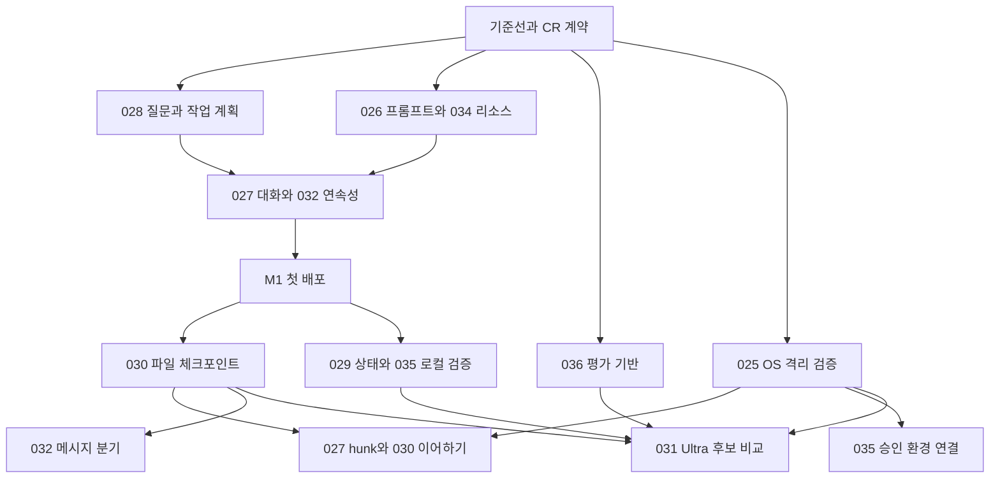

# Corral 통합 개선 실행 계획

2026-10-19 · 순차 구현 승인 · M0~M3 구현 및 단계 회귀 확인 · M4 진행 중

**첫 배포는 세션에서 요청하고, 진행을 보고, 질문과 승인에 응답하고, 변경과 근거를 검토하는 흐름을 완성한다.** 기존 Pi·Coordinator·SQLite·파일 broker를 확장한다. 이후 체크포인트와 안전한 이어하기를 완성하고, 비교 평가를 통과한 Ultra를 제공한다. D&D와 Reins는 모든 단계의 유지·회귀 검증 대상이다.

이 계획은 제공된 **Corral 통합 완성 계획 v3**를 현재 저장소에 맞춰 작업으로 나눈 것이다. Bell의 2026-10-19 후속 요청으로 M0부터 순차 구현한다. CR 등록 → 필요한 실패 재현 → 구현 → 기존 회귀 확인을 따르며, 새 테스트는 사용자 동작·데이터/권한 경계에 집중하고 기존 시험을 우선 확장한다. 단계별 완료는 [구현 증거](../evaluation/Integrated-Improvement-M0-2026-10-19.md)와 구별한다. 유료 호출·배포/병합은 실행하지 않는다.

M1의 구현 및 검증 범위는 [M1 증거](../evaluation/Integrated-Improvement-M1-2026-10-19.md)에 기록한다. M2의 구현·회귀·미검증 경계는 [M2 증거](../evaluation/Integrated-Improvement-M2-2026-10-19.md)에 기록한다. M3의 구현·회귀·미검증 경계는 [M3 증거](../evaluation/Integrated-Improvement-M3-2026-10-19.md)에 기록한다. M4는 아래 완료 조건을 유지하고 순서대로 진행한다.

## 1 기준선과 적용 범위

| 항목 | 확인한 기준 |
|---|---|
| 입력 가이드 | `Corral-Integrated-Implementation-Plan-v3-2026-10-18.md`, 825행 |
| 가이드 SHA-256 | `5262d40fb1baa6ab58e281390d6d0faad06e44dc5acf7ff79daa983054f9b062` |
| 원격 main | `c8a3a1d2d312af3d615c2bba10afb2225985d0a3` — GitHub API로 확인. 가이드 기준과 동일 |
| 검토한 작업 브랜치 | `fix/auto-start-races`, HEAD `780591e8c249f0cb3f94efd611bb004bcd2f2855` |
| main 이후 차이 | 자동 시작 재시도·취소·작업 사본 경합 수정. [PR #60](https://github.com/fromiron/corral/pull/60)은 조회 시 열려 있음 |
| 기존 CR | 기준선은 CR-001~024. 후속 구현 요청에서 CR-025~036을 충돌 확인 후 등록 |
| 런타임 | Pi agent-core/ai/coding-agent/mcp `1.3.0`, Node `^24.15.0`, pnpm `10.30.3` |
| 재사용할 UI 의존성 | React `19.3.1`, TanStack Virtual `3.14.19`, Pierre Diffs `1.5.2`, XYFlow `12.12.0` |
| leeskills | 고정 commit `1472032c0521c7f76f8811973b4cbe6b67804988`의 10개 SKILL 경로·MIT LICENSE·integration 문서 확인. 번들 전체 내용 및 실행 호환성은 M0/M1에서 검증 |

현재 기능 판정은 소스와 계약을 대조한 결과다. 아래의 ‘기반 있음’은 이번에 빌드·브라우저·live 시험을 통과했다는 뜻이 아니다. 기존 계획에 남은 체크박스보다 현재 소스·CR·해당 후보의 검증 증거를 우선한다.

**착수 기준:** PR #60의 변경을 중복 구현하지 않는다. 해당 수정과 CI가 확인된 `780591e`에서 `feat/integrated-improvements`를 분기했다. PR #60은 열려 있으며 후속 병합 시 main 포함 여부를 다시 확인한다.

## 2 현재 구현과 남은 차이

| 가이드 범위 | 현재 재사용할 구현 | 실제 추가 작업 |
|---|---|---|
| CR-025 안전 기반 | managed tool 승인, descriptor hash, permit, strict 제한, process lease | 최종 인자와 정책을 결합한 규칙·감사, 플랫폼별 OS 격리와 실패 표시 |
| CR-026 프롬프트 | 공통 `systemPrompt`, assignment별 제출 계약, SDK `ModelRequestRecord`의 구획별 hash/bytes, mandatory Skill 검사 | 결정적 구획 조립, 역할별 지식 지도, 포함 이유·버전·context 예산, 두 runtime의 지원 계약 |
| CR-027 대화 | `buildTranscript`, `RunMessage`, `ChatView`, `ExecutionTranscript`, 스트림 chunk 순서 검사 | 요청 단위의 통합 projection, 질문·승인·도구 상태 카드, 첨부, 안정적 message ID와 긴 대화 처리 |
| CR-028 질문과 계획 | agent 간 `ask/reply`, extension UI 요청/답변·private record·receipt | 별도 `ask_user`, 작업 checklist용 `update_plan`, 공통 InteractionView. 기존 `team-plan.ts`는 팀 생성 계획이므로 덮어쓰지 않음 |
| CR-029 상태 패널 | CR-023 compact Run 패널, Reins 진입, 사용량·하네스 상세 | 환경·컨텍스트/비용·연결·변경 요약 4개, 역할별 context 계측과 정확한 상태 연결 |
| CR-030 지속성 | Run 전후 Git tree·refs, write lease, uncertain file operation, SDK compaction 호출 계측 | 복구 가능한 checkpoint manifest·GC, 보호 context, 새 Run으로 이어하기. SDK `SessionManager.inMemory`만으로 재시작 복구는 안 됨 |
| CR-031 Ultra | CR-024 자동 팀 템플릿, review recipe, reasoning 해석, admission/예산 | mode와 독립된 quality preset, 단일 후보 검증 강화, 이후 격리 후보 비교 |
| CR-032 연속성 | 세션별 text/intent/target/references 초안, 스크롤 위치, 설정 복귀·미저장 그래프, 세션 검색 | 첨부와 안정적 스크롤 앵커 확장, 통합 검색·작업 탭, checkpoint 기반 메시지 분기 |
| CR-033 완성도 | IME 처리, 테마, Electron notification/badge IPC, 기존 접근성·성능 시험 | 새 카드의 키보드·focus·announcement, 가상 목록 검증, 알림 deep link·중복 억제, 나머지 desktop 동작 |
| CR-034 내장팩 | 리소스 등록·hash·신뢰·불변 revision·profile 합성·Skill read·사본 잠금 | Core/Coding/leeskills 번들, 명시 선택·정적 추천, sibling 참조·동명 충돌, 전달 추적·보고서 연결 |
| CR-035 브라우저와 웹 | pi-mcp 설정/인증/도구 allowlist·lease, search/read_document, safe HTTP | 브라우저 session/origin/출력 소유권, fixture 검증, 승인 환경 연결, 버전 있는 본문 추출·근거 등록 |
| CR-036 eval과 유지 | `corral eval`, 고정 정답·calibration/holdout, 5군 하네스 비교, 기존 Skill 작성·편집 UI | 새 ablation 비교군·선택/전달/결과 지표, 작성물 평가·채택, upstream diff·검증 후 업데이트/rollback |

특히 다음 네 가지는 가이드를 그대로 신규 구현으로 옮기면 중복된다.

- **초안 보존은 확장한다.** 기존 revision 기반 전송 초안 소비와 늦은 응답 보호를 유지한다.
- **프롬프트 추적은 확장한다.** `PromptManifest`가 필요해도 기존 `ModelRequestRecord`와 같은 정보를 별도 원장에 중복 저장하지 않는다.
- **파일 diff는 연결한다.** 이미 존재하는 tree 비교를 요청 카드에 연결한다. 복구용 checkpoint가 있어야 읽기 전용 diff를 제공할 수 있는 것은 아니다.
- **Skill 작성기는 재사용한다.** CR-036-C는 CR-022 편집 화면 위에 fixture·eval·채택 단계를 추가하는 작업이다.

## 3 유지할 실행 계약

1. 명령과 효과는 기존 `Coordinator → 영속 기록 → projection → REST/SSE → UI`를 따른다. UI가 승인·완료·비용을 확정하지 않는다. 공통 Inbox는 읽기 모델이며 별도 승인 원장이 아니다.
2. `commandId` 재전송, 명령별 revision·attempt·대상 hash 검사, receipt 조회를 유지한다. `accepted`, 전달, 실제 종료를 구별한다.
3. 세션 사용자 요청·Run·Pi turn을 구별한다. 늦은 결과는 원래 소유 Run/execution에만 반영한다. 과거 실행 선택을 최신 이벤트가 바꾸지 않는다.
4. `mode=mock|live`, agent 간 `ask/reply`, 기존 pause/resume 의미를 유지한다. `qualityPreset`, `ask_user`, checkpoint에서 새 Run 시작은 각각 별도 계약이다.
5. 전역 활성 Run 하나, 모델 동시 실행 최대 3, 동일 작업 사본 쓰기 직렬화를 유지한다. 탭·팀 계획·후보 수가 이를 늘리지 않는다.
6. 설치·신뢰·바인딩·본문 전달·절차 수행·검증 통과를 구별한다. 작업 지침 선택 자체가 권한 확대나 native 코드 실행 허가는 아니다.
7. 기존 snapshot/hash는 그대로 둔다. 새 필드는 optional 또는 명시 schema version으로 추가하고, 과거 기록의 실효 기본값은 읽기 계층에서 해석한다.
8. 안전·권한·필수 출력 계약은 프롬프트 길이 때문에 제거하지 않는다. 웹·Skill 본문·다른 역할의 출력은 권한을 바꾸는 명령으로 취급하지 않는다.
9. 대상 tree가 바뀌면 검증·검토의 유효성을 다시 계산한다. ID 존재 확인, 보고서 schema 통과, 실제 동작 통과는 별개의 증거다.
10. 공개 이벤트·export·알림에는 비밀·사용자 본문·내부 경로를 넣지 않는다. generated HTML은 기존 script 비활성 preview 경계를 유지한다.

## 4 배포 단위와 의존성

주차 대신 완료 조건으로 나눈다. 인원·지원 OS·기준선 실행 시간이 정해지기 전에는 기간을 확정하지 않는다. 아래 작업 ID `M0-1` 등은 이 문서 내부 식별자이며 정식 backlog ID는 CR 승인 뒤 등록한다.

| 단계 | 사용자에게 생기는 변화 | 완료 조건 |
|---|---|---|
| M0 계약과 기준선 | 개발 기준과 검증 방법 확정 | baseline·traceability·호환성 fixture·OS PoC 판단을 확보 |
| M1 첫 일상 사용 배포 | 요청→진행→질문/승인→결과·읽기 전용 diff, 기본팩 선택, 초안/대상 보존 | 한 세션에서 흐름이 이어지고 재접속·취소·설정 왕복·D&D·Reins가 유지됨 |
| M2 변경과 디자인 검증 | 4개 상태 요약, 파일 checkpoint, 디자인 보고서·근거, 로컬 브라우저 검증 | 현재 tree와 검사 범위를 대조하고, 손상 없이 checkpoint를 생성·조회·복구할 수 있음 |
| M3 안전한 장기 작업 | 검증 OS의 격리, hunk 작업, 압축·이어하기, 검색·탭·분기, 승인 환경의 브라우저/웹 수집 | 사용자 수정·미정산 비용·알 수 없는 효과를 보호하며 이어갈 수 있음 |
| M4 비교를 통과한 확장 | Ultra, Skill eval·채택·업데이트, desktop 보완 | 같은 과제의 품질·비용·회귀 결과로 채택 여부를 판단하고 이전 revision으로 복귀 가능 |

가이드 §1의 첫 출시 정의에 맞춰 **CR-027-C 읽기 전용 diff 요약은 M1에 연결한다.** 가이드 §8의 M2에는 상세 근거 통합과 checkpoint를 둔다. hunk 쓰기(CR-027-D)는 M3까지 열지 않는다. 기존 읽기 경로를 이용하므로 첫 배포가 파일 복구 구현을 기다릴 필요가 없다.

이 그림은 기능의 핵심 선행 조건이다. 접근성·오류 처리·개인정보 보호·무료 회귀 시험은 모든 단계에 포함한다. OS별 미검증 capability는 닫고 검증된 기능부터 제공한다.

## 5 단계별 실행 작업

### M0 계약과 기준선

| ID | 작업과 산출물 | 완료 판정 |
|---|---|---|
| M0-1 | main/PR #60 상태 재확인, 실행 기준 SHA 고정. auto-start·cancel·session draft·harness·file snapshot 기존 회귀를 기준선으로 수집 | 시작 중 응답 유실·취소·worktree 생성 경쟁이 새 기능의 실패와 구별됨. 실패가 있으면 원인별 수정 작업으로 연결 |
| M0-2 | CR-025~036 제안 범위 정리. 첫 구현은 025-A/026/027/028/032-A/033-A/034/036-A의 필요한 계약부터 승인·등록. TaskBrief 투영·API·event·DB·기존 snapshot fixture의 변경표 작성 | 요구→태스크→반례→검사 위치가 연결되고 과거 archive/hash 유지. 나머지 CR도 계획에서 추적하되 미리 구현하지 않음 |
| M0-3 | 기존 `corral eval`을 이용해 현재 baseline, prompt만, Corral Skill 추가, leeskills 추가, 선택 전문팩 추가의 비교 설계 | 현재 `personal_harness` 5군 enum을 조용히 재해석하지 않음. 새 suite 형식을 version/별도 discriminant로 구분하고 고정 정답·holdout 유지 |
| M0-4 | Linux 우선 SandboxBackend PoC, macOS·Windows/WSL 지원표. 파일·network·process·IPC 차단, browser 프로세스 종료 시험 설계 | 성공/미지원/실패와 실제 보장 범위를 기록. 다른 OS의 결과를 추정하지 않음 |
| M0-5 | leeskills 전체 manifest·참조 closure·NOTICE와 같은 이름 충돌 fixture 준비. `pi-core`/`pi-sdk` 기능 표, 두 runtime의 신규 도구 확장 위치 확정 | 콘텐츠 전용 팩이 실행 확장·postinstall을 요구하지 않음. 누락·변조·미바인딩 참조를 실제 실패 시험으로 재현할 준비 |

**계약 우선순위:** 사용자 질문·작업 계획을 프롬프트에 쓰기 전에 도구와 broker 경로부터 만든다. UI·콘텐츠 착수를 모든 플랫폼의 sandbox 완성 뒤로 미루지 않는다.

### M1 첫 일상 사용 배포

| ID | 작업과 산출물 | 완료 판정 |
|---|---|---|
| M1-1 | CR-025-A 최종 인자·descriptor/schema hash·정책 revision 검증과 구조화 규칙. 기존 approval/native tool 경로 확장 | 강제 deny와 역할/strict 상한을 allow가 넘지 못함. 필수 hook 실패는 차단. 이번 Run 승인과 다음 Run 규칙 저장을 구별 |
| M1-2 | CR-028-A `ask_user`, private 질문/답변, 응답 명령, InteractionView. 계약 enum·allowlist 상한·IPC·두 runtime·CLI까지 연결 | 질문 1~4개, 선택형은 선택지 2~5개와 단일/복수 선택, 자유 입력형 지원. question/option ID·schema hash·입력 길이 검증. 답변/timeout/취소/두 탭 경쟁에서 한 번만 해결 |
| M1-3 | CR-028-B 작업 계획. execution별 소유자·revision·항목 상태·근거를 기록. 팀 계획은 지정 planner 한 명의 소유로 시작 | 실행별 in_progress 최대 1개, 팀의 병렬 execution은 허용. 검증 필수 항목은 유효 근거 없이 완료되지 않고 plan 완료가 Task/Run 성공을 만들지 않음 |
| M1-4 | CR-026 결정적 prompt composer와 CR-034-A/B/C 기본팩. Core 5개·Coding 3개·leeskills 10개를 콘텐츠로 배포하고 필요한 subset만 명시 바인딩 | role/assignment/output 계약 유지. 필수 구획 누락·예산 초과는 명확히 거절. Skill 본문 읽기와 provider payload 포함을 따로 추적 |
| M1-5 | CR-027-A/B 대화 카드와 CR-032-A 연속성. 기존 session entry/Run/transcript 연결, 도구 상태·질문·승인·공개 진행 설명, 텍스트 첨부, 초안/대상/앵커 보존 | 설정 왕복·빠른 A→B 전환·재접속·중복 전송 후 잘못된 대상 응답과 초안 소실 없음. 첨부 MIME/크기/개수/hash와 retry 상태 검증 |
| M1-6 | CR-027-C 읽기 전용 `N개 파일 +x -y`와 기존 Files/Review 연결, 변경된 tree의 검사 상태 표시 | 세션 전체/이번 Run/마지막 검토 이후 범위 유지. 기준 없음·바이너리·삭제·대형 파일 표시. Pi turn이나 시간만으로 작성자를 추정하지 않음 |
| M1-7 | CR-033-A 키보드·IME·focus·announcement·reduced motion 및 긴 transcript 기반. 기존 Virtual·Pierre·UI 컴포넌트 사용 | 입력 중 승인 shortcut이 실행되지 않음. 과거 대화를 읽을 때 자동 스크롤 중단. D&D 팀 작성·직접 실행·동일 execution Reins 회귀 통과 |

**범위를 고정할 세부 결정:**

- `TaskBrief`는 기존 RunInput·assignment·criteria·프로젝트 규약 snapshot의 참조를 묶는 투영으로 시작한다. 허용 수정 범위와 `review_only`, 대상 tree/산출물, `targeted`/`release` 검증 범위·선택팩·예산을 명시하며 별도 작업 엔진은 만들지 않는다.
- `InteractionView`는 approval·extension UI·사용자 질문의 공통 조회 모델로 시작한다. 응답 명령은 종류별로 유지한다. budget/recovery 항목은 해당 기능을 추가할 때 같은 모델에 연결한다.
- `recommended`와 `defaultAnswer`를 구별한다. 자동 답변은 명시 opt-in·host가 허용한 저위험 질문·유효한 defaultAnswer가 모두 있을 때만 가능하다. 권한·비용 증가·삭제·외부 전송·인증·모호한 복수 선택에는 적용하지 않는다. 질문 대기는 모델 슬롯을 놓지만 진행 중 호출 정산과 기존 wall deadline은 유지한다.
- headless `--answers`는 질문 ID/key와 schema hash에 결합한다. 누락·만료·불일치는 machine-readable `needs_input`으로 남긴다. 기존 `corral exec`의 ‘사람 필요 시 취소’ 동작과 달라지는 부분은 CR-028에 명시하고 기존 승인 동작을 자동 변경하지 않는다.
- 새 질문의 timeout 기본은 응답 필요 상태다. 기존 extension UI의 기한·누적 한도·취소 의미를 일괄 바꾸지 않는다. 다른 pause/대기가 남으면 마지막 답변만으로 Run을 재개하지 않는다.
- `pi-core`에 Skill을 붙이기 위해 몰래 SDK로 바꾸지 않는다. 공통 prompt와 신규 협업 도구는 두 runtime에서 검증하고, Skill 지원은 명시적 `pi-sdk` 프로필로 시작한다.
- `skills/<name>/` 경로의 기존 검증을 풀지 않는다. sibling 참조는 **바인딩된 entry 간 host 매핑**으로 해결한다. 동일 이름 충돌은 namespace/명시 선택으로 해소한다.
- 현재 diff는 `--no-renames`를 사용한다. 첫 요약에서도 이동은 추가·삭제와 기록된 move provenance로 정직하게 표시한다. rename을 한 항목으로 합치는 UX는 별도 내용 매칭·기준 검증 후 제공하며 변경 파일을 숨기지 않는다.
- 이미지 첨부는 M2에서 binary 저장·모델 image capability 검증 후 연다. 텍스트 첨부로 임의 로컬 파일 접근 권한을 부여하지 않는다.

**M1 제품 수용 흐름:** 새 세션 → 요청 및 작업팩 선택 → 공개 진행/도구 카드 → 질문 답변과 정확한 도구 승인 → 결과·이번 Run diff → 역할 Reins → 설정 왕복 → 같은 세션의 다음 요청. review-only UI 검토에서는 쓰기를 거절하고 leeskills 보고서를 산출물로 열 수 있어야 한다. 브라우저를 사용하지 않은 검토는 코드/자료로 확인한 범위만 보고한다.

### M2 변경과 디자인 검증

| ID | 작업과 산출물 | 완료 판정 |
|---|---|---|
| M2-1 | CR-030-A 기존 tree/ref/lease 위에 checkpoint manifest·event sequence·pin/GC·복구 전 checkpoint·exact precondition 복구 추가 | tree/manifest/event 중간 crash는 incomplete로 남음. 복구 직전 사용자 수정은 보호하고 stale 검사 재계산. ignored/untracked/binary 포함 정책 명시 |
| M2-2 | CR-029 환경·컨텍스트/비용·연결·변경 요약, 선택 execution의 context와 안전 경계의 압축 요청 연결 준비 | 4개 요약에서 상세/설정/Reins로 이동. 실측 usage와 추정 context를 구별하며 미정산/알 수 없음을 0으로 표시하지 않음. 압축 동작은 M3-3 전까지 노출하지 않음 |
| M2-3 | CR-034-D/E leeskills 상세 보고서→기존 review schema adapter, 토큰 제안, 호출 템플릿, 선택 Vercel/Anthropic 팩 | `targeted-pass`를 전체 release pass로 승격하지 않음. AI 위임과 실제 사용자 선택 provenance 구별. 템플릿은 입력만 바꾸며 권한은 유지 |
| M2-4 | CR-035-A/B/C Playwright MCP 하나와 `corral-browser-verification` 절차로 소유 브라우저·등록 dev-server recipe·관찰/assertion·결과 등록 연결 | 별도 local fixture에서 정상/실패/timeout/취소와 자식 프로세스 종료 확인. 개인 로그인 프로필·임의 evaluate·업로드·전역 kill 미노출 |
| M2-5 | CR-036-A/B 결과·근거·선택·전달·비용 지표와 image 첨부 capability 시험 | fake evidence, 다른 Run 참조, stale 검사, 음성 trigger 검출. 실제 모델 비교는 별도 opt-in·호출/토큰/비용 상한이 승인된 경우만 수행 |

브라우저의 local fixture 성공은 OS 격리나 외부 계정 검증을 뜻하지 않는다. M2에서는 기존 `trusted-native` 범위를 그대로 표시하며 strict에 MCP를 자동 허용하지 않는다. 체크포인트는 파일 복구 범위이고 외부 API·DB·배포·모델 비용을 되돌리지 않는다.

### M3 안전한 장기 작업

| ID | 작업과 산출물 | 완료 판정 |
|---|---|---|
| M3-1 | CR-025-B PoC를 통과한 OS의 launch/stop/probe, credential·원본·private DB·Git 관리정보·egress 차단 | 실제 OS에서 파일/network/child-process/IPC 반례 통과. 시작 실패나 미지원 시 silent fallback 없음. 검증한 경계만 UI에 표시 |
| M3-2 | CR-027-D hunk 승인·원본 반영·작업 사본 되돌리기 | M2 checkpoint 선행. from/to tree·파일 hash·patch hash·lease 재검사. 사용자 수정·symlink·부분 I/O 실패 시 conflict/partial/uncertain 보존 |
| M3-3 | CR-030-B compaction의 보호 context와 비용 정산 | 미해결 질문·Reins·계획·검증 기준·리소스 참조 보존. 실패/취소 시 기존 context 유지. 정책/승인을 자연어 요약으로 대체하거나 permit 재사용하지 않음 |
| M3-4 | CR-030-C versioned runtime checkpoint에서 새 Run/attempt로 이어하기 | 원래 interrupted Run은 terminal 유지. worker 종료·resource hash·tree·대기·미정산 비용·unknown effect를 확인하고 lineage 기록. 불명확한 외부 효과 자동 재실행 금지 |
| M3-5 | CR-032-B/C metadata→private full-text 검색, 세션 작업 탭, 메시지에서 분기 | 한국어/일본어/파일 경로 fixture, 삭제/보관·index version 처리. 분기는 해당 메시지의 context/checkpoint만 사용. 옛 기록은 context-only임을 표시 |
| M3-6 | CR-035-D 웹 추출 및 승인된 테스트 환경의 브라우저 | URL/redirect/DNS/IP/MIME/용량 경계 유지. immutable source/document·수집 시각·extractor 버전 기록. 브라우저 origin 옵션만으로 egress 격리를 주장하지 않음 |

M3의 첫 실제 브라우저 상호작용은 사용자가 승인한 테스트 환경으로 제한한다. 게시·삭제·구매·전송은 대상·내용에 결합된 별도 승인과 효과 경계가 있어야 열린다. 한 후보/세션 취소가 다른 소유 프로세스를 종료해서는 안 된다.

### M4 비교를 통과한 확장

| ID | 작업과 산출물 | 완료 판정 |
|---|---|---|
| M4-1 | CR-031-A `qualityPreset`의 default/ultra 선택, 검증된 built-in 팀의 planner→executor→verifier, 수정 최대 2회 | 기본 경로/hash와 mode 유지. verifier 기본 수정 권한 없음. model/effort·정책·예산을 조용히 올리지 않음. default와 같은 과제로 비교 |
| M4-1b | CR-031 C-118 복수 LLM 협업 Ultra와 최대 지원 추론 | 2026-10-19 사용자 목표 보완. 명시 pool·역할 배정·전송 범위, 기존 그래프/위임과 다른 모델의 필수 검토. provider conformance → 협업/예산/UI → 코딩 검사·provider 확대 순서. C-113은 legacy로 보존 |
| M4-2 | CR-031-B 후보별 worktree/lease/비용과 단일 후보 승격 | OS 격리·checkpoint·eval 선행. 기본 후보 3/최대 5와 동시 실행 최대 3 분리. 전원 실패는 `no_acceptable_candidate`. 자동 병합은 첫 범위 제외 |
| M4-3 | CR-036-C 기존 Skill 편집기에 trigger/output fixture·eval·채택 추가 | 생성물은 draft revision에 머무름. 자기 grader 수정·현재 Run 지침 덮어쓰기·자기 활성화 차단 |
| M4-4 | CR-036-D upstream diff·호환성·eval·사용자 채택·rollback 관리 | source/license/reference/script/권한 변경을 함께 검토. 기존 사용자 수정·진행 Run·복구 checkpoint의 revision을 보존 |
| M4-5 | CR-033-B density·desktop 알림·tray/dock·Open in editor·온보딩, 필요 시 opt-in OTel·CLI browser 비교 | 기존 theme/notification/badge 기반 재사용. 정확한 deep link·허용 URI·focus 복귀 검증. CLI는 동일 정책·취소·정확도·성능 비교 후에만 채택 |

Ultra의 80% 예산 경계에서는 신규 fan-out/revise admission을 멈추고 마무리 검증/요약 비용을 사전 확보한다. 절대 호출·토큰·금액 상한에 후보·계획·판정·재시도·압축 비용을 포함한다. 미정산 usage는 남은 예산으로 계산하지 않는다.

업데이트용 immutable revision과 이전 바인딩 보존은 M1부터 적용한다. M4-4는 이를 사용자가 검토하고 운영하는 UI·eval 흐름을 완성하는 단계다.

## 6 첫 구현 PR 순서

각 PR은 승인된 요구 범위와 구현까지 포함해 독립적으로 green이어야 한다. red는 작업 브랜치에서 구현 전에 확인하며, red 테스트만 main에 넣지 않는다. 큰 공통 schema를 미래 기능 전체에 맞춰 먼저 만들지 않는다.

| 순서 | 포함 범위 | 주요 완료 증거 |
|---|---|---|
| PR-A | M0 기준선·추적 등록·eval fixture. 뒤 PR들이 사용할 승인된 최소 계약 정리 | 기존 archive replay·hash·auto 시작 회귀, baseline 재현 정보 |
| PR-B | M1-1 승인 후 최종 인자 검증 + M1-2 질문/InteractionView의 서버·adapter·client와 최소 UI | 두 runtime 질문 왕복, stale/두 탭/timeout/취소, 승인 의미 유지 |
| PR-C | M1-3 작업 계획 도구와 최소 대화 표시 | owner/revision·근거 없는 완료·병렬 실행·취소 반례 |
| PR-D | M1-4 Core/Coding/leeskills 번들 + resolver/read 매핑 + prompt composer + 기본 선택 UI | 누락/변조/동명/비바인딩 sibling 차단, 실제 전달 기록, review-only 최소 시나리오 |
| PR-E | M1-5/6/7 대화 통합·연속성·텍스트 첨부·diff 요약·접근성·가상화 | production build의 세션 왕복, IME, 끊김, D&D·Reins, 첫 배포 수용 흐름 |

PR-D가 커지면 콘텐츠 manifest 검증과 런타임 활성화를 둘로 나눈다. 콘텐츠만 들어온 중간 상태를 ‘적용 가능’으로 노출하지 않는다. 첫 배포의 대화와 작업팩이 각각 실제 end-to-end 흐름으로 확인되기 전에는 M1 완료로 처리하지 않는다.

## 7 수정 범위와 재사용 위치

`고삐·마구간·산호·문지기`는 가이드의 책임 구분이다. 별도 에이전트를 자동 실행하거나 인력을 배정했다는 뜻은 아니다.

| 책임과 범위 | 수정/확인할 기존 파일 | 함께 갱신할 연결부 |
|---|---|---|
| 고삐 — 도메인·도구·대기 | `packages/contracts/src/{definition,commands,events,harness,verification,evaluation}.ts`, `packages/core/src/{coordinator,projection,auto-team,review-recipe}.ts` | tool enum/배열 상한·schema 생성·event catalog·memory testkit·SQLite projection·API 문서 |
| 마구간 — Pi·프롬프트·리소스 | `packages/adapter-pi/src/{worker-tools,worker,sdk-worker,protocol,adapter,locked-resources,worker-process}.ts`, `apps/server/src/harness/service.ts` | `static-tools.ts`, `pi-tool-schemas.json`, `worker-leases.ts`, 기존 resource store·프로필 합성·packaged runtime 자산 |
| 고삐/마구간 — 파일·복구 | `apps/server/src/files/{service,review,verification,git,process-group}.ts`, `packages/storage-sqlite/src/{database,run-store,harness-store}.ts` | server route·client 파일 API·snapshot/ref/GC·effect 기록·기존 review/integration 경로 |
| 산호 — 세션·대화·상태 | `apps/studio/src/pages/{SessionPage,RunPage,FilesViews,ReviewPage}.tsx`, `apps/studio/src/workbench/{ChatView,RunMessage,ComposerInput,ComposerSurface,FilePanel}.tsx` | `sessionDraft.ts`, `editorDraft.ts`, `navigation.ts`, command registry·router·locale·demo capability |
| 산호 — 공통 표시·전송 | `packages/react/src/run/{session,transcript}.ts`, `packages/react/src/components/{ExecutionTranscript,RunResults}.tsx`, `packages/client/src/` | StreamFrame/connectionState·private 본문 조회·virtual scroll·키보드/focus·복사/export |
| 고삐/마구간 — 브라우저·웹 | `apps/server/src/harness/mcp-service.ts`, `packages/adapter-pi/src/{mcp,mcp-transport,worker-leases}.ts`, `apps/server/src/{inputs,safe-http}.ts` | launch fingerprint·registered check·output 파일 등록·MCP 인증·SSRF·취소 정산 |
| 문지기 — 평가·릴리스 | `packages/cli/src/exec.ts`, `examples/eval/`, `tools/evaluation/`, `tools/release/` | `contracts/{requirements,backlog,event-catalog}.json`, `tests/{test-catalog,traceability}.json`, `docs/{Evaluation,Release,Decisions,API-Contract}.md` |

새 콘텐츠는 우선 `resources/builtin/{core,coding,design}/` **정적 디렉터리 제안**으로 시작한다. 기존 리소스 서비스가 읽어 immutable revision으로 등록하게 한다. 설치형 배포에 포함되는 경로는 M0에서 확정한다. Skill마다 npm package나 별도 loader를 만들지 않는다.

외부 라이브러리/API의 실제 호출 형태를 구현할 때는 프로젝트 버전에 맞는 Context7 문서를 우선한다. 계획 작성 시 Context7 도구는 노출되지 않았으며, Pi 호출 방식은 설치 버전의 소스·타입과 공식 자료로 재확인할 구현 gate로 남긴다. 최신 문서 예시만으로 Pi 1.3.0 지원을 선언하지 않는다.

## 8 테스트와 증거 계획

정식 신규 테스트 ID는 CR 등록 때 배정한다. 기존 테스트명을 바꿔 과거 증거를 잃지 않는다. 아래는 위험 점검용 제안 그룹이며 그룹마다 별도 테스트를 반드시 추가한다는 뜻은 아니다. `TC-<대문자>-<3자리>-H/N` 형식을 사용하고 기존 시험과 합쳐 적용되는 정상·실패·취소·중복·늦은 이벤트를 확인한다. M0 평가 비교에는 TC-QEVAL-001을 배정하며 후속 작성 UI 테스트 ID는 착수 때 구분한다.

| 제안 ID 또는 기존 회귀 | 주요 반례와 통과 기준 | 시험 위치/단계 |
|---|---|---|
| 기존 `TC-AUTO-*`, `TC-UX-*` | auto 응답 유실·시작 취소·설정 왕복·늦은 초안 소비 → 실행 중복과 입력 손실 없음 | core/server auto tests, `auto-regressions.spec.ts`, 기존 UX E2E / M0·M1 |
| `TC-SAFE-001-H/N` | hook 후 인자/schema 변경·strict 상한 우회·필수 hook timeout → 승인 전 효과 없음, 실행 직전 거절 | core harness/tool lifecycle, adapter / M1 |
| `TC-SAFE-002-H/N` | credential/private DB/다른 local endpoint 접근·sandbox 시작 실패·자식 생존 → 차단/비지원, 종료 전 lease 미반납 | 실제 OS fixture / M0 PoC·M3 |
| `TC-INTR-001-H/N` | 두 탭 응답·timeout 경쟁·종료 attempt·schema mismatch → 단일 유효 응답, 다른 차단 유지 | core/SQLite/CLI/extension UI / M1 |
| `TC-TODO-001-H/N` | stale plan revision·다른 owner·근거 없는 검증 완료·취소 항목 → 잘못된 완료 차단 | core/replay/UI / M1 |
| `TC-PRM-001-H/N` | 미등록 도구 지시·필수 구획 삭제·context 초과 → 실제 descriptor만 사용, 명시 거절 | worker-tools/sdk adapter 골든+통합 / M1 |
| `TC-BPACK-001-H/N` | 누락 reference·변조 hash·sibling 탈출·같은 pack의 미바인딩 entry·동명 Skill → fail closed | harness package/locked-resources / M1 |
| `TC-BPACK-002-H/N` | backend 작업에 디자인팩·구버전 스택·review-only 쓰기·payload 미포함 → 부적절 활성화/효과 차단 및 상태 구분 | static resolver/mock IPC/live opt-in / M1·M2 |
| `TC-CONV-001-H/N` | 중복/누락/늦은 chunk·SSE 단절·큰 결과·late usage → 잘못된 답변 연결 없음, 원래 호출 정산 | run-session/transcript/transport/server SSE / M1 |
| `TC-CONT-001-H/N` | A→B 전환 후 응답·첨부 retry·선택 Run 변경·삭제 프로젝트 → A 결과는 A만 갱신 | sessionDraft/navigation·production E2E / M1 |
| `TC-STAT-001-H/N` | 여러 역할 context 합산·미정산을 0 표시·stale compact 대상 → 잘못된 값/조작 차단 | panel projection·component / M2·M3 |
| `TC-EVID-001-H/N` | 가짜/타 Run ID·stale tree·schema pass만으로 release pass·AI 위임 provenance 변조 → 근거 거절/불확정 | review/contracts/server/eval / M1 기본·M2 확장 |
| `TC-CKPT-001-H/N` | tree/manifest/event 사이 crash·GC·ignored/binary·복구 전 사용자 수정 → 미완성 사용 금지, 참조 보존, conflict | files/SQLite 장애 주입 / M2 |
| `TC-HUNK-001-H/N` | 적용 전 파일 변경·symlink 교체·부분 I/O 실패 → 무단 덮어쓰기 없이 conflict/partial/uncertain | files/review·임시 Git fixture / M3 |
| `TC-CMP-001-H/N` | 압축 실패·취소·Reins/질문/필수 Skill 누락 → 기존 context 보존, 새 permit·정산 | SDK/core/복구 fixture / M3 |
| `TC-RCV-001-H/N` | 이전 worker 생존·unknown effect·미정산·resource mismatch·분기 지점 뒤 정보 누출 → 재실행 차단/새 lineage | server restart·storage·branch E2E / M3 |
| `TC-BRWS-001-H/N` | 프로필 공유·타 localhost·취소 중 다운로드·전역 종료·임의 출력 path → 소유권/endpoint/파일 경계 유지 | MCP/fixture browser/OS / M2·M3 |
| `TC-RESEARCH-001-H/N` | DNS/redirect 변경·MIME 위장·동일 URL의 새 본문·prompt injection → 접속 경계와 불변 문서 보존 | safe-http/input provider fixture / M3 |
| `TC-ULTRA-001-H/N` | 후보 5/동시 3·80% 경계·전원 실패·단일 후보 취소 → 상한·비용·소유권 유지, 거짓 성공 없음 | admission/files/eval / M4 |
| `TC-QEVAL-001-H/N` | 자기 활성화·grader 수정·업데이트 중 현재 Run 변경·rollback → draft/기존 snapshot 보존 | management/CLI/replay / M4 |
| 기존 migration·a11y·performance 확장 | 과거 hash/flag off, IME 문자 shortcut, drawer focus, 1만 항목·검색 이동·전체 복사 → 역사/핵심 조작 유지 | storage·production Chromium/Firefox·Electron / 각 단계 |

**진행 중 검사:** 영향받는 contract/core/storage/adapter 단위·통합 시험과 기존 E2E 흐름을 확장한다. 새 분기마다 E2E 파일을 늘리지 않는다. 실제 실패 확인 후 구현하고, 같은 원인의 회귀를 묶어 검증한다.

**배포 후보 검사:** 고정한 후보에서 `pnpm spec:check`, `pnpm contracts:check`, `pnpm deps:check`를 포함한 기존 `pnpm release:gate`를 실행한다. 이 gate는 lint/typecheck/test/build/E2E/성능/배포 inventory도 포함하므로 같은 변경 없는 후보에 중복 전체 검사를 반복하지 않는다. 각 PR의 필수 CI는 별도로 통과해야 한다.

**현재 후보의 증거를 분리한다:**

- 결정적 fixture/production E2E는 기능과 반례 처리 증거다.
- 실제 Linux/macOS/Windows 시험은 해당 OS·설정의 보장만 증명한다.
- live LLM·검색·외부 계정 시험은 별도 opt-in과 상한을 기록한다. 기존 `release:check`가 요구하는 후보 hash 일치를 유지한다. live를 실행하지 못한 후보는 결정적 gate 통과까지만 보고한다.
- 품질 비교는 고정 task/criteria/tree/model/effort/runtime/resource hash와 반복 수·변동을 기록한다. 기존 `personal_harness` 결과를 새 내장팩 효과로 전용하지 않는다.
- 시각 snapshot과 자동 접근성 검사는 키보드·IME·screen reader·실제 OS 수동 검사를 대신하지 않는다.

## 9 품질 채택과 배포 기준

주 지표는 요구 충족률·회귀·거짓 완료·범위 위반이다. 선택률과 Skill 읽기 횟수는 진단 지표로만 사용한다. 비용은 실패한 실행을 포함한 총비용과 성공 작업당 비용, 지연은 첫 유용한 진행·전체 완료·사용자 대기를 구별한다.

| 판단 항목 | 채택 조건 |
|---|---|
| 안전과 불변성 | 권한 상승·누출·취소 후 효과·사용자 파일 손상 critical fixture 전부 통과 |
| 기본팩 | baseline보다 요구 충족을 악화시키지 않으면서 거짓 완료·잘못된 선택·불필요한 절차를 줄였는지 평가 |
| 디자인팩 | 브랜드·주요 동작·접근성·수정 범위를 보존. 특정 미감이나 보고서 validator 점수를 제품 품질로 대체하지 않음 |
| Ultra | 우연히 성공한 후보의 비율이 아닌 실제 선택 결과의 성공률을 비교. 더 큰 예산과 총비용·성공당 비용을 함께 공개 |
| 성능 | 가이드의 1만 항목 입력→paint p95 100ms, 확정 대기 event→카드 p95 300ms는 초기 목표안. 기기/build/fixture를 고정한 baseline 후 확정 |
| 회귀 대응 | 새 실행의 capability/콘텐츠 revision을 되돌리고 과거 기록은 읽을 수 있게 유지. 파일·외부 효과를 소급 취소했다고 표시하지 않음 |

비용 허용폭·품질 개선 최소치·live 표본 수는 M0 baseline과 사용자 예산을 기준으로 CR에서 확정한다. 근거 없이 ‘정확도 95%’ 또는 ‘Ultra가 더 좋음’을 완료 기준으로 쓰지 않는다.

## 10 남은 결정과 권장 기본값

| 결정할 사항 | 권장 기본값 | 결정이 필요한 시점 |
|---|---|---|
| 초기 지원 OS | 현재 개발 환경인 Linux부터 검증, macOS는 독립 시험, Windows/WSL은 capability 분리 | M0 sandbox PoC 뒤 |
| 내장팩 배포 위치 | 기존 loader가 읽는 정적 콘텐츠 디렉터리 하나, 프로필은 immutable revision에 바인딩 | M0 패키징 확인 뒤 |
| 첫 Skill runtime | 명시적 pi-sdk 프로필. pi-core는 공통 계약과 검증한 도구 지원 범위만 | M1 시작 확인 UI 전 |
| 팀 작업 계획 소유자 | 지정 planner 단일 소유. worker는 자기 execution 계획만 갱신 | CR-028 등록 시 |
| 최초 browser backend | 기존 pi-mcp 경로의 Playwright MCP 한 개, 별도 개인 프로필 없음 | M2 연결 구현 전 |
| 외부 전문팩과 추출기 | 필요한 스택에만 opt-in, 정확한 commit/버전·라이선스·참조 closure 고정 | M2/M3의 해당 의존성 채택 전 |
| checkpoint 포함/보존 | 현재 Git tree 정책을 출발점으로 ignored 파일 제외를 표시, 참조 중 자료 GC 금지 | CR-030 등록 시 |
| 같은 Run crash resume | 첫 버전은 새 Run과 lineage. 기존 resume은 pause 해제 유지 | CR-030 등록 시 |
| live 품질·비용 한도 | 구현과 무료 fixture를 먼저 완성한 뒤 호출/토큰/금액 한도 제시 | 첫 live 비교 실행 전 |

신규 의존성을 도입하면 유지보수·TypeScript·Node/Pi peer 호환·번들/프로세스 비용·라이선스·보안 상태를 `docs/Dependencies-and-Sources.md`와 `docs/dependency-lock.json`에 기록한다. 방향·비용·벤더 종속성이 달라지는 선택은 후보 2~3개와 추천안을 별도 결정으로 제시한다. 이 계획은 새로운 workflow 엔진·범용 plugin manager·유료 Skill router를 요구하지 않는다.

## 11 완료 산출물과 추적

각 단계는 다음을 함께 남긴다.

1. 승인한 CR·요구/태스크/테스트 ID와 실제 수정 범위.
2. 실패 재현과 구현 후 통과 기록, 필요한 migration/replay fixture.
3. 고정 후보 SHA 및 연결된 resource/content hash, 유료 호출이 있다면 별도 사용량.
4. 사용자 흐름의 완료 증거와 미지원 OS/capability, rollback 방법.

최초 계획 작성 때 문서 링크·기존 코드 경로·표 구조, CR-025~036의 포함, 28개 작업 ID의 중복 여부와 제안 테스트 그룹의 충돌 여부를 확인했다. 후속 구현 변경과 검증 결과는 별도의 단계 증거에 기록한다.

최초 계획 작성 시 `spec:check`는 Python `jsonschema`가 없어 완료하지 못했다. 구현 착수에서는 기존 `tools/requirements.txt`를 임시 가상환경에 설치하고 Node 24.19.0을 사용한다. 제품 의존성과 시스템 Python은 변경하지 않는다.

## 12 진행 기록

| 범위 | 상태 | 근거와 남은 일 |
|---|---|---|
| M0-1/2 | 완료 | C-088. 기존 회귀 기준선·CR-025~036·필요 추적 등록. 기존 F/D 테스트 태그 누락과 strict 정상 시나리오 연결을 보완 |
| M0-3 | 완료 | C-089. 별도 skill_quality 비교·제한된 반복·case 상한·기존 비교 보존. 실제 모델 품질 수치는 M2 opt-in |
| M0-4 | 완료 | C-090. 현재 Linux의 bubblewrap PoC와 미지원/실패 경계. 제품 worker 연결 및 다른 OS는 M3 |
| M0-5 | 완료 | C-091. 고정 leeskills 10개/90파일 참조 closure·라이선스, runtime 차이·entry 경계 확인. 실제 번들/선택은 M1 |
| M1 | 구현·검증 완료 | C-092–100. 질문/승인/계획·팩/프롬프트·대화, M1 evidence 참조 |
| M2 | 구현·검증 완료 | C-101–106. checkpoint/status/browser/이미지·eval, M2 evidence 참조 |
| M3 | 구현·검증 완료 | C-107–112. Linux 격리·hunk·압축·이어하기·검색/분기·웹 추출, 지원 범위는 M3 evidence 참조 |
| M4 | 진행 | C-113 legacy 보존. C-118 복수 모델 pool·최대 추론·병렬 보조·종합/교차 검토·예산·UI/API/CLI 구현 및 회귀 확인. Hive 실제 high 호출도 별도 확인. C-118의 격리 코드 검사/provider 확대, C-114 후보 비교, Skill 작성/업데이트와 desktop 보완은 남음. [M4 evidence](../evaluation/Integrated-Improvement-M4-2026-10-19.md) 참조 |

현재 증거는 [M0와 첫 안전 수정 보고서](../evaluation/Integrated-Improvement-M0-2026-10-19.md)에 있다. CR 승인과 단계 완료는 같은 상태가 아니다.

## 13 근거 문서

- 사용자 제공 `Corral-Integrated-Implementation-Plan-v3-2026-10-18.md`(입력의 SHA-256은 §1).
- [제품 스펙](../../Corral-Spec-v0.1.md), [API 계약](../API-Contract.md), [Reins 계약](../../specs/reins/spec.md).
- [CR-011 세션](../change-requests/CR-011-sessions-and-intents.md), [CR-012 파일](../change-requests/CR-012-workspaces-and-file-changes.md), [CR-013 검토](../change-requests/CR-013-review-integration-inbox.md).
- [CR-018 하네스](../change-requests/CR-018-pi-standard-harness.md), [CR-020 합성](../change-requests/CR-020-harness-composition.md), [CR-022 리소스 관리](../change-requests/CR-022-resource-management.md).
- [CR-023 화면 책임](../change-requests/CR-023-ui-structure.md), [CR-024 자동 팀](../change-requests/CR-024-session-auto-team.md), [기존 평가 계약](../Evaluation.md).
- [leeskills 고정 소스](https://github.com/fromiron/leeskills/tree/1472032c0521c7f76f8811973b4cbe6b67804988), [integration](https://github.com/fromiron/leeskills/blob/1472032c0521c7f76f8811973b4cbe6b67804988/docs/integration.md), [LICENSE](https://github.com/fromiron/leeskills/blob/1472032c0521c7f76f8811973b4cbe6b67804988/LICENSE).
