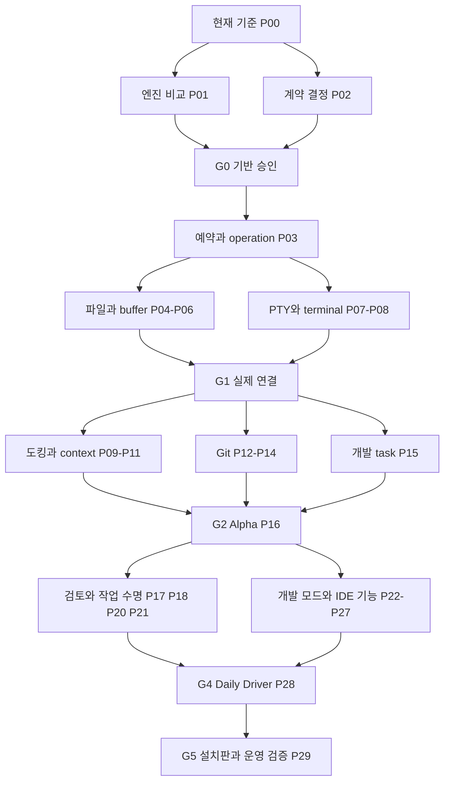

# Corral 개발 Workbench 상세 구현 계획

작성일: 2026-10-21. 상세 제안 후 사용자가 “플랜대로 구현하고 적절한 타이밍에 커밋”하도록 승인한 활성 계획이다. 구현·관련 검증·커밋을 진행하며 유료 호출·외부 배포·병합은 별도다. `WB-Pxx`는 계획 작업 번호이며 제품 원장의 ID와 연결한다. 최초 계약 묶음은 [CR-046](../change-requests/CR-046-development-workbench.md), C-142·143이다. P22의 공유 개발 모드와 P30의 선택적 외부 하네스는 계획에 명시한 별도 결정 조건을 유지한다.

입력은 `Corral-Workbench-Ecosystem-Plan-v2-2026-10-21.md`이며 SHA-256은 `11087e6b6b940bdbca89792e5a8efd84764b326ec42664ff1d289c4d65ae4451`이다. 원문을 수정하거나 전체 제품 조사를 복제하지 않는다. 기준 코드는 PR #68을 포함하는 위 commit이며, 계획 작성 시 소스·계약·manifest를 대조했다. 이후 실행 결과는 별도 검증 기록에 남긴다.

현재 진행: C-143/P03의 공통 예약·receipt·사본 generation은 구현하고 관련 회귀를 확인했다. C-142의 A/B 비교와 대상/owner 계약을 완료하고 ADR-040에 따라 기존 셸+A 엔진 연결을 선택했다. C-144/P04 문서 API는 [구현·관련 회귀](../evaluation/Development-Workbench-Documents-2026-10-21.md)를 완료했으며, [C-145·146/P05–06 편집·복구](../evaluation/Development-Workbench-Editor-2026-10-21.md)는 구현하고 Linux 인앱 흐름을 확인했다. [C-147·148/P07–08 PTY](../evaluation/Development-Workbench-Terminal-2026-10-21.md)는 구현하고 Linux 인앱의 파일→PTY→Diff 흐름을 확인했다. [C-149/P09 패널 대상·경로 연결](../evaluation/Development-Workbench-Panels-2026-10-21.md)을 구현하고 Linux 인앱에서 과거 결과·설정·초안 왕복을 확인했다. [C-150/P10 도킹·배치·복구](../evaluation/Development-Workbench-Docking-2026-10-21.md)를 구현하고 Linux 인앱에서 문서/PTY 수명·키보드·390px 승인/중지 접근을 확인했다. [C-151/P11 컨텍스트 참조·대화 밀도](../evaluation/Development-Workbench-Context-2026-10-21.md)를 구현하고 Linux 인앱에서 코드/검사/hunk→queue→scripted Run 및 실제 PTY 선택, 미저장 확인·원본/교체/삭제·표시 밀도·390px를 확인했다. [C-152/P12 읽기 전용 Git 관찰](../evaluation/Development-Workbench-Git-Observation-2026-10-21.md)을 구현하고 Linux 인앱에서 실제 index·작업 파일 구분, 원본/사본 전환, stale 새로고침과 unborn 원본을 확인했다. 이어서 [C-153/P13 stage·commit](../evaluation/Development-Workbench-Git-Write-2026-10-22.md), [C-154/P14 branch·원격](../evaluation/Development-Workbench-Git-Remote-2026-10-22.md), [C-155/P15 task·preview·Problems](../evaluation/Development-Workbench-Tasks-2026-10-22.md)를 구현했다. [C-156/P16 Alpha 인수](../evaluation/Development-Workbench-Alpha-2026-10-22.md)는 Linux 인앱에서 수동·결정적 agent 흐름을 로컬 bare remote push까지 확인했다. 실제 OS IME·스크린리더·외부 원격·지원 플랫폼/설치판 GUI qualification은 남아 있다. 2026-10-23 재검토를 반영해 [C-157/P17 변경 검토와 근거 연결](../evaluation/Development-Workbench-Review-Evidence-2026-10-23.md)을, 이어서 [C-158/P18-A 저장 팀 그래프의 도킹 탭](../evaluation/Development-Workbench-Team-Dock-2026-10-23.md)과 [C-159/P18-B execution 근거·Reins 대상](../evaluation/Development-Workbench-Execution-Evidence-2026-10-23.md), [C-160/P21-A 사본 보관·삭제](../evaluation/Development-Workbench-Copy-Lifecycle-2026-10-23.md)를 구현했고 [P22 D2 결정 자료](../proposals/P22-shared-development-D2.md)를 작성했다. [실행 기록](../evaluation/Development-Workbench-Foundation-2026-10-21.md)을 참조한다.

## P16 완료 시점의 재개 메모

작업 브랜치 `feat/development-workbench`에서 P00–P16이 구현됐다. 2026-10-22 사용자 결정으로 이번 범위는 P16 Alpha까지였다. 이 메모만으로 P17 이후를 자동 재개하지 않는다.

- **D5 결정:** hook은 신뢰 프로젝트에서만 실행한다. 서명은 저장소 설정대로 하고, 실패하면 거절한다. 작성자는 Git 설정의 허용 키만 읽는다. 원격 작업은 신뢰 프로젝트에서 사용자 credential helper를 쓴다. 상세는 CR-046 P13·P14 절에 있다.
- **계획과 달라진 점**
  - 사용자 task는 별도 테이블 없이 인간 operation 원장을 쓴다.
  - Git 조작은 Git 창 한 곳에 있다.
  - 도구 창 이름은 "Tasks & preview"다.
- 2026-10-23 사용자 요청으로 아래 재검토를 반영해 P17, P18(A·B), P21-A를 구현하고 P22 D2 결정 자료를 작성했다. **P22 D2는 B안으로 승인됐다(2026-10-23, CR-046 P22). 구현은 아직 시작하지 않았다.** 그동안 독립 작업은 R4의 P23(언어 세션)·P24-A(읽기 전용 파일 검색)다.
- 직전 실행·환경 한계는 [P16 기록](../evaluation/Development-Workbench-Alpha-2026-10-22.md)에 있다. 상태 원장은 `contracts/backlog.json`의 C-153–156이다. 이 기록을 전체 release gate 통과로 해석하지 않는다.

## 2026-10-23 P17 이후 재검토 반영

검토 HEAD `faae41a2824598752230a6c20183a17df9bf6637`(PR base `0712768`, P12 기준 `613096b`)의 P17–P30 재검토 제안(사용자 첨부 `Corral-PR69-P17-Onward-Review-2026-10-23.md`)을 사용자가 “플랜을 기반으로 구현”하도록 요청했다. 제안 문서는 검토 산출물이며 정본은 이 계획·CR-046·backlog·증거다. 이 요청을 P22 공유 쓰기·P30 외부 하네스·외부 배포/push·PR 갱신의 승인으로 해석하지 않는다.

**채택:** P00–P16은 재설계하지 않는다. P17–P30의 범위·식별자는 유지하고 아래 하위 작업·화면 소유권·순서만 개정한다.

| 기능 | 대표 화면 | 다시 만들지 않는 것 |
|---|---|---|
| 저장소·index 변경 | Git 창 | 검토 화면 안의 stage/commit |
| Run·세션 snapshot 검토 | 기존 변경 검토 화면 | 별도 Review Center·두 번째 댓글 시스템 |
| 검사 실행·결과 / 오류 위치 | Checks / Problems | pane별 검사 owner, LSP 전용 두 번째 Problems |
| 사용자 shell / 개발 task | Terminal / Tasks & preview | 명령 기록을 shell로 표시, task 관리창 중복 |
| 실행 제어 / 역할 개입 | DockRunControls / 기존 Reins | pane별 pause·cancel 묶음, 별도 조율 엔진 |
| 팀 설계 / 설정 | 기존 그래프 surface의 도킹 문서 / 단일 설정 모달 | 두 번째 그래프 store, 독립 설정 페이지 |

여러 문맥의 링크가 같은 기능·대상·상태로 도착하면 중복이 아니다.

**순서:** R0 P16 잔여 검증과 P29 조기 적용 → R1 P17 → R2 P18 → R3 P21-A와 P22 결정 자료 → R4 승인된 P22·P23·P24-A → R5 P20·P24-B·P25 → R6 P26·P27 → R7 P28·설치판 P29. P19/C-114, P21-B/C-135, P30은 독립 조건을 유지한다. P24-A와 P20의 작은 연결은 조건이 맞으면 앞당긴다. P22 결정 대기 중에도 다른 독립 작업은 진행한다.

**R0 잔여 검증(미수행):** PR 제목·본문을 P16 기준으로 갱신하는 일, #85 감사 ID별 해결/보류 대조, 최신 댓글의 기존 실패 분류는 외부 게시 동작이므로 사용자 확인 뒤 한다. 실제 desktop preview 프레임 조작, 살아 있는 host에서 PTY transport 끊김·재연결(자동 stdin replay 없음), 파일·Git·과거 Run·설정 왕복, 390px Composer·승인·취소는 P16 기록에서 빠진 통합 여정으로 남는다. 새 E2E는 실제 관찰로 필요가 확인된 경우만 추가한다.

## 1. 구현 순서와 제품 경계

권고 순서는 **현재 기능 지도 → 기반 비교와 쓰기 계약 → 파일 편집·PTY·Diff의 실제 연결 → 도킹 이관 → Git·개발 작업 → 검토·언어·디버깅 → 설치판 검증**이다. 도킹부터 크게 바꾸면 파일/프로세스 수명 문제와 레이아웃 문제를 함께 디버깅해야 한다. 따라서 파일 하나를 실제 저장하고 PTY 하나를 실행하는 경로를 기존 화면에서 먼저 증명한다.

| 단계 | 사용자가 할 수 있어야 하는 일 | 완료를 선언하지 않는 것 |
|---|---|---|
| G0 기반 결정 | 비교 결과와 권한·동시성 선택을 검토하고 다음 구현 범위를 승인 | 라이브러리를 설치한 사실만으로 통합 성공 |
| G1 실제 연결 | 관리 사본의 파일 편집/저장, 사용자 PTY, 기존 Diff 확인; 기존 대화·설정·D&D·Reins 유지 | 완성된 도킹 셸·IDE |
| G2 Alpha | 프로젝트→요청→수동 보완→실행→preview→검사→선택 stage→commit/push | 모든 언어·OS·동시 편집 지원 |
| G3 검토 연결 | Run/역할/파일/검증/검토 결정을 왕복하며 정확한 대상을 유지 | C-114 후보 비교 전체를 이미 구현했다고 간주 |
| G4 Daily Driver 후보 | 명시한 JS/TS/React/Node 프로젝트에서 언어 기능·검색/교체·충돌 해결·디버깅·배포 확인 | 모든 VS Code 확장·모든 언어 지원 |
| G5 배포 후보 | 지원 OS/arch의 실제 설치 산출물, 접근성·부하·복구 증거 | 다른 OS의 성공으로 미검증 OS를 대체 |

기본 대화 진입과 모델 미연결 상태를 유지한다. 수동 파일/터미널/Git 작업은 모델 로그인 없이 동작해야 한다. 원본 폴더의 읽기 전용 기본값, 승인·예산·Run 완료의 Coordinator 소유권을 유지한다. 레이아웃 전환은 실행 모드 전환이 아니다.

## 2. 현재 코드와 재사용 지도

아래의 “현재”는 정적 코드 확인이다. 기존 테스트가 있다는 사실과 이번 후보에서 그 테스트가 통과했다는 사실은 구분한다.

| 영역 | 현재 코드·계약 | 구현 시 재사용과 추가할 부분 |
|---|---|---|
| 작업 셸·설정 | [RootLayout](../../apps/studio/src/pages/RootLayout.tsx), [Workbench](../../apps/studio/src/pages/Workbench.tsx), [설정 수명](../../apps/studio/src/workbench/SettingsLifecycle.tsx), [navigation](../../apps/studio/src/workbench/navigation.ts) | Outlet, 설정 overlay, 저장 대상/receipt, history 복귀 유지. 패널 위치와 활성 문서만 새 레이아웃 owner에 연결 |
| 파일 읽기 | [FilePanel](../../apps/studio/src/workbench/FilePanel.tsx), [WorkspaceService](../../apps/server/src/files/service.ts), [WorkspacesApi](../../packages/client/src/index.ts) | 현재 읽기 탭·SourceCode·줄 참조·binary/too_large 표현 재사용. 사용자 편집 버퍼와 save API는 추가 필요 |
| 사본·snapshot | 같은 WorkspaceService, [SQLite](../../packages/storage-sqlite/src/database.ts) | `workspace_bindings`, `session_worktrees`, 임시 Git index 및 `refs/corral/` 재사용. 사본은 현재 session별이며 detach된 Git worktree로 생성됨 |
| writer | [RunAccessStore](../../apps/server/src/files/run-access.ts), WorkspaceService의 write lease | `run_access`의 active/uncertain writer, 고정 reader snapshot 보존. 현 소유자는 Run이므로 인간 작업과 충돌을 조정하는 경계 추가 필요 |
| 명령·프로세스 | [CommandRuntime](../../apps/server/src/processes/runtime.ts), [owned-process](../../apps/server/src/processes/owned-process.ts), [host capacity](../../packages/adapter-pi/src/processes/capacity.ts) | 소유·취소·cleanup·capacity 재사용. 현재 명령은 stdin ignore, stdout/stderr pipe이며 PTY가 아님. owner는 Run/Execution/attempt/effect를 요구 |
| 명령 UI | [WorktreeCommandPanel](../../apps/studio/src/workbench/WorktreeCommandPanel.tsx) | 기존 명령 기록·출력·중지 UI 유지. 사용자 interactive terminal로 이름만 바꾸지 않음 |
| Git·검토 | [git helper](../../apps/server/src/files/git.ts), [review](../../apps/server/src/files/review.ts), [HunkActions](../../apps/studio/src/workbench/HunkActions.tsx) | bounded argv 실행, snapshot·hunk 근거 재사용. 사용자 index·commit·remote operation은 별도 계약. 기존 helper는 hooks를 끄므로 사용자 commit에 무조건 재사용하지 않음 |
| LSP | [LspRunner](../../apps/server/src/files/lsp.ts), [LSP edits](../../apps/server/src/files/lsp-edits.ts), [계약](../../packages/contracts/src/lsp.ts) | query별 서버 실행, 버전 검사, rename/code action의 제안·검토 재사용. 상시 편집 세션의 didChange·증분 진단·수명 관리 추가 필요 |
| preview | [PreviewService](../../apps/server/src/preview/service.ts), [Desktop preview](../../apps/desktop/src/preview.ts), [preview policy](../../apps/desktop/src/preview-policy.ts) | 기존 lease·port 소유 증명·격리 재사용. 사용자 dev task의 owner와 요소 피드백을 연결 |
| 원격 host | [서비스 생성](../../apps/studio/src/services.tsx), [remote hosts](../../apps/desktop/src/remote-hosts.ts) | 기존 host namespace/partition·명령/receipt 복구 사용. host selector를 새로 중복 구축하지 않음 |
| Desktop | [main](../../apps/desktop/src/main.ts), [sidecar](../../apps/desktop/src/sidecar.mjs), [현재 계약](../current/desktop-contract.md) | 기존 패키지·업데이트·preload 경계 유지. PTY native binary와 editor worker 패키징 추가 |

현재 설치 버전은 React 19.3.1, Electron 44.4.5, Vite 8.3.4, TypeScript 6.0.3, Fastify 5.12.7, Pierre Diff 1.5.2, Base UI를 쓰는 공용 UI, `vscode-languageserver-protocol` 3.18.4다. Node 요구는 `^24.15.0`, pnpm은 10.30.3이다. Dockview/Monaco/xterm/node-pty/Theia는 현재 직접 의존성에 없으므로 이 문서가 임의 버전을 확정하지 않는다.

기존 추적 항목은 중복 생성하지 않는다.

| 기존 태스크 | 현재 원장 상태 | 이 계획의 연결 |
|---|---|---|
| C-122 / ABS-01 | implemented | 명령·service 재사용. 사용자 PTY와 인간 operation만 확장 |
| C-127 / ABS-06 | implemented | writer/reader 보존. 새 인간 작업과의 조정은 계약 변경 |
| C-140·141 | implemented | 설정·초안·컨트롤·자동 제목·모델 표시 회귀. 다시 만들지 않음 |
| C-125·128·135·136 | in_progress | [Desktop 잔여 계획](../plans/desktop-completion.md)의 플랫폼/원격/장치 검증과 연결. 전부 미구현으로 집계하지 않음 |
| C-118 | in_progress | 복수 모델 Ultra의 기존 협업을 패널에 연결. 미지원 provider는 그대로 표시 |
| C-114 | planned | [Ultra 잔여 계획](../plans/ultra-and-quality.md)의 격리 후보 비교·명시 단일 승격으로 통합 |

## 3. 착수 전에 결정할 사항

결정 owner는 제품 범위·권한·비용에 대해 사용자, 구현 방식·시험 근거에 대해 구현 담당자다. 이번에는 선택지를 구체화하며 결정을 대신 승인하지 않는다.

| 결정 | 권고안 | 대안과 선택 조건 | 확정 시점 |
|---|---|---|---|
| D1 앱 기반 | ADR-040: 기존 React/Electron + 공개 Dockview/Monaco/xterm 연결 | Theia는 동일 수용 시나리오에서 통합 비용이 실제로 작을 때. Code-OSS는 VS Code 확장 호환이 필수 제품 요구가 됐을 때 | WB-P01 후, 대규모 UI 이관 전 |
| D2 사람과 프로세스의 쓰기 | G1/Alpha는 strict 단일 writer와 명시 handoff | Daily Driver에는 선택적 shared-development를 별도 승인하거나 OS 격리안을 선택. 개발 서버를 read-only로 분류하지 않음 | WB-P02에서 기본 규칙, WB-P22 착수 전 확장 승인 |
| D3 편집 대상 | session의 기존 관리 사본을 첫 writable 대상으로 사용 | 원본 직접 편집·비Git 폴더·session과 독립된 여러 사본은 별도 범위. 원본은 현재 보호 유지 | WB-P02 |
| D4 재시작 | renderer 재연결은 살아 있는 host PTY에 재attach. host 재시작은 process 상태 재확인 | 앱 종료 뒤에도 PTY를 유지하는 독립 daemon은 후속. 명령 자동 replay는 제외 | WB-P02 |
| D5 Git 실행 권한 | snapshot용 Git과 사용자 Git 정책을 분리 | 신뢰된 hook·credential helper·signer 실행 허용 범위를 명시해야 정상 개발 Git을 제공할 수 있음. 기존 hooks-off helper를 전역 변경하지 않음 | WB-P12 전 |
| D6 검증 플랫폼 | 현 환경에서 Linux 개발·증거 수집을 먼저 수행하고 Windows/macOS gate를 함께 설계 | 검증할 OS/arch 장비가 없으면 해당 배포 지원은 대기. 기능 구현을 했다는 이유로 지원 완료 표시 금지 | WB-P01과 각 배포 후보 |

### 3.1 기반 비교를 끝내는 방법

WB-P01의 최초 비교는 **5 엔지니어일 상한을 둔 조사·실험 묶음**으로 제안한다. 일정 약속이 아니라 조사 확장을 막는 상한이다. 결과가 부족하면 미결정과 다음 실험 비용을 제출한다. 모든 조합의 완제품을 두 벌 만들지 않는다.

- A와 Theia B 각각에서 같은 TS fixture를 열고 파일 한 개 수정, PTY echo/resize, Corral 설정·그래프·Reins 표시 및 포커스 복귀, 언어 정의 이동/진단, Node 디버그 연결 가능성을 확인한다. 단순 iframe embedding은 통합 통과가 아니다.
- 본격 구현 전 가장 어려운 경계인 native PTY 패키징, worker/CSP, dirty buffer 보존과 writer 조정부터 검증한다. 기존 Pi/Coordinator/DB를 B의 서비스로 이식하지 않고 공개된 adapter 경계의 성립 여부를 본다.
- 기본 후보는 Monaco와 xterm이다. CodeMirror/Ghostty 대안은 동일 fixture에서 후보의 명확한 실패나 배포/메모리 이점이 확인될 때 비교한다. 두 editor/terminal 엔진을 production 기본 경로로 유지하지 않는다.
- 각 의존성은 정확한 package/version/tag·LICENSE/NOTICE·TS/peer·Node/Electron ABI·transitive 취약점·유지보수 owner·번들/시작 비용·롤백을 한 행으로 기록한다. 현재 온라인 문서를 버전 고정 문서로 간주하지 않는다.
- Dockview 공식 문서는 공개 MIT 패키지와 Enterprise를 구분하며 내장 keyboard docking을 Enterprise로 표시한다. 공개 API와 Corral 명령 체계로 필요한 키보드 이동/배치를 제공할 수 있는지 확인한다. 불가능하면 대안 또는 비용 결정을 받는다. 별도 DnD 엔진을 직접 만드는 우회는 하지 않는다. [공식 라이선스](https://dockview.dev/docs/overview/licence/), [키보드 문서](https://dockview.dev/docs/advanced/keyboard/)

G0 산출물은 의존성 매니페스트, A/B 비교표, 선택 ADR, D1–D6 결정표와 첫 작업 묶음이다. “최신 패키지를 설치했다”는 통과 기준이 아니다.

## 4. 데이터와 상태 소유권

아래 타입·파일명은 설계안이다. API/DB 정본을 새로 복제하지 않으며 승인 시 [API 계약](../API-Contract.md)·Zod·client·schema·tests에 함께 반영한다.

### 4.1 대상과 문서 identity

```text
WorkspaceTarget = hostId + projectId + bindingId + sessionId + copyGeneration
DocumentKey     = WorkspaceTarget + canonicalRelativePath + live-or-snapshot(tree)
ViewKey         = DocumentKey + viewInstanceId
OperationKey    = hostId + operationId
```

- `copyGeneration`은 사본 삭제/재생성·binding 교체를 구분하는 새 식별자 후보다. 같은 session/path를 재사용해도 이전 dirty 문서를 새 사본에 자동 적용하지 않는다. 기존 `session_worktrees`에 추가하는 최소 migration부터 검토한다.
- canonical root와 path 검증은 host가 담당한다. 클라이언트가 보낸 절대 경로나 `hostId`를 곧바로 권한으로 사용하지 않는다. 현재 safe path, `.git`/`.corral` 보호, symlink 제한을 보존한다. 대소문자 정책은 실제 FS를 기준으로 검증한다.
- 같은 사본·경로의 여러 pane은 한 buffer/model을 공유한다. 다른 사본의 같은 상대 경로는 다른 모델이다. Monaco의 URI/model/view 구분을 그대로 활용하고 Dockview tab ID를 파일 identity로 사용하지 않는다. [Monaco 모델과 URI](https://github.com/microsoft/monaco-editor#concepts)
- URL은 host/session/Run/문서 선택 의미, layout store는 pane/group/폭, buffer store는 text/undo/dirty를 소유한다. URL 변경 때 작업 전체를 remount하지 않는다.

### 4.2 owner별 저장과 수명

| owner | 저장하는 것 | 저장하지 않거나 결정하지 않는 것 |
|---|---|---|
| 기존 Coordinator | Run/Execution/Approval/effect/budget/receipt | 인간 save를 가짜 Run으로 만들지 않음 |
| host의 파일·operation 서비스 | disk version, save 결과, 인간 작업 receipt, Git precondition, writer/프로세스 소유 | pane focus/scroll, 모델의 완료 주장 |
| renderer의 buffer store | text, baseHash, editVersion, undo 모델, dirty, 마지막 recovery ack | 실제 disk 저장 성공, Git/Run 완료 |
| 로컬 draft 저장소 | host/copy/client별 미저장 복구 snapshot | 원본 파일 덮어쓰기, 모델 context 자동 전송 |
| layout store | schemaVersion, pane 종류·대상 참조, group/size/focus | raw 파일 내용·credential·PTY 입력/출력 |
| host process owner | PTY/task/LSP/DAP의 lifecycle, generation, capacity reservation | panel unmount를 process 종료로 취급하지 않음 |

buffer는 처음부터 renderer root의 store에 두며 pane의 React state에 가두지 않는다. 기존 session/editor draft 패턴을 대조하되 코드 편집 문서를 기존 그래프 draft와 혼합하지 않는다. dirty 복구는 IndexedDB 등 기존 브라우저 저장 수단을 우선 검토한다. 저장 실패/용량 초과를 숨기지 않고, 저장 ack 이후의 마지막 입력은 crash 시 손실될 수 있음을 제품 상태로 구분한다. raw draft는 로그·telemetry·export에 포함하지 않는다.

독립 창끼리 실시간 공동 편집은 첫 범위가 아니다. 두 renderer가 같은 파일을 편집하면 각 dirty draft를 보존하고 host의 baseHash 충돌로 두 번째 저장을 재검토한다. host 변경·사본 제거·로그아웃 후 복구 초안을 다른 대상에 붙이지 않는다.

### 4.3 인간 operation과 writer 조정

새 owner는 `user operation`과 기존 `agent execution`을 명시적으로 구분한다. 기존 Run command와 receipt를 바꾸거나 UI에서 성공 이벤트를 합성하지 않는다.

```text
접수 전 로컬 준비 → running → succeeded | failed | cancelled | uncertain
```

접수 시 `operationId + payloadHash + target generation + preconditions`와 공통 writer 예약을 같은 SQLite transaction으로 기록하고, 효과 이후 결과·observed revision·cleanup을 기록한다. 같은 ID/다른 내용은 거절하며 같은 ID/같은 내용은 원래 receipt를 조회한다. 응답 유실 상태에서 새 ID로 재실행하지 않는다. commit/push처럼 외부 효과가 있는 작업은 실제 ref와 원래 receipt를 대조해도 결론을 못 내리면 uncertain으로 남긴다.

현재 `RunAccessStore`에는 run_id 기반 unique writer가 있다. 인간 전용 lock을 옆에 추가하면 두 경로가 동시에 통과할 수 있다. **공통 writer 예약 저장소/arbiter로 확장하고 기존 RunAccess API를 adapter로 유지하는 migration**을 우선 검토한다. 기존 active/uncertain 예약을 보존하며 이전/새 코드가 서로 다른 lock으로 동시에 쓰지 못하게 한다. 공통 `workspace_access`로 이관하고 기존 Run API는 adapter로 유지한다. writer unique key는 canonical path 단독이며 generation을 넣어 이전 uncertain owner를 우회하지 않는다. copy generation은 기존 행에 기본 1, 같은 session 사본 재생성 시 증가한다. Run worker 복구가 인간 예약을 해제하지 않는다.

| 상황 | strict 기본 동작 |
|---|---|
| 같은 사본에서 agent writer 실행 중 인간 save/PTY/checkout | 거절 또는 명시 handoff. 편집 draft 자체는 유지 |
| 사용자 PTY/쓰기 dev task가 살아 있는 동안 agent writer | 종료 확인 또는 다른 사본 선택 전 시작 금지 |
| 인간 save와 stage/checkout 경합 | 사본 예약과 파일/index precondition으로 직렬화 |
| 다른 사본의 작업 | host capacity 안에서 병행 |
| snapshot reader | 기존 고정 tree만 읽음. mutable 편집 내용을 중간에 섞지 않음 |
| 종료 불확실 | 예약을 풀지 않음. 같은 PID만 보고 다른 프로세스를 종료하지 않음 |

host의 기존 12 process-group 상한을 PTY/LSP/DAP도 공유하도록 연결한다. 각 서비스별 “12개”를 새로 만들어 합계 상한을 우회하지 않는다. 수치 변경은 측정과 별도 결정 사항이다.

### 4.4 파일 save와 복구

1. open은 target generation·정규화 path·full content hash·bytes/encoding/EOL·읽기 가능 여부를 반환한다. 기존 1MiB·UTF-8 제한을 첫 편집 범위로 유지한다. partial/binary/too_large 결과에는 save를 제공하지 않는다.
2. save는 `operationId`, `baseHash`, `editVersion`, 새 bytes를 제출한다. host가 신뢰·대상·writer·path·baseHash를 확인한다.
3. 기존 원자 write 패턴을 재사용해 같은 디렉터리 임시 파일→flush/replace→readback을 수행한다. BOM/CRLF/마지막 개행·지원 파일 mode를 보존한다. 성공 ack는 제출 editVersion에만 적용하며 저장 중 추가 입력을 clean으로 지우지 않는다.
4. 외부 변경과 충돌하면 base/ours/theirs를 유지하고 재읽기·비교·명시 덮어쓰기/다른 파일 저장을 제공한다. watcher 이벤트만 신뢰하지 않고 focus/reconnect/save 직전 readback으로 누락을 보완한다.
5. Corral 예약은 외부 editor/임의 프로세스를 잠그지 못한다. hash 검사+rename을 모든 외부 writer에 대한 OS 원자 CAS라고 주장하지 않는다. 외부 경합의 허용 범위와 데이터 보존 한계를 테스트한다.

다중 파일 rename/refactor는 모든 기준을 먼저 검사하되 파일시스템 전체의 원자 트랜잭션이라고 표시하지 않는다. 단계별 journal과 충돌 안전 복구를 사용하고, 부분 적용 후 외부 변경을 자동 역적용으로 지우지 않는다.

### 4.5 터미널과 preview 경계

PTY는 host에 위치한다. renderer에는 xterm view만 둔다. `CommandRuntime`의 Run owner를 nullable 필드로 느슨하게 풀기보다 사용자 PTY owner 타입과 공통 process primitive를 분리한다. node-pty는 부모 권한을 상속하므로 관리 사본의 cwd만 지정했다고 filesystem sandbox라고 표시하지 않는다. [node-pty 공식 설명](https://github.com/microsoft/node-pty#security)

- transport는 기존 HTTP 인증에 연결한다. WebSocket을 선택하면 Fastify 5와 호환되는 `@fastify/websocket` 등 성숙한 경로를 심사한다. URL query에 영구 token을 넣지 않고 Origin·host·target·attach lease를 검사한다.
- output은 generation/sequence와 byte 상한을 갖는다. 느린 viewer의 backpressure와 UTF-8/ANSI chunk 분할을 시험한다. 입력은 ack/sequence로 중복을 막되 재접속 시 과거 키 입력·명령을 자동 replay하지 않는다. keystroke 원문을 영속 operation 로그에 남기지 않는다.
- Linux qualification에서 xterm serialize는 미완료 escape parser 상태를 보존하지 못했고, interactive shell의 별도 process group job은 기존 group kill 뒤에도 남았다. P07은 이 두 실제 반례를 해결하거나 정확한 제한을 표시해야 한다.
- scrollback이 잘린 상태에서 임의 중간 ANSI부터 재생하면 화면 상태가 깨질 수 있다. xterm의 headless/serialize 계열처럼 기존 기능으로 복구 snapshot을 만들 수 있는지 WB-P07에서 검증한다. 불가능한 상태는 재attach 성공으로 속이지 않고 명시적 제한/새 터미널 경로를 제공한다.
- clipboard escape, 링크, terminal title, OSC는 비신뢰 입력이다. 명령·링크를 자동 실행하지 않는다. preview는 기존 별도 origin/partition을 유지한다. [xterm 보안 지침](https://xtermjs.org/docs/guides/security/)
- host가 재시작하면 PTY 자체가 복원된다고 가정하지 않는다. 이전 process identity·종료 결과를 재확인하며 불명확한 프로세스는 orphan/uncertain으로 표시한다. renderer reload와 host restart 테스트를 따로 둔다.

## 5. 작업 묶음과 PR 완료 조건

각 작업의 변경 순서는 **승인 범위/CR·요구·테스트 연결 → 실제 실패 반례 → 구현 → 관련 회귀 → 증거 기록**이다. 모든 PR에 다섯 상태를 기계적으로 늘리지는 않는다. 정상·실패·취소·중복·늦은 응답 중 해당 경계에 의미 있는 반례를 선정한다.

크기 S/M/L은 상대적 구현·검증 규모다. L은 준비/host/UI 등으로 나눠 리뷰하며 단일 거대 PR로 올리지 않는다. 정확한 일정은 G0 이후 산정한다. 아래 새 파일명은 제안 위치이고 아직 존재하는 API/클래스가 아니다.

### M0 기준과 설계 결정

**WB-P00 현재 기능 대조 — S, 원문 W2-00**

- 작업: §2 지도를 코드 위치·기존 requirement/TC·환경 증거로 확정. PR #68 완료분, C-114 등 실제 잔여분, 토큰/위험 버튼 대비/footer 결함을 별도 분류한다.
- 산출물: 현행 재사용 manifest와 회귀 목록. 제품 원장 상태는 증거 없이 변경하지 않는다.
- 완료: 각 신규 요구가 “재사용/확장/신규/결정 대기” 중 하나로 분류되고 중복 owner가 없다. 선행 없음.

**WB-P01 기반과 엔진 실험 — L, W2-01, C-142 qualification 완료**

- 작업: §3.1의 A/B 비교, Dockview 공개 기능, Monaco URI/worker/CSP, xterm/node-pty 조합을 작은 독립 fixture로 검증한다. native code가 Electron main인지 sidecar Node인지 실제 로딩 위치/ABI를 확인한다.
- 반례: pane reparent 후 dirty 유실, IME Enter 오작동, native module 로딩 실패, terminal resize/부하, 회수되지 않는 model/process.
- 완료: 기능별 pass/fail/unknown과 비용을 가진 ADR 초안. 미검증 OS/Enterprise 필요 여부가 드러나야 한다. 선행 P00.

**WB-P02 대상·권한·동시성 계약 — M, W2-02**

- 작업: §4의 identity/owner/state diagram, D1–D6, API 경계·에러·취소·migration/rollback을 확정한다. 신규 endpoints는 문서화된 제안 schema부터 만든다.
- 완료: user save/PTY/Git가 Run을 위조하지 않으면서 기존 writer와 경합하는 규칙을 테스트로 표현할 수 있음. CR-046의 strict writer 기본값으로 먼저 구현하며 엔진 조합 확정은 P01 근거를 따른다. 선행 P00, 최종 조합은 P01.

### M1 기존 화면에서 실제 파일과 터미널 연결

**WB-P03 공통 예약과 인간 operation 원장 — L, W2-02, C-143 구현**

- 위치: `apps/server/src/files/run-access.ts`, `processes/`, `packages/contracts`, `packages/storage-sqlite`; 새 `apps/server/src/workbench/operations.ts` 후보.
- 작업: 인간/에이전트 owner를 구분한 durable reservation·receipt, 재시작 recover, idempotency hash, target generation을 추가한다. 기존 Run acquire/release와 effect permit은 그대로 연결한다.
- 반례/완료: 인간 save와 agent start 동시 진입, 예약 후 crash, 중복 ID/다른 payload, 종료 불확실·늦은 완료에서 한 writer만 인정. 이전 DB fixture upgrade/backup rollback 증거. 선행 P02 승인.

**WB-P04 파일 읽기 버전과 사용자 저장 API — L, W2-04, C-144 구현**

- 위치: WorkspaceService·`packages/client/src/index.ts`, 새 `files/documents.ts` 후보. 큰 기존 서비스에서 필요한 함수만 분리하고 전체 리팩터링하지 않는다.
- 작업: full-hash read, guarded atomic save, create/rename의 대상 precondition. 원본/snapshot은 읽기 전용. delete는 복구 가능한 journal/checkpoint와 명시 확인 후 제공한다.
- 반례/완료: A가 읽은 뒤 B 변경, 사본 재생성, symlink/경로 이탈, BOM/CRLF, 권한/디스크 부족, 저장 응답 유실에서 원본·draft 보존. 실제 임시 파일과 SQLite로 검증. 선행 P03.

**WB-P05 shared buffer와 dirty 복구 — M, W2-04, C-145 구현**

- 위치: `apps/studio/src/workbench/documents/`의 store/recovery 후보, 기존 draft·Desktop unsaved 흐름 연결.
- 작업: 문서당 단일 model, view별 selection/scroll, explicit save, last-view close의 저장/버리기/취소, crash recovery. 독립 창 동기 편집은 추가하지 않는다.
- 반례/완료: 같은 문서 두 pane undo, 다른 사본 동일 path, 저장 중 추가 입력, storage quota 실패, stale draft 복구, 설정/route 이동 뒤 draft 유지. 선행 P04의 계약.

**WB-P06 코드 편집 view와 첫 context 연결 — M, W2-04, C-146 구현**

- 위치: FilePanel·기존 SourceCode fallback, 새 `CodeEditorView` 후보. Monaco를 선택했을 때 public API만 사용한다.
- 작업: 읽기 view를 editor로 연결하고 dirty·read-only·충돌 상태를 표시한다. file reference로 path/range 이동, binary/대용량 fallback, 새 worker의 CSP/asset 경로 처리.
- 반례/완료: 한/일 IME, 키보드 저장, 390px에서 읽기/복구 접근, worker 실패에도 원문 보존, 편집기 dispose가 buffer를 버리지 않음. P04·05 이후 실제 한 파일 저장→기존 Diff로 확인.

**WB-P07 PTY host와 attach 계약 — L, W2-05**

- 위치: `apps/server/src/processes/pty.ts` 후보와 기존 owned-process/capacity, 인증 route/client, Desktop 패키징.
- 작업: 사용자 owner의 create/attach/input/resize/stop/readback, attach generation, 한 input controller와 read-only viewers, bounded output, clean environment, 종료 후손 확인.
- 반례/완료: spawn 전 취소, 중복 create, 끊김 직후 입력 ack 유실, 다른 host attach, host cap 도달, PID 재사용, 자식이 부모보다 늦게 종료. 실제 OS PTY와 패키지 smoke가 필요. 선행 P03·P01.

**WB-P08 terminal view와 G1 시연 — M, W2-05**

- 위치: 새 `TerminalPanel`/view adapter, 기존 WorktreeCommandPanel은 유지.
- 작업: ANSI/alt-screen/Unicode/IME/resize/선택·복사, 명시 종료, detach/reattach, UI 숨김 중 output 제어. 기존 실행 취소와 사용자 PTY 종료를 구분한다.
- 완료: 파일 수정→저장→PTY에서 실제 읽기/검사→기존 Diff 확인을 모델 없이 수행. Run A 취소가 사용자 PTY B를 종료하지 않음. 대화·설정·그래프·Reins 회귀 통과. 선행 P06·07, G1.

### M2 도킹과 왕복 이동

**WB-P09 패널 등록과 route bridge — M, W2-03**

- 위치: RootLayout/Workbench, `workbench/panels/` 후보. 기존 chat/EditorPage 그래프/Run/파일/Diff/preview를 typed panel descriptor로 등록한다.
- 작업: 대상 참조와 view 수명만 registry로 옮긴다. 실행/SSE/모델을 pane별로 재생성하지 않고 SettingsLifecycle을 작업 root에 유지한다.
- 반례/완료: deep link·back/forward, 설정에서 늦게 끝난 저장, 선택 Run 변경, 그래프 dirty 상태가 패널 이동으로 다른 대상으로 바뀌지 않음. 선행 G1·D1.

**WB-P10 도킹·배치·키보드·복구 — L, W2-03**

- 작업: 중앙 1~2 문서 그룹, 보조 그룹, 하단 도크와 대화/구현/검토 preset. split/resize/tab close/그룹 이동·키보드 대안을 제공한다. 무제한 floating/별도 Electron 창은 제외한다.
- 저장: host/project별 versioned layout. Dockview serialization은 view 배치만 담고 dirty 내용은 별도. corruption/unknown pane은 해당 view만 기본 배치/placeholder로 복구한다. [저장](https://dockview.dev/docs/core/state/save/), [복원](https://dockview.dev/docs/core/state/load/)
- 완료: 20개 문서 이동·preset 변경·reload에도 동일 buffer/PTY/Run 수명 유지. 키보드-only 조작과 390px 단일 활성 pane + 승인/중지 접근 확인. 선행 P09.

**WB-P11 context chip과 대화 밀도 — M, W2-08 일부**

- 작업: 선택 코드/terminal 오류/file-hunk/검사 결과를 정확한 target·version·range와 함께 다음 요청에 첨부한다. dirty text는 disk snapshot과 다르게 표시하고 사용자 확인 후 전달한다.
- 결과/기본/상세 활동은 projection의 표시 옵션으로 구현한다. 원본 이벤트·prompt 기록을 지우거나 진행 중 Run의 모델 입력을 바꾸지 않는다.
- 완료: chip 원본 이동·교체·삭제, stale source 표시, 승인/실패는 접힌 상세 밖에서도 발견 가능. compose/queue/late reply/IME 회귀. 선행 P06·09.

### M3 실제 Git과 개발 작업으로 Alpha 완성

**WB-P12 Git 관찰과 정책 분리 — M, W2-06**

- 위치: 기존 git helper 옆 typed `user-git.ts` 후보, client, GitPanel 후보. 내부 snapshot refs·임시 index와 사용자 index를 분리한다.
- 작업: Git porcelain의 machine format으로 status, HEAD/branch/upstream, staged/unstaged/untracked, binary/rename·diff 조회. detached/unborn/shallow 상태를 명시한다.
- 완료: 공백/한글/개행 경로, 외부 index 변경, 다른 사본의 branch/index 혼선 없음. 읽기만으로 hook/filter를 실행하거나 index를 변경하지 않음. 선행 P03·D5, UI P09.

**WB-P13 파일 stage/unstage와 commit — L, W2-06**

- 작업: 파일 단위 stage/unstage, 선택 목록·commit message·실행 정책 확인, HEAD/index/worktree 사전조건과 operation receipt. commit은 선택 stage 결과를 readback한다.
- 반례/완료: 실행 직전 외부 stage, hook 실패/취소, lock 충돌, commit 후 응답 유실, signing 불가. 중복 commit 없음, 원본 내용·비선택 stage 보존. trusted hooks 실행은 D5의 명시 정책을 따른다.
- fixture: 로컬 임시 repo. 기존 HunkActions가 Git index를 건드리지 않는 회귀 포함. 선행 P12.

**WB-P14 branch/worktree와 remote — L, W2-06**

- 작업: detached 사본을 명시 branch에 연결, branch 생성/전환, fetch, fast-forward-only pull, 명시 push. 저장 안 된 버퍼·dirty tree·활성 process가 있으면 전환을 막거나 정리 경로를 제시한다.
- 반례/완료: remote 이동, non-fast-forward, auth 실패, push 성공 후 응답 유실을 로컬 bare remote로 검증. blind retry/force push/reset/clean 기본 버튼은 제공하지 않음. 실제 외부 push는 별도 승인 대상.
- 선행 P13. 이 단계는 merge/rebase 충돌 해결 완료가 아니다.

**WB-P15 개발 task·preview·검사 연결 — L, W2-07**

- 작업: package scripts/기존 등록 검사를 읽고 명시 실행. 발견이 실행·설치를 뜻하지 않는다. 사용자 task owner와 preview lease/port attestation, Problems 위치 이동, source revision별 결과를 연결한다.
- strict 모드에서는 서비스 실행 동안 같은 사본 저장을 제한하고 stop→cleanup 확인→save→명시 재실행 경로를 제공한다. 검증 snapshot과 실제 mutable dev task를 혼동하지 않는다.
- 완료: React/Node fixture의 실제 server/HMR 통신·preview·검사 결과, 포트 가로채기·취소·stale 결과를 검증. P07·P12와 기존 preview를 재사용한다.

**WB-P16 Alpha 통합 인수 — M, W2-03–07**

- 정상: 모델 미연결 수동 흐름, 결정적 agent 요청 흐름 각각에서 open→edit→save→task→preview→test→Diff→선택 stage→commit/push를 완료한다.
- 반례: 도중 설정 진입, disk conflict, terminal 연결 유실, invalid branch, 실패 검사, response loss, renderer reload. 특정 adapter가 mock인 부분을 명시한다.
- 완료: source/build hash·지원 OS·fixture·영상/스크린샷·결과 목록이 있는 G2 기록. CI 통과만으로 packaged 성공이라 하지 않는다. 선행 P10·11·14·15.

### M4 검토와 Corral 실행 흐름 연결

**WB-P17 변경 검토와 근거 연결 — M, W2-08 — 구현(C-157)**

- 새 검토 도구가 아니라 기존 댓글·Diff·hunk 첨부·읽음·검사 결과의 근거 연결과 의미 분리다. 기존 `WorkspaceTarget`·`from/to`·`path/side/range`·`patchHash`·`verificationId/fingerprint/configRevision`을 재사용하고 새 증거 DB나 Coordinator 원장을 만들지 않는다.
- P17-A 비교 기준: Run·세션·읽음 기록 이후 비교는 같은 Diff renderer를 쓰되 기준 tree 쌍으로 구분한다. Git의 HEAD→index와 index→worktree는 Git 창이 계속 소유한다.
- P17-B 의미 분리: 파일 **읽음**(내용 blob)은 유지하고, **변경 검토**는 host·경로·이전/이후 blob 쌍에 귀속한다. 판단(승인·수정 요청)은 ReviewService가 정확한 from/to에만 귀속한다. 원본 반영·Git stage·commit은 별도 행동이다. 검사는 tree가 같아도 자기 명령 정의가 바뀌면 현재 유효성을 잃는다.
- P17-C 피드백 왕복: 선택 hunk·검사 출력 첨부는 출처 무결성과 현재 사본 적용성을 따로 보인다. 오래된 의견을 현재 줄에 자동 재부착하지 않으며, 의견 상태는 사람이 바꾼다.
- 완료: A→B 검토 뒤 C→B에서 검토 완료가 보이지 않음, hunk 출처는 읽을 수 있으나 파일이 이후 변경됨, 같은 tree의 검사 설정 변경, 세션 전환 뒤 늦은 응답·표시가 새 세션에 붙지 않음, Corral이 쓴 뒤 다른 쓰기가 섞인 파일은 `mixed`. Git 창과 검토 화면의 stage/commit 책임은 나뉜 그대로다.

**WB-P18 D&D와 Reins의 작업 연결 — M, W2-09**

- 작업: 기존 그래프 편집기를 독립 탭으로 이관하고 execution→활동/파일/결과 링크를 연결한다. Reins 대상은 host/run/execution/attempt/revision으로 고정한다.
- P18-A(구현, C-158): `kind: graph` 도킹 descriptor를 추가해 기존 route·embedded 진입점이 같은 편집 surface(working copy·undo/redo·협업·definition/layout revision)를 연다. 그래프를 파일 문서로 가장하지 않는다. definition 초안과 보기 배치를 구분하고, 저장 팀이 없는 자동 팀에 편집 링크를 만들지 않는다. 구 layout은 알 수 없는 pane만 복구 안내하며 코드 문서·그래프 dirty·PTY를 함께 버리지 않는다.
- P18-B(구현, C-159): 현재 Run 제어는 DockRunControls/RunActions 경로를 유지하고 과거 Run 조회 중 실제 제어 대상을 명시한다. 그래프 편집기의 시험 실행과 세션 Run 제어, 자동 팀 snapshot과 저장 팀 draft를 섞지 않는다.
- 완료: 탭/host/선택 Run을 바꾼 뒤 늦은 pause/cancel/patch가 새 대상에 적용되지 않음. D&D·undo·협업·Loop·budget 회귀. P09부터 적용해 G2까지 기존 기능을 항상 유지하고 이 작업에서 탐색 연결을 완성한다.

**WB-P19 Ultra 후보 비교 연결 — L, W2-09**

- 작업: C-114의 후보 workspace·예산 예약·검사·비교·명시한 하나의 승격을 기존 원장에 구현/연결한다. C-118 복수 모델 협업을 새로 만드는 항목이 아니다.
- 완료: 선택 tree 재검증, 후보 취소·전원 실패·unknown 비용·늦은 결과·명시 단일 승격 반례. provider/OS 격리가 없는 경로는 시작 차단. 자동 승격/자동 merge 없음.
- 선행 P03·17와 [CR-031](../change-requests/CR-031-ultra-quality.md). Alpha의 독립 선행 조건으로 묶지 않지만 이미 승인된 잔여 기능을 폐기하지 않는다.
- 2026-10-23: P17의 검토 identity와 P18의 대상 탐색을 재사용하고 기존 검토 surface의 비교 보기로 시작한다. 별도 멀티에이전트 대시보드·실행 원장을 추가하지 않으며 검증되지 않은 퍼센트·품질 점수를 만들지 않는다. 첫 일상 개발 루프의 선행 조건이 아니며, 격리 실패가 남은 플랫폼에서는 후보 실행을 차단한다.

**WB-P20 preview 요소 피드백 — M, W2-10**

- 작업: 기존 preview 도구의 선택/screenshot 관측을 사용자 확인 가능한 context로 연결. URL·lease·source revision·선택 DOM/스타일/콘솔 범위를 표시한다.
- 완료: 악성 페이지의 host API/credential 접근 차단, cross-origin/포트 변경·폐기 lease 거절, 사용자 선택 밖 내용을 자동 전송하지 않음. 이미 지원하는 관측 도구는 재사용. 선행 P11·15.
- 2026-10-23 분할: P20-A는 P16에서 빠진 실제 desktop preview 프레임의 렌더링·조작·종료·재연결 확인이 먼저다. P20-B는 선택 관측→기존 첨부→수정 요청→같은 preview 확인이며, 가변 dev server 화면이 특정 tree와 원자적으로 일치한다고 주장하지 않는다(불명은 불명으로 표시). 새 범용 브라우저·사이트 편집기를 만들지 않는다.

**WB-P21 작업 공간 수명과 원격 복귀 — L, W2-10**

- 작업: 명시 setup/run/cleanup, archive와 실제 사본 삭제 분리, dirty buffer·Git·process·pending approval 요약, restore와 remote reconnect 상태 연결.
- 완료: archive가 파일/PTY를 몰래 지우지 않음. 복구 전 같은 경로 재생성은 다른 generation. SSH 복구에서 local fallback/credential 혼선 없음. `.env`/키 자동 복사·setup 자동 실행 없음.
- 선행 P05·07·14. 원격 성공 실증은 C-135에 합쳐 승인된 실제 host에서 검증하며 fixture 성공으로 대체하지 않음.
- 2026-10-23 분할(P21-A 구현, C-160): P21-A 로컬 수명(삭제 전 dirty·미제출 의견·Git·task/PTY·승인 대기·복구 초안 요약, 기존 원장 조회, 불확실 cleanup은 완료 아님)과 P21-B 원격(C-135, renderer detach·transport reconnect·host restart 구분)을 나눈다. 외부 계정 대기로 P21-A를 막지 않는다.

### M5 일상 개발 기능

**WB-P22 명시적 shared-development — L, W2-02·07 확장**

- 결정: D2 승인 후 구현한다. 권고 비교안은 인간 편집+명시 dev task를 하나의 개발 owner 아래 허용하되 같은 사본의 agent writer/branch 구조 변경은 handoff 전 차단하는 모델이다. 기존 strict 보장과 다른 모드임을 표시한다.
- 작업: owner 전환, 변동 generation, 외부 수정 관측, dirty 충돌, 검증 snapshot 고정, 종료 후 strict 복귀. read-only Run은 계속 고정 snapshot을 사용한다.
- 완료: dev server가 소스도 수정하는 반례, save와 임의 외부 write의 경합, 관측 누락·불확실 attribution을 검증. 경로/명령 allowlist만으로 OS 격리를 주장하지 않음. G4의 일반적인 live-edit 흐름에는 이 결정 또는 실제 격리 대안이 필요하다.
- 2026-10-23: [D2 결정 자료](../proposals/P22-shared-development-D2.md)를 작성했다(결정 대기). **결정 자료는 P17/P18 진행 중 준비하고, P20 live feedback과 P23 이후 일상 개발 완료 선언 전에 결정한다.** 먼저 정할 의미는 mode·owner 저장과 복구, agent writer 시작 시 공유 task 종료/인계, 파일 CAS·감시 누락·외부 쓰기의 불확실성 표시, branch/index/검토/검사의 snapshot 경계, source version 변경과 copyGeneration 변경의 구분(저장마다 generation을 올리지 않음), host 재시작 때 미확인 프로세스를 자동 재실행하거나 grant를 조용히 복원하지 않는 정책이다. 첫 범위에 무제한 사용자 셸+여러 agent 동시 쓰기를 넣지 않는다. 미승인 동안 strict stop→cleanup→save→restart를 유지하고 이 제한을 일상 개발 UX에 명시한다.

**WB-P23 프로젝트 언어 세션 — L, W2-11**

- 위치: 기존 LSP runner 옆 상시 세션 adapter, registry/fingerprint·owner·capacity, editor provider 연결. 기존 agent query 도구는 유지한다.
- 작업: JS/TS/React 프로젝트의 실제 tsconfig·import·dependency graph, didOpen/change/close, diagnostic version, completion/definition/references. 선택 server의 지원 capability만 표시한다.
- 완료: dirty 문서 진단, 다른 사본 격리, UTF-16 범위/CJK·code point 차이, late diagnostic, crash/restart 후 버퍼 보존. syntax highlight만으로 완료하지 않음. 선행 P05·06·07. [LSP 명세](https://microsoft.github.io/language-server-protocol/)
- 2026-10-23: 서버 수명은 host·관리 사본·설정 fingerprint에 귀속하고 탭·분할 view마다 실행하지 않는다. 구조화된 LSP 진단을 기존 Problems·에디터에 server generation·document version과 함께 연결하며 문자열 정규식에 통과시키지 않는다. 진단 도착이 포커스나 Problems 배치를 바꾸지 않는다. P17에서 task 출력 위치는 "버전 모름", 다른 검사 정의의 결과는 "이전 설정"으로 구분했다. 현재 파서의 공백·한글·Windows·tsc pretty 위치 한계는 fixture로 보완하되 임의 절대 경로는 열지 않는다.

**WB-P24 검색·교체·refactor — L, W2-11**

- 작업: 기존 파일 열거/가상화와 native 검색 도구 후보를 사용한다. ripgrep 등 새 binary를 채택하면 버전·배포·license를 심사하고 없는 환경에서 몰래 설치하지 않는다. ignore·범위·취소·결과 상한을 둔다.
- 연결: dirty buffer를 검색에 포함할지 표시하고, 디스크 결과와 중복하지 않음. replace-all/rename/code action은 diff preview와 버전별 적용으로 연결하며 LSP가 요청한 명령을 자동 실행하지 않는다.
- 완료: stale range, partial multi-file apply, 외부 변경, case-only rename, binary/대용량/ignored file, 취소 후 늦은 결과. 선행 P04·23의 proposal 경로.
- 2026-10-23 분할: **P24-A 읽기 전용 파일 검색은 P23 완료를 기다리지 않는다.** 기존 파일 service·열거·가상화를 쓰고 결과는 기존 문서 열기 경로로 보낸다. 파일 내용 검색과 세션/대화 검색은 진입점이 이어져도 결과 종류를 구분한다. P24-B 다중 파일 교체·refactor는 P17 비교 근거·writer 정책·P23 edit proposal을 연결하고 적용 전 preview와 파일별 precondition을 확인한다.

**WB-P25 고급 Git와 충돌 해결 — L, W2-12**

- 작업: index 기반 hunk stage/unstage, 3-way base/ours/theirs, merge/rebase 진행·continue/abort, 충돌 파일 편집 연결. checkpoint hunk와 다른 UI/계약으로 표현한다.
- 완료: rename/delete·binary conflict, 외부 index 변경, 중단/재시작 중 Git sequencer 상태, ref 변경 뒤 stale hunk. 손실 없는 중단/복구와 로컬 remote 통합 시험. 선행 P13·14·17.
- 2026-10-23: Git 창에 추가한다. index 기준 hunk는 checkpoint의 HunkActions를 이름만 바꿔 재사용하지 않고 index fingerprint·HEAD·경로·hunk 변화에 재검토를 요구한다. 자동 merge·destructive reset/clean·force push 기본 노출을 추가하지 않고 D5 hook·signer·credential 정책을 바꾸지 않는다.

**WB-P26 DAP 디버깅 — L, W2-12**

- 작업: 먼저 Node/TypeScript, 이어 Chromium/browser의 검증된 debug adapter를 연결한다. launch/attach 설정·env 참조·cwd·source map·breakpoint·step·stack·variables·terminate를 지원한다.
- 권한: launch configuration, debug console evaluate, adapter가 시작하는 terminal도 실행 효과다. privileged 기본값이나 임의 외부 debug port 접속을 만들지 않는다. browser adapter는 extension host 없이 배포/실행 가능한지 P01에서 확인한다.
- 완료: unmapped breakpoint, source map 변경, child/debuggee 잔존, adapter crash, disconnect와 terminate 구분. process owner/host cap 사용. 선행 P07·23. [DAP 개요](https://microsoft.github.io/debug-adapter-protocol/overview)
- 2026-10-23: 첫 묶음은 Node/TypeScript, 다음 묶음이 browser/Chromium과 실제 preview 대상이다. Node만 검증한 상태를 browser까지 완료로 기록하지 않으며, P28에서 browser를 빼려면 별도 제품 범위 결정이 필요하다. debugging pane 닫기가 debuggee를 조용히 끝내거나 orphan을 남기지 않는다.

**WB-P27 배포 task와 결과 readback — M, W2-13**

- 작업: provider별 거대 설정 UI 대신 기존 task에 환경·source commit/tree·credential 참조·명시 확인·결과 URL을 연결한다. dirty source 배포 여부를 숨기지 않는다.
- 완료: mock 성공은 로컬 통합 증거, 실제 승인된 테스트 배포는 provider readback 증거로 분리. timeout/응답 유실에서 자동 재배포하지 않고 불확실 상태 확인. 출력 URL은 신뢰·프로토콜 정책 확인 후 링크로 표시한다.
- 선행 P14·15·17. 실제 외부 계정·비용·대상은 이 계획 승인만으로 허용되지 않는다.
- 2026-10-23: 별도 배포 catalog·credential 저장소를 먼저 만들지 않고 기존 인간 operation 원장과 task 경로에 환경·commit/tree·dirty·승인·credential 참조·readback을 연결한다. exit code와 배포 성공 확인을 구분하고, 확인이 안 되면 uncertain이다.

**WB-P28 Daily Driver 인수 — M, W2-11–13**

- 시나리오: JS/TS fixture에서 잘못된 import/타입 진단→다중 파일 rename→테스트 실패 위치 이동→Node/browser breakpoint 조사→Git conflict 해결→commit/push→승인된 배포 task 결과 확인.
- 완료: 외부 IDE로 넘기는 버튼만으로 수용하지 않음. 지원 fixture·언어/adapter·OS를 명시한 G4 기록. P22의 개발 loop 결정, P23–27 필요. 미지원 언어는 텍스트 보기와 구분한다.
- 2026-10-23: 기능 목록이 아니라 프로젝트 열기→진단/검색→직접 수정→dev loop→AI 피드백 왕복→snapshot 검사→변경 검토→부분 stage/충돌→Node/browser 디버깅→commit/push→승인한 테스트 배포 readback의 여정으로 인수한다. AI 미연결 수동 흐름을 유지하고 지원 수준을 설계/구현/로컬 검증/설치판 검증/외부 통합으로 나눈다.

### M6 전 단계 검증과 선택적 확장

**WB-P29 설치판·성능·접근성·복구 — L, W2-14**

- M1부터 수행한다. 각 OS/arch에서 PTY/후손 종료, file watcher/rename, editor worker/CSP, native ABI, IME/화면 배율, 키보드/스크린리더, updater/rollback을 해당 산출물 hash로 확인한다.
- 부하 fixture: 문서 20개·PTY 3개·다른 사본의 Run 2개·1만 파일·큰 Diff·장문 대화. 기존 admission 상한을 몰래 높여 fixture를 통과시키지 않는다.
- 완료: 기준 장비와 cold/warm 구분, 입력/전환 p95·long task·terminal backlog·idle CPU·model/process 회수를 기록. 성능 수치는 baseline 후 예산을 승인하고 CI용 결정적 한도와 실기 관측을 분리한다. G5에서 합산한다.
- 2026-10-23: 끝의 대청소가 아니라 각 단계의 공통 증거 기준이다. 대상·host·generation·Run attempt 고정, 단일 설정 모달·폼 초안·Escape·포커스 복귀, 문서/그래프 dirty·undo와 PTY·task 수명, 응답 유실·중복·늦은 결과, 좁은 화면의 Composer·승인·중지를 변경 영역마다 확인한다. 기존 12 process-group 상한을 유지하고 LSP/DAP마다 별도 카운터를 만들지 않으며, Dockview의 상시 mount pane 수만큼 LSP·poll·구독이 늘지 않게 한다.

**WB-P30 선택 외부 하네스 — L, W2-15**

- 독립 제품 요청이 있을 때 ACP/Codex app-server 등 하나씩 검토한다. 첫 편집/PTY/Git 완성의 선행 조건이 아니다.
- 작업: 시작/취소/receipt/재연결/승인/workspace/usage/변경 근거의 conformance adapter. 기존 Pi·Coordinator를 launcher에 맞춰 재작성하지 않는다.
- 완료: 외부 엔진이 broker 밖에서 효과를 실행하면 strict 보장을 표시하지 않는다. trusted-external/미지원 경계·credential·비용 opt-in을 별도로 정의한다. 원문 조사만으로 현재 API 지원/안정판 여부를 확정하지 않고 착수 때 공식 버전 문서를 다시 확인한다.

## 6. 의존 관계와 리뷰 분할



P29는 마지막에 새로 시작하는 단계가 아니라 각 경계에 반복 적용한다. P19/C-114와 P30은 별도 범위를 가진다. 도식의 묶음은 한 PR이나 한 번의 자동 실행을 뜻하지 않는다.

최소 PR 단위는 public contract+host+client+필요한 UI+관련 회귀가 함께 검토 가능한 크기다. L 작업은 예를 들어 PTY의 owner/transport와 view/패키징으로 나누되, 사용자에게 노출되는 중간 상태는 capability로 차단한다. UI 버튼만 켜고 host 계약을 나중에 구현하지 않는다.

## 7. 검증 계획과 증거

| 시험 층 | 기존에 재사용할 검사 | 추가할 핵심 시험 |
|---|---|---|
| 순수/계약 | `packages/core/test/admission-gates.test.ts`, 기존 schema·receipt | target identity, owner 전환, payloadHash, buffer reducer, layout migration |
| 저장/파일 통합 | `apps/server/test/files.test.ts`, `concurrent-files.test.ts`, SQLite 회귀 | atomic save/readback, 사본 generation, 인간/agent 경합, operation crash point, draft 복구 |
| 실제 process | `process-runtime.test.ts`, `host-process-capacity.test.ts`, process owner 검사 | PTY stdin/resize/후손 종료·backpressure·attach/host restart, LSP/DAP 종료 |
| LSP/검토 | `lsp-transport.test.ts`, `lsp-edits.test.ts`, 기존 review/hunk | dirty version 동기화, late diagnostic, workspace edit partial/conflict, index hunk 분리 |
| 브라우저 | `contextual-settings.spec.ts`, `settings-lifecycle.spec.ts`, `settings-controls.spec.ts`, files/review/service-preview/reins 회귀 | pane 이동/복귀·context·수동 개발·Git·terminal·모델 미연결 여정 |
| 실제 패키지 | 기존 Desktop smoke/native-smoke와 preview/remote-host tests | native PTY/worker 자산, CJK IME, screen reader, DPI, 설치/업데이트/유예/복구 |
| 외부 통합 | 기존 opt-in live 기록 방식 | 승인한 SSH/remote Git/provider/debug/deploy 환경만. 비용·credential·대상 한도 기록 |

사용자 추가 지침: SDD/TDD를 따르되 가능성이 낮은 상황을 위한 과도한 guard와 검증은 추가하지 않는다. E2E는 실제 인앱 브라우저+computer use에서 필요성이 확인된 뒤에만 추가한다. 시간 자체가 계약이 아닌 곳에는 빡빡한 elapsed-time/대기 기준을 두지 않으며 event/barrier와 여유 있는 harness timeout을 사용한다.

시간·ID·외부 호출이 결과를 좌우하는 시험에는 주입 또는 결정적 대역을 쓴다. PTY 자체·Git 동작·OS 종료는 mock만으로 끝내지 않고 임시 실제 자원으로 확인한다. 실제 사용자 DB·원본 저장소는 fixture로 쓰지 않는다.

필수 실패 주입 지점은 “예약 전/후, 효과 직전/직후, receipt 저장 전/후, 클라이언트 ack 전/후”다. 재접속 때 duplicate commit·키 입력·save·배포가 일어나지 않거나, 판단 불가 상태가 명시적으로 남아야 한다. “정상 화면이 보임”만으로 통과하지 않는다.

증거에는 candidate commit/tree, lockfile/build/artifact hash, OS/arch, mock/live, 실행 명령, pass/fail/skip, screenshot/trace, source revision, 남은 조건을 기록한다. `설계 / 구현 / mock / 실제 host / 설치판 / 외부 provider`를 구분한다. 원장 `implemented`와 release-ready는 다르다.

문서/추적 변경은 `pnpm spec:check`, 계약/의존성 경계 변경은 `pnpm contracts:check`/`pnpm deps:check`, 런타임 변경은 관련 단위·통합·UI 회귀를 실행한다. 이번 PR #68의 “CI/CD를 기다리지 말고 병합” 요청을 이 계획의 향후 merge 권한이나 gate 면제로 재사용하지 않는다.

## 8. 마이그레이션과 되돌리기

1. **UI:** 기본 셸을 유지한 opt-in capability로 시작한다. 첫 연결은 기존 FilePanel에서 검증하고 도킹은 단계적으로 노출한다. 거대한 플래그 조합을 만들지 않고 검증한 조합만 켠다.
2. **layout:** 새 namespace/schemaVersion을 쓰며 이전 shell prefs는 삭제하지 않는다. unknown pane은 view만 복구한다. layout 초기화가 dirty/Run/PTY를 삭제하지 않는다.
3. **draft:** 저장 포맷 버전을 분리하고 변경 전 recovery snapshot을 보존한다. migration 실패는 원문 읽기/내보내기 경로를 제공한다. 비밀값이 로그로 노출되는 자동 진단은 금지한다.
4. **DB/lease:** 인간 operation과 copy generation migration은 기존 session과 active/uncertain Run을 보존한다. 이전 코드와 새 lock이 동시에 쓰지 않는 upgrade 절차를 시험한다. UI flag off를 DB downgrade로 취급하지 않는다.
5. **process:** 기능 비활성화는 새 실행만 막고 기존 owner를 정리한다. 종료 확인 없는 reservation 해제나 orphan 자동 성공 처리를 하지 않는다.
6. **Git:** 분기된 작업 사본·사용자 index·커밋을 UI rollback 때문에 reset/clean하지 않는다. 실패한 적용은 원래 precondition/journal로 조사한다.

## 9. 첫 실행 승인안과 산정 방식

사용자의 구현 승인에 따라 **P00–P02의 기준·실험·계약 결정부터 P03–P08의 실제 연결까지 순차 진행**한다. 라이브러리에 독립적인 writer/receipt 기반은 엔진 실험과 병행할 수 있다. 각 완료 묶음을 커밋하고, 계획의 선택적 범위·외부 효과는 해당 결정 조건을 유지한다.

첫 묶음의 제출물은 다음 네 가지다.

1. 기존 코드/계약/테스트 재사용 지도와 원문 W2 항목 대응.
2. A/B 실제 작은 시연, 엔진/의존성 고정 후보, 실패·미검증 OS를 포함한 비교표.
3. 인간 operation·writer/dev server·dirty recovery·PTY owner·Git hook 정책의 ADR/CR 초안.
4. G1까지의 PR별 파일/계약/실패 시험과 크기를 재산정한 작업표.

G0 이전에는 전체 일정의 확정치를 만들지 않는다. 산정은 각 작업에 구현·반례·실제 패키지 검증·리뷰 수정 시간을 포함하고, 장비/계정 확보 대기는 별도로 적는다. P04–06과 P07–08은 공통 계약이 확정된 후 독립 진행 가능하지만, DB migration/owner 계약의 중복 수정을 피한다. 외부 하네스·플랫폼 확대를 Alpha 일정에 숨겨 포함하지 않는다.

## 10. 원문 로드맵 대응과 계획 작성 검증

| 원문 | 상세 작업 |
|---|---|
| W2-00 | P00, §2 |
| W2-01 | P01, §3.1 |
| W2-02 | P02–03, P22, §4 |
| W2-03 | P09–10 |
| W2-04 | P04–06 |
| W2-05 | P07–08 |
| W2-06 | P12–14 |
| W2-07 | P15–16 |
| W2-08 | P11, P17 |
| W2-09 | P18–19; C-114/C-118 연결 |
| W2-10 | P20–21 |
| W2-11 | P23–24 |
| W2-12 | P25–26 |
| W2-13 | P27–28 |
| W2-14 | P29 전 단계 적용 |
| W2-15 | P30 독립 확장 |

원문의 비교 제품별 라이선스/유지보수 조사는 채택 후보 근거로만 유지한다. 이번에는 Corral의 현재 manifest·owner·테스트와 Dockview/Monaco/node-pty/xterm/Theia/LSP/DAP 공식 경계만 대조했다. Theia의 contribution은 대안 기반의 통합 지점이지 기존 서비스가 자동 호환된다는 증거가 아니다. [Theia 공식 확장 구조](https://theia-ide.org/docs/authoring_extensions/)

이 세션에 Context7 도구가 없어 공식 문서와 설치된 소스를 사용했다. 구현에 사용하는 실제 package 버전이 정해지면 해당 버전 문서/타입을 다시 맞춘다. 새 라이브러리 설치·PoC·성능 측정·제품 회귀 실행은 이 계획 작성의 결과에 포함하지 않는다.

계획 자체는 작업 번호 P00–P30의 중복/누락, 원문 W2-00–15 전체 대응, 로컬 링크 존재 여부와 `pnpm spec:check`로 검사했다. 이 결과는 문서 정합성 검증이며 제품 구현 검증이 아니다.
