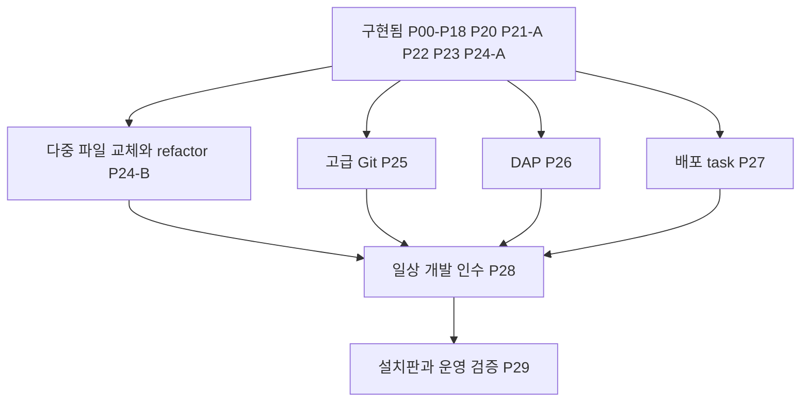

# Corral 개발 Workbench 상세 구현 계획

작성일: 2026-10-21. 상세 제안 후 사용자가 “플랜대로 구현하고 적절한 타이밍에 커밋”하도록 승인한 활성 계획이다. 구현·관련 검증·커밋을 진행하며 유료 호출·외부 배포·병합은 별도다. `WB-Pxx`는 계획 작업 번호이며 제품 원장의 ID와 연결한다. 최초 계약 묶음은 [CR-046](../change-requests/CR-046-development-workbench.md), C-142·143이다. P22 B안은 승인·구현됐고 P30의 선택적 외부 하네스는 별도 결정 조건을 유지한다.

입력은 `Corral-Workbench-Ecosystem-Plan-v2-2026-10-21.md`이며 SHA-256은 `11087e6b6b940bdbca89792e5a8efd84764b326ec42664ff1d289c4d65ae4451`이다. 원문을 수정하거나 전체 제품 조사를 복제하지 않는다. 기준 코드는 PR #68을 포함하는 위 commit이며, 계획 작성 시 소스·계약·manifest를 대조했다. 이후 실행 결과는 별도 검증 기록에 남긴다.

현재 구현: P00–P18·P20·P21-A·P22·P23·P24-A(C-142–164). 완료 항목의 계약은 [현재 Workbench](../current/workbench.md)·[CR-046](../change-requests/CR-046-development-workbench.md), 각 환경의 실행 증거는 [상태표](../status.md)와 [증거 지도](../evaluation/README.md)에 연결한다. P19·P21-B·P24-B·P25는 이 완료 범위에 포함하지 않는다.

## 현재 재개 지점: P24-B → P25

`d658830`까지 코어 잔여 검증과 P23 언어 세션(C-162), P24-A 읽기 전용 파일 검색(C-163)을 마쳤다. 핵심 검증과 한계는 [코어 기록](../evaluation/Development-Workbench-Core-2026-10-23.md), [언어 지원 기록](../evaluation/Development-Workbench-Language-2026-10-23.md), [파일 내용 검색 기록](../evaluation/Development-Workbench-Content-Search-2026-10-23.md)을 따른다. 이후 사용자가 P20 preview 피드백(C-164) → P24-B 교체/refactor(C-165) → P25 고급 Git(C-166) 순서의 구현·핵심 회귀·실제 화면·단위별 로컬 커밋을 승인했다. 이 순서로 진행하며 전체 플랫폼/부하 검증이나 외부 게시·배포는 자동 진행하지 않는다.

기존 task·Git·문서·공통 owner를 재사용했다. 별도 task 테이블·모드 열·관리창은 추가하지 않았다. 상태 원장은 `contracts/backlog.json`이며 전체 release gate 통과를 뜻하지 않는다.

## 2026-10-23 P17 이후 재검토 반영

검토 HEAD `faae41a2824598752230a6c20183a17df9bf6637`(PR base `0712768`, P12 기준 `613096b`)의 P17–P30 재검토 제안(사용자 첨부 `Corral-PR69-P17-Onward-Review-2026-10-23.md`)을 사용자가 “플랜을 기반으로 구현”하도록 요청했다. 제안 문서는 검토 산출물이며 정본은 이 계획·CR-046·backlog·증거다. 이 요청을 P22 공유 쓰기·P30 외부 하네스·외부 배포/push·PR 갱신의 승인으로 해석하지 않는다.

**채택:** P00–P16은 재설계하지 않는다. P17–P30의 범위·식별자는 유지하고 아래 하위 작업·화면 소유권·순서만 개정한다.

| 기능 | 대표 화면 | 다시 만들지 않는 것 |
|---|---|---|
| 저장소·index 변경 | Git 창 | 검토 화면 안의 stage/commit |
| Run·세션 snapshot 검토 | 기존 변경 검토 화면 | 별도 Review Center·두 번째 댓글 시스템 |
| 검사 실행·결과 / 오류 위치 | Checks / Problems | pane별 검사 owner, LSP 전용 두 번째 Problems |
| 사용자 shell / 개발 task | Terminal / Tasks & preview | 명령 기록을 shell로 표시, task 관리창 중복 |
| 실행 제어 / 역할 개입 | DockRunControls / 기존 Reins | pane별 pause·cancel 묶음, 별도 조율 엔진 |
| 팀 설계 / 설정 | 기존 그래프 surface의 도킹 문서 / 단일 설정 모달 | 두 번째 그래프 store, 독립 설정 페이지 |

여러 문맥의 링크가 같은 기능·대상·상태로 도착하면 중복이 아니다.

**남은 순서:** R5 P24-B·P25 → R6 P26·P27 → R7 P28·설치판 P29. P17·P18·P21-A·P22·P23·P24-A는 구현됐고 R0 코어 검증은 아래 기록으로 회수했다. P19/C-114, P21-B/C-135, P30은 독립 조건을 유지한다.

**R0 코어 검증 완료:** [코어 실행 기록](../evaluation/Development-Workbench-Core-2026-10-23.md)에서 preview HTTP/HMR 소유권·종료, 실제 PTY viewer 재접속 후 셸 상태·입력 제어, dirty 문서→Git→설정 왕복·저장을 확인했다. 사용자 요청에 따라 다음 기능마다 전체 여정을 반복하지 않고 변경한 코어 회귀와 실제 화면만 확인한다. Desktop 전용 프레임/설치판·전체 좁은 화면 인수는 P29, 원격 host는 P21-B에 남긴다. PR #69/#85의 설명·감사 목록 갱신은 별도 외부 게시 작업이다.

## 1. 구현 순서와 제품 경계

권고 순서는 **현재 기능 지도 → 기반 비교와 쓰기 계약 → 파일 편집·PTY·Diff의 실제 연결 → 도킹 이관 → Git·개발 작업 → 검토·언어·디버깅 → 설치판 검증**이다. 도킹부터 크게 바꾸면 파일/프로세스 수명 문제와 레이아웃 문제를 함께 디버깅해야 한다. 따라서 파일 하나를 실제 저장하고 PTY 하나를 실행하는 경로를 기존 화면에서 먼저 증명한다.

| 단계 | 사용자가 할 수 있어야 하는 일 | 완료를 선언하지 않는 것 |
|---|---|---|
| G0 기반 결정 | 비교 결과와 권한·동시성 선택을 검토하고 다음 구현 범위를 승인 | 라이브러리를 설치한 사실만으로 통합 성공 |
| G1 실제 연결 | 관리 사본의 파일 편집/저장, 사용자 PTY, 기존 Diff 확인; 기존 대화·설정·D&D·Reins 유지 | 완성된 도킹 셸·IDE |
| G2 Alpha | 프로젝트→요청→수동 보완→실행→preview→검사→선택 stage→commit/push | 모든 언어·OS·동시 편집 지원 |
| G3 검토 연결 | Run/역할/파일/검증/검토 결정을 왕복하며 정확한 대상을 유지 | C-114 후보 비교 전체를 이미 구현했다고 간주 |
| G4 Daily Driver 후보 | 명시한 JS/TS/React/Node 프로젝트에서 언어 기능·검색/교체·충돌 해결·디버깅·배포 확인 | 모든 VS Code 확장·모든 언어 지원 |
| G5 배포 후보 | 지원 OS/arch의 실제 설치 산출물, 접근성·부하·복구 증거 | 다른 OS의 성공으로 미검증 OS를 대체 |

기본 대화 진입과 모델 미연결 상태를 유지한다. 수동 파일/터미널/Git 작업은 모델 로그인 없이 동작해야 한다. 원본 폴더의 읽기 전용 기본값, 승인·예산·Run 완료의 Coordinator 소유권을 유지한다. 레이아웃 전환은 실행 모드 전환이 아니다.

## 2. 현재 코드와 재사용 지도

아래는 2026-10-23 P23·P24-A 구현까지 반영한 재사용 지도다. 기존 테스트가 있다는 사실과 해당 후보·환경에서 그 테스트가 통과했다는 사실은 구분하며 실행 결과는 각 증거 기록을 따른다.

| 영역 | 현재 코드·계약 | 구현 시 재사용과 추가할 부분 |
|---|---|---|
| 작업 셸·설정 | [DockWorkbench](../../apps/studio/src/workbench/docking/DockWorkbench.tsx), [패널 목록](../../apps/studio/src/workbench/panels/registry.ts), [설정 수명](../../apps/studio/src/workbench/SettingsLifecycle.tsx) | P09–10 도킹·URL·배치 복구와 단일 설정 모달 구현. 기존 owner와 진입점을 확장 |
| 문서 편집 | [DocumentPanel](../../apps/studio/src/workbench/DocumentPanel.tsx), [문서 store](../../apps/studio/src/workbench/documents/store.ts), [WorkspaceService](../../apps/server/src/files/service.ts) | P04–06 save/create/rename/delete·hash CAS·receipt·Monaco 공유 모델·dirty 복구 구현. P22에서도 그대로 사용 |
| 사본·공통 소유권 | [WorkbenchOperations](../../apps/server/src/files/workbench-operations.ts), [WorkspaceAccessStore](../../apps/server/src/files/workspace-access.ts) | Run/사람 writer 예약·generation·uncertain 복구 구현. P22는 기존 원장에 development owner와 허용된 하위 효과를 연결 |
| 터미널·개발 task | [PTY](../../apps/server/src/processes/pty.ts), [CommandRuntime](../../apps/server/src/processes/runtime.ts), [작업 UI](../../apps/studio/src/workbench/WorkbenchTasks.tsx) | P07–08 실제 PTY·입력 소유권, P15 명시 task·프로세스 정리 구현. 공유 허용은 task만, 임의 터미널은 제외 |
| Git·검토 | [Git 쓰기](../../apps/server/src/files/user-git-write.ts), [GitPanel](../../apps/studio/src/workbench/GitPanel.tsx), [ReviewPage](../../apps/studio/src/pages/ReviewPage.tsx) | P12–14 실제 index·commit·branch/remote·receipt, P17 읽음/검토/승인 분리 구현. 내부 snapshot과 사용자 Git 정책을 유지 |
| 팀·execution | [EditorPage](../../apps/studio/src/pages/EditorPage.tsx), [ExecutionEvidence](../../apps/studio/src/workbench/ExecutionEvidence.tsx) | P18 그래프 도킹·초안/undo·실행 근거·Reins 대상 고정 구현. 별도 그래프/Run store를 만들지 않음 |
| 사본 수명 | [CopyRemovalDialog](../../apps/studio/src/workbench/CopyRemovalDialog.tsx), WorkspaceService | P21-A 보관/삭제 분리·삭제 전 요약·generation 고정 구현. P21-B 원격 재접속은 별도 |
| LSP·Problems | [LspRunner](../../apps/server/src/files/lsp.ts), [LanguageSessions](../../apps/server/src/files/language-sessions.ts), [ProblemsPanel](../../apps/studio/src/workbench/ProblemsPanel.tsx) | P23 상시 언어 세션·dirty 문서 동기화·구조화 진단·completion·정의/참조 이동 구현. 기존 query별 LSP·제안은 보존. 상시 세션의 수정 제안은 P24-B에서 확장 필요 |
| 파일 내용 검색 | [WorkspaceService](../../apps/server/src/files/service.ts), [ContentSearch](../../apps/studio/src/workbench/ContentSearch.tsx), [FilePanel](../../apps/studio/src/workbench/FilePanel.tsx) | P24-A 저장된 파일의 읽기 전용 내용 검색·기존 문서 열기/위치 이동 구현. 미저장 초안 검색·다중 파일 교체는 포함하지 않음 |
| preview | [PreviewService](../../apps/server/src/preview/service.ts), [ServicePreview](../../apps/studio/src/workbench/ServicePreview.tsx), [Desktop preview](../../apps/desktop/src/preview.ts) | 사용자 task owner·포트 증명·proxy 연결 구현. P22 live edit·P20 선택 관측/첨부 구현. 실제 Desktop 코어와 전체 설치판/OS qualification을 구분 |
| 원격·Desktop | [remote hosts](../../apps/desktop/src/remote-hosts.ts), [sidecar](../../apps/desktop/src/sidecar.mjs) | 기존 host namespace·패키지 경계 유지. Linux native PTY smoke와 전체 설치판/지원 OS 검증을 구분 |

현재 직접 의존성은 Monaco 0.57.0, Dockview 8.6.1, xterm 6.0.0/addon-fit 0.11.0, node-pty 1.1.0이다. Theia는 비교 후 채택하지 않았다(ADR-040). 정확 버전·고지는 package manifest·lockfile·THIRD-PARTY-NOTICES를 따른다. Node 요구는 `^24.15.0`, pnpm은 10.30.3이다.

기존 추적 항목은 중복 생성하지 않는다.

| 기존 태스크 | 현재 원장 상태 | 이 계획의 연결 |
|---|---|---|
| C-122 / ABS-01 | implemented | 명령·service 재사용. 사용자 PTY와 인간 operation만 확장 |
| C-127 / ABS-06 | implemented | writer/reader 보존. 새 인간 작업과의 조정은 계약 변경 |
| C-140·141 | implemented | 설정·초안·컨트롤·자동 제목·모델 표시 회귀. 다시 만들지 않음 |
| C-125·128·135·136 | in_progress | [Desktop 잔여 계획](../plans/desktop-completion.md)의 플랫폼/원격/장치 검증과 연결. 전부 미구현으로 집계하지 않음 |
| C-118 | in_progress | 복수 모델 Ultra의 기존 협업을 패널에 연결. 미지원 provider는 그대로 표시 |
| C-114 | planned | [Ultra 잔여 계획](../plans/ultra-and-quality.md)의 격리 후보 비교·명시 단일 승격으로 통합 |

## 3. 확정한 결정과 남은 조건

결정 owner는 제품 범위·권한·비용에 대해 사용자, 구현 방식·시험 근거에 대해 구현 담당자다. 확정한 결정을 다시 승인 대기로 돌리지 않는다.

| 결정 | 권고안 | 대안과 선택 조건 | 확정 시점 |
|---|---|---|---|
| D1 앱 기반 | ADR-040: 기존 React/Electron + 공개 Dockview/Monaco/xterm 연결 | Theia는 동일 수용 시나리오에서 통합 비용이 실제로 작을 때. Code-OSS는 VS Code 확장 호환이 필수 제품 요구가 됐을 때 | ADR-040으로 확정 |
| D2 사람과 프로세스의 쓰기 | P22 B안 승인: 사람 편집+명시 task를 한 development owner 아래 공유 | strict 기본값 유지. agent writer·터미널·구조 변경은 공유 종료 전 차단 | 2026-10-23 승인·구현, CR-046 P22 / C-161 |
| D3 편집 대상 | session의 기존 관리 사본을 첫 writable 대상으로 사용 | 원본 직접 편집·비Git 폴더·session과 독립된 여러 사본은 별도 범위. 원본은 현재 보호 유지 | CR-046으로 확정 |
| D4 재시작 | renderer 재연결은 살아 있는 host PTY에 재attach. host 재시작은 process 상태 재확인 | 앱 종료 뒤에도 PTY를 유지하는 독립 daemon은 후속. 명령 자동 replay는 제외 | CR-046으로 확정 |
| D5 Git 실행 권한 | P12 읽기와 P13·14 사용자 쓰기 정책 분리 구현 | trusted hook·저장소 서명 설정·사용자 credential helper 정책은 CR-046 P13·14 유지 | 확정·구현됨 |
| D6 검증 플랫폼 | 현 환경에서 Linux 개발·증거 수집을 먼저 수행하고 Windows/macOS gate를 함께 설계 | 검증할 OS/arch 장비가 없으면 해당 배포 지원은 대기. 기능 구현을 했다는 이유로 지원 완료 표시 금지 | WB-P01과 각 배포 후보 |

## 4. 후속 구현에서 유지할 경계

이미 구현된 소유권·문서·터미널의 설계 초안은 현재 계약과 중복되므로 제거했다. P01의 엔진 비교는 ADR-040으로 완료됐으며 다시 실행할 착수 조건이 아니다.

- 대상·공통 예약·receipt·고정 snapshot: [CR-046](../change-requests/CR-046-development-workbench.md), [실행과 안전](../current/execution-and-safety.md), `packages/contracts/src/workbench.ts`.
- 문서 모델·dirty 복구·도킹·D&D·Reins·Git·task: [현재 Workbench](../current/workbench.md), [API 계약](../API-Contract.md), §2의 기존 구현.
- P23 상시 LSP의 host process 상한·owner·종료 확인·target/version 계약을 유지한다. 후속 DAP도 이 공통 경계를 재사용한다.
- P22는 로컬 명시 opt-in이다. 원본·원격·임의 PTY·여러 agent의 동시 쓰기까지 확장하지 않는다.

## 5. 작업 묶음과 PR 완료 조건

각 작업의 변경 순서는 **승인 범위/CR·요구·테스트 연결 → 실제 실패 반례 → 구현 → 관련 회귀 → 증거 기록**이다. 모든 PR에 다섯 상태를 기계적으로 늘리지는 않는다. 정상·실패·취소·중복·늦은 응답 중 해당 경계에 의미 있는 반례를 선정한다.

크기 S/M/L은 상대적 구현·검증 규모다. L은 준비/host/UI 등으로 나눠 리뷰하며 단일 거대 PR로 올리지 않는다. 후속 작업의 새 API·클래스는 구현·계약 확정 전까지 제안이다.

### 완료 항목의 연결

P00–P18(C-142–159)·P21-A(C-160)·P22(C-161)·P23(C-162)·P24-A(C-163)는 구현됐다. 초기 구현 지시와 비교 실험 계획은 제거했으며 요구·테스트 ID, 승인 CR, 해당 commit·환경의 결과는 원장과 증거에 보존한다. 현재 동작은 Workbench와 CR-046을 따른다. 코어 여정의 확인 범위는 위 R0에 회수했으며 P29 설치판·접근성·복구 조건은 아래에 남긴다.

### M4 남은 검토·preview·원격 연결

**WB-P19 Ultra 후보 비교 연결 — L, W2-09**

- 작업: C-114의 후보 workspace·예산 예약·검사·비교·명시한 하나의 승격을 기존 원장에 구현/연결한다. C-118 복수 모델 협업을 새로 만드는 항목이 아니다.
- 완료: 선택 tree 재검증, 후보 취소·전원 실패·unknown 비용·늦은 결과·명시 단일 승격 반례. provider/OS 격리가 없는 경로는 시작 차단. 자동 승격/자동 merge 없음.
- 선행 P03·17와 [CR-031](../change-requests/CR-031-ultra-quality.md). Alpha의 독립 선행 조건으로 묶지 않지만 이미 승인된 잔여 기능을 폐기하지 않는다.
- 2026-10-23: P17의 검토 identity와 P18의 대상 탐색을 재사용하고 기존 검토 surface의 비교 보기로 시작한다. 별도 멀티에이전트 대시보드·실행 원장을 추가하지 않으며 검증되지 않은 퍼센트·품질 점수를 만들지 않는다. 첫 일상 개발 루프의 선행 조건이 아니며, 격리 실패가 남은 플랫폼에서는 후보 실행을 차단한다.

P20(C-164)은 구현됐다. 현재 동작은 [미리보기 요소 피드백](../current/workbench.md#미리보기-요소-피드백), 실제 Desktop 선택·첨부·동일 화면 갱신과 환경 경계는 [실행 기록](../evaluation/Development-Workbench-Preview-Feedback-2026-10-23.md)을 따른다. 전체 설치판/OS·원격 capture와 실제 이미지 지원 모델은 이번 증거에 포함하지 않는다.

**WB-P21 작업 공간 수명과 원격 복귀 — L, W2-10**

- 작업: 명시 setup/run/cleanup, archive와 실제 사본 삭제 분리, dirty buffer·Git·process·pending approval 요약, restore와 remote reconnect 상태 연결.
- 완료: archive가 파일/PTY를 몰래 지우지 않음. 복구 전 같은 경로 재생성은 다른 generation. SSH 복구에서 local fallback/credential 혼선 없음. `.env`/키 자동 복사·setup 자동 실행 없음.
- 선행 P05·07·14. 원격 성공 실증은 C-135에 합쳐 승인된 실제 host에서 검증하며 fixture 성공으로 대체하지 않음.
- 2026-10-23 분할(P21-A 구현, C-160): P21-A 로컬 수명(삭제 전 dirty·미제출 의견·Git·task/PTY·승인 대기·복구 초안 요약, 기존 원장 조회, 불확실 cleanup은 완료 아님)과 P21-B 원격(C-135, renderer detach·transport reconnect·host restart 구분)을 나눈다. 외부 계정 대기로 P21-A를 막지 않는다.

### M5 일상 개발 기능

P22 공유 개발 owner는 C-161로 구현했다. 로컬 Vite live edit, CAS 충돌·초안 보존, writer 거절·재시작 복구·snapshot 회귀는 [실행 기록](../evaluation/Development-Workbench-Shared-Development-2026-10-23.md)에 있다. Desktop preview 프레임과 원격/지원 OS qualification은 이 결과에 포함하지 않는다.

P23 상시 언어 세션(C-162)의 동작은 [CR-046 P23](../change-requests/CR-046-development-workbench.md#p23-프로젝트-언어-세션), 지원 환경과 핵심 검증은 [실행 기록](../evaluation/Development-Workbench-Language-2026-10-23.md)을 따른다. 버전 없는 진단을 현재 dirty 문서의 진단으로 확정하지 않으며 후속 언어/OS/수정 제안 확장은 별도다.

P24-A 읽기 전용 파일 내용 검색(C-163)은 구현됐다. 저장된 파일만 검색하고 미저장 초안을 보존하는 계약은 [CR-046 P24-A](../change-requests/CR-046-development-workbench.md#p24-a-읽기-전용-파일-내용-검색), 핵심 검증과 한계는 [실행 기록](../evaluation/Development-Workbench-Content-Search-2026-10-23.md)을 따른다.

**WB-P24-B 다중 파일 교체·refactor — L, W2-11**

- 작업: P24-A 검색과 기존 단발 LSP의 수정 제안·P17 비교 근거·writer 정책을 재사용한다. P23 상시 세션에는 아직 edit proposal 경로가 없으므로 document version·server generation에 고정한 수정 제안 계약과 연결을 확장한다.
- 연결: replace-all/rename/code action은 적용 전 diff preview와 파일별 precondition을 확인한다. dirty buffer 포함 정책을 명시하고 초안을 덮지 않으며 LSP가 요청한 명령을 자동 실행하지 않는다.
- 완료: stale range, partial multi-file apply, 외부 변경, case-only rename, binary/대용량/ignored file, 취소 후 늦은 결과. 기존 P04·P23·P24-A의 보호 경계를 유지한다.

**WB-P25 고급 Git와 충돌 해결 — L, W2-12**

- 작업: index 기반 hunk stage/unstage, 3-way base/ours/theirs, merge/rebase 진행·continue/abort, 충돌 파일 편집 연결. checkpoint hunk와 다른 UI/계약으로 표현한다.
- 완료: rename/delete·binary conflict, 외부 index 변경, 중단/재시작 중 Git sequencer 상태, ref 변경 뒤 stale hunk. 손실 없는 중단/복구와 로컬 remote 통합 시험. 선행 P13·14·17.
- 2026-10-23: Git 창에 추가한다. index 기준 hunk는 checkpoint의 HunkActions를 이름만 바꿔 재사용하지 않고 index fingerprint·HEAD·경로·hunk 변화에 재검토를 요구한다. 자동 merge·destructive reset/clean·force push 기본 노출을 추가하지 않고 D5 hook·signer·credential 정책을 바꾸지 않는다.

**WB-P26 DAP 디버깅 — L, W2-12**

- 작업: 먼저 Node/TypeScript, 이어 Chromium/browser의 검증된 debug adapter를 연결한다. launch/attach 설정·env 참조·cwd·source map·breakpoint·step·stack·variables·terminate를 지원한다.
- 권한: launch configuration, debug console evaluate, adapter가 시작하는 terminal도 실행 효과다. privileged 기본값이나 임의 외부 debug port 접속을 만들지 않는다. browser adapter는 extension host 없이 배포/실행 가능한지 P01에서 확인한다.
- 완료: unmapped breakpoint, source map 변경, child/debuggee 잔존, adapter crash, disconnect와 terminate 구분. process owner/host cap 사용. 선행 P07·23. [DAP 개요](https://microsoft.github.io/debug-adapter-protocol/overview)
- 2026-10-23: 첫 묶음은 Node/TypeScript, 다음 묶음이 browser/Chromium과 실제 preview 대상이다. Node만 검증한 상태를 browser까지 완료로 기록하지 않으며, P28에서 browser를 빼려면 별도 제품 범위 결정이 필요하다. debugging pane 닫기가 debuggee를 조용히 끝내거나 orphan을 남기지 않는다.

**WB-P27 배포 task와 결과 readback — M, W2-13**

- 작업: provider별 거대 설정 UI 대신 기존 task에 환경·source commit/tree·credential 참조·명시 확인·결과 URL을 연결한다. dirty source 배포 여부를 숨기지 않는다.
- 완료: mock 성공은 로컬 통합 증거, 실제 승인된 테스트 배포는 provider readback 증거로 분리. timeout/응답 유실에서 자동 재배포하지 않고 불확실 상태 확인. 출력 URL은 신뢰·프로토콜 정책 확인 후 링크로 표시한다.
- 선행 P14·15·17. 실제 외부 계정·비용·대상은 이 계획 승인만으로 허용되지 않는다.
- 2026-10-23: 별도 배포 catalog·credential 저장소를 먼저 만들지 않고 기존 인간 operation 원장과 task 경로에 환경·commit/tree·dirty·승인·credential 참조·readback을 연결한다. exit code와 배포 성공 확인을 구분하고, 확인이 안 되면 uncertain이다.

**WB-P28 Daily Driver 인수 — M, W2-11–13**

- 시나리오: JS/TS fixture에서 잘못된 import/타입 진단→다중 파일 rename→테스트 실패 위치 이동→Node/browser breakpoint 조사→Git conflict 해결→commit/push→승인된 배포 task 결과 확인.
- 완료: 외부 IDE로 넘기는 버튼만으로 수용하지 않음. 지원 fixture·언어/adapter·OS를 명시한 G4 기록. P22의 개발 loop 결정, P23–27 필요. 미지원 언어는 텍스트 보기와 구분한다.
- 2026-10-23: 기능 목록이 아니라 프로젝트 열기→진단/검색→직접 수정→dev loop→AI 피드백 왕복→snapshot 검사→변경 검토→부분 stage/충돌→Node/browser 디버깅→commit/push→승인한 테스트 배포 readback의 여정으로 인수한다. AI 미연결 수동 흐름을 유지하고 지원 수준을 설계/구현/로컬 검증/설치판 검증/외부 통합으로 나눈다.

### M6 전 단계 검증과 선택적 확장

**WB-P29 설치판·성능·접근성·복구 — L, W2-14**

- M1부터 수행한다. 각 OS/arch에서 PTY/후손 종료, file watcher/rename, editor worker/CSP, native ABI, IME/화면 배율, 키보드/스크린리더, updater/rollback을 해당 산출물 hash로 확인한다.
- 부하 fixture: 문서 20개·PTY 3개·다른 사본의 Run 2개·1만 파일·큰 Diff·장문 대화. 기존 admission 상한을 몰래 높여 fixture를 통과시키지 않는다.
- 완료: 기준 장비와 cold/warm 구분, 입력/전환 p95·long task·terminal backlog·idle CPU·model/process 회수를 기록. 성능 수치는 baseline 후 예산을 승인하고 CI용 결정적 한도와 실기 관측을 분리한다. G5에서 합산한다.
- 2026-10-23: 끝의 대청소가 아니라 각 단계의 공통 증거 기준이다. 대상·host·generation·Run attempt 고정, 단일 설정 모달·폼 초안·Escape·포커스 복귀, 문서/그래프 dirty·undo와 PTY·task 수명, 응답 유실·중복·늦은 결과, 좁은 화면의 Composer·승인·중지를 변경 영역마다 확인한다. 기존 12 process-group 상한을 유지하고 LSP/DAP마다 별도 카운터를 만들지 않으며, Dockview의 상시 mount pane 수만큼 LSP·poll·구독이 늘지 않게 한다.

**WB-P30 선택 외부 하네스 — L, W2-15**

- 독립 제품 요청이 있을 때 ACP/Codex app-server 등 하나씩 검토한다. 첫 편집/PTY/Git 완성의 선행 조건이 아니다.
- 작업: 시작/취소/receipt/재연결/승인/workspace/usage/변경 근거의 conformance adapter. 기존 Pi·Coordinator를 launcher에 맞춰 재작성하지 않는다.
- 완료: 외부 엔진이 broker 밖에서 효과를 실행하면 strict 보장을 표시하지 않는다. trusted-external/미지원 경계·credential·비용 opt-in을 별도로 정의한다. 원문 조사만으로 현재 API 지원/안정판 여부를 확정하지 않고 착수 때 공식 버전 문서를 다시 확인한다.

## 6. 의존 관계와 리뷰 분할

P29는 마지막에 새로 시작하는 단계가 아니라 각 경계에 반복 적용한다. P19/C-114와 P30은 별도 범위를 가진다. 도식의 묶음은 한 PR이나 한 번의 자동 실행을 뜻하지 않는다.

최소 PR 단위는 public contract+host+client+필요한 UI+관련 회귀가 함께 검토 가능한 크기다. L 작업은 예를 들어 PTY의 owner/transport와 view/패키징으로 나누되, 사용자에게 노출되는 중간 상태는 capability로 차단한다. UI 버튼만 켜고 host 계약을 나중에 구현하지 않는다.

## 7. 검증 계획과 증거

| 시험 층 | 기존에 재사용할 검사 | 추가할 핵심 시험 |
|---|---|---|
| 순수/계약 | `packages/core/test/admission-gates.test.ts`, 기존 schema·receipt | target identity, owner 전환, payloadHash, buffer reducer, layout migration |
| 저장/파일 통합 | `apps/server/test/files.test.ts`, `concurrent-files.test.ts`, SQLite 회귀 | atomic save/readback, 사본 generation, 인간/agent 경합, operation crash point, draft 복구 |
| 실제 process | `process-runtime.test.ts`, `host-process-capacity.test.ts`, process owner 검사 | PTY stdin/resize/후손 종료·backpressure·attach/host restart, LSP/DAP 종료 |
| LSP/검토 | `lsp-transport.test.ts`, `lsp-edits.test.ts`, 기존 review/hunk | dirty version 동기화, late diagnostic, workspace edit partial/conflict, index hunk 분리 |
| 브라우저 | `contextual-settings.spec.ts`, `settings-lifecycle.spec.ts`, `settings-controls.spec.ts`, files/review/service-preview/reins 회귀 | pane 이동/복귀·context·수동 개발·Git·terminal·모델 미연결 여정 |
| 실제 패키지 | 기존 Desktop smoke/native-smoke와 preview/remote-host tests | native PTY/worker 자산, CJK IME, screen reader, DPI, 설치/업데이트/유예/복구 |
| 외부 통합 | 기존 opt-in live 기록 방식 | 승인한 SSH/remote Git/provider/debug/deploy 환경만. 비용·credential·대상 한도 기록 |

사용자 추가 지침: SDD/TDD를 따르되 가능성이 낮은 상황을 위한 과도한 guard와 검증은 추가하지 않는다. E2E는 실제 인앱 브라우저+computer use에서 필요성이 확인된 뒤에만 추가한다. 시간 자체가 계약이 아닌 곳에는 빡빡한 elapsed-time/대기 기준을 두지 않으며 event/barrier와 여유 있는 harness timeout을 사용한다.

시간·ID·외부 호출이 결과를 좌우하는 시험에는 주입 또는 결정적 대역을 쓴다. PTY 자체·Git 동작·OS 종료는 mock만으로 끝내지 않고 임시 실제 자원으로 확인한다. 실제 사용자 DB·원본 저장소는 fixture로 쓰지 않는다.

필수 실패 주입 지점은 “예약 전/후, 효과 직전/직후, receipt 저장 전/후, 클라이언트 ack 전/후”다. 재접속 때 duplicate commit·키 입력·save·배포가 일어나지 않거나, 판단 불가 상태가 명시적으로 남아야 한다. “정상 화면이 보임”만으로 통과하지 않는다.

증거에는 candidate commit/tree, lockfile/build/artifact hash, OS/arch, mock/live, 실행 명령, pass/fail/skip, screenshot/trace, source revision, 남은 조건을 기록한다. `설계 / 구현 / mock / 실제 host / 설치판 / 외부 provider`를 구분한다. 원장 `implemented`와 release-ready는 다르다.

문서/추적 변경은 `pnpm spec:check`, 계약/의존성 경계 변경은 `pnpm contracts:check`/`pnpm deps:check`, 런타임 변경은 관련 단위·통합·UI 회귀를 실행한다. 이번 PR #68의 “CI/CD를 기다리지 말고 병합” 요청을 이 계획의 향후 merge 권한이나 gate 면제로 재사용하지 않는다.

## 8. 마이그레이션과 되돌리기

1. **UI:** 기본 셸을 유지한 opt-in capability로 시작한다. 첫 연결은 기존 FilePanel에서 검증하고 도킹은 단계적으로 노출한다. 거대한 플래그 조합을 만들지 않고 검증한 조합만 켠다.
2. **layout:** 새 namespace/schemaVersion을 쓰며 이전 shell prefs는 삭제하지 않는다. unknown pane은 view만 복구한다. layout 초기화가 dirty/Run/PTY를 삭제하지 않는다.
3. **draft:** 저장 포맷 버전을 분리하고 변경 전 recovery snapshot을 보존한다. migration 실패는 원문 읽기/내보내기 경로를 제공한다. 비밀값이 로그로 노출되는 자동 진단은 금지한다.
4. **DB/lease:** 인간 operation과 copy generation migration은 기존 session과 active/uncertain Run을 보존한다. 이전 코드와 새 lock이 동시에 쓰지 않는 upgrade 절차를 시험한다. UI flag off를 DB downgrade로 취급하지 않는다.
5. **process:** 기능 비활성화는 새 실행만 막고 기존 owner를 정리한다. 종료 확인 없는 reservation 해제나 orphan 자동 성공 처리를 하지 않는다.
6. **Git:** 분기된 작업 사본·사용자 index·커밋을 UI rollback 때문에 reset/clean하지 않는다. 실패한 적용은 원래 precondition/journal로 조사한다.

## 9. 후속 작업 산정

완료된 P00–P08의 최초 승인안은 제거했다. 남은 작업의 크기는 구현·반례·실제 패키지 검증·리뷰 수정을 포함하며 장비/계정 확보 대기는 별도로 기록한다. 외부 하네스·지원 플랫폼 확대를 일상 개발 기능 완료에 숨겨 포함하지 않는다.

## 10. 원문 로드맵 대응과 계획 작성 검증

| 원문 | 상세 작업 |
|---|---|
| W2-00 | P00, §2 |
| W2-01 | P01, §3.1 |
| W2-02 | P02–03, P22, §4 |
| W2-03 | P09–10 |
| W2-04 | P04–06 |
| W2-05 | P07–08 |
| W2-06 | P12–14 |
| W2-07 | P15–16 |
| W2-08 | P11, P17 |
| W2-09 | P18–19; C-114/C-118 연결 |
| W2-10 | P20–21 |
| W2-11 | P23–24 |
| W2-12 | P25–26 |
| W2-13 | P27–28 |
| W2-14 | P29 전 단계 적용 |
| W2-15 | P30 독립 확장 |

원문의 비교 제품별 라이선스/유지보수 조사는 채택 후보 근거로만 유지한다. 이번에는 Corral의 현재 manifest·owner·테스트와 Dockview/Monaco/node-pty/xterm/Theia/LSP/DAP 공식 경계만 대조했다. Theia의 contribution은 대안 기반의 통합 지점이지 기존 서비스가 자동 호환된다는 증거가 아니다. [Theia 공식 확장 구조](https://theia-ide.org/docs/authoring_extensions/)

이 세션에 Context7 도구가 없어 공식 문서와 설치된 소스를 사용했다. 구현에 사용하는 실제 package 버전이 정해지면 해당 버전 문서/타입을 다시 맞춘다. 새 라이브러리 설치·PoC·성능 측정·제품 회귀 실행은 이 계획 작성의 결과에 포함하지 않는다.

계획 자체는 작업 번호 P00–P30의 중복/누락, 원문 W2-00–15 전체 대응, 로컬 링크 존재 여부와 `pnpm spec:check`로 검사했다. 이 결과는 문서 정합성 검증이며 제품 구현 검증이 아니다.
