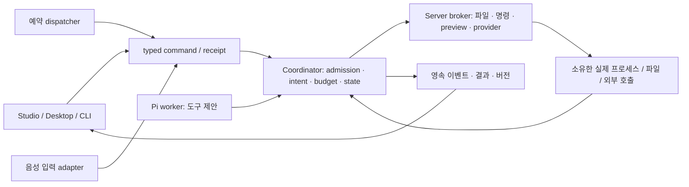

# Desktop 기능 상세 계약

승인된 상세 동작·수용 기준을 당시 구현 계획에서 이관했다. 아래 단계명은 계약 식별자이며 구현 순서나 새 작업 지시가 아니다.

## 3. 전체 범위와 재사용

| ID | 기능 | Corral에서 재사용 | 계약이 다루는 핵심 |
|---|---|---|---|
| ABS-01 | 워크트리 명령 실행 | effect intent, 승인, 파일 snapshot, Reins | 임의 명령 계약, OS 셸, process lease, 출력 조회 |
| ABS-02 | Ask / Accept edits / Auto | tool-policy, PermissionPolicyEditor, 승인 UI | 컴포저 프리셋과 Run snapshot |
| ABS-03 | Hashline 편집 | read 근거, broker, 원자 쓰기, diff | 태그/ops 엔진과 별도 편집 방식 |
| ABS-04 | 파일·HTML·로컬 앱 미리보기 | FilePanel, diff, 기존 브라우저 MCP | preview lease, 분리된 렌더링, 실제 작업 사본 origin |
| ABS-05 | 모델 카탈로그·설정 가져오기·사고 강도 | ModelRegistry, credentials, reasoning | 카탈로그 cache, import preview/commit, capability 대조 |
| ABS-06 | 동시 세션·Run | Coordinator live Map, Run별 events/예산 | 다중 실행 admission, host 용량, 사본 경합, UI 구독 |
| ABS-07 | Windows/macOS 패키지·트레이·업데이트·절전 방지·단축키 | Electron shell, Linux 패키지, commandRegistry | OS별 runtime packaging, update lifecycle, 사용자 바인딩 |
| ABS-08 | 예약 실행 | 세션 요청, Coordinator, 승인·알림 | 영속 일정·발화 claim·중복/놓친 실행 정책 |
| ABS-09 | 프로젝트 열기·복제·지침·메모리 | 프로젝트/폴더 연결, 참조, 입력 snapshot | clone 작업, 문서 관리와 명시 참조 |
| ABS-10 | 이미지 생성 | 모델 credential store, effect/예산, Artifacts | 생성 provider operation, 바이너리 버전 |
| ABS-11 | Markdown 위임 정의 가져오기 | callable Agent, capability link, spawn_subagents | parser, 권한/모델 매핑 preview |
| ABS-12 | 확장 패키지 | harness package import, 스킬·MCP·신뢰한 확장 | 통합 manifest/review/업데이트·비활성화 |
| ABS-13 | 암호화 설정 금고 | 설정 revision, credential store | 9개 도메인 schema, 암호화·충돌·적용 journal |
| ABS-14 | 원격 Corral 호스트 | 같은 typed API/SSE, 원격 Coordinator | 호스트 등록/인증/transport/namespace |
| ABS-15 | 라이브 음성 | 세션 next/steer, 명령 receipt | live voice transport, 마이크 lifecycle, 대상 고정 |

기존 세션·worktree·검토함·대기열/editQueued·`/`·`@`·명령 팔레트·MCP·내장 스킬·로그인·한국어·체크포인트·ask_user·update_plan은 대체하지 않는다.

## 4. 최종 구조와 공통 계약

설정 저장·import·금고 적용은 기존 서버 설정 서비스가 소유한다. 모든 CRUD를 억지로 Run 도구로 만들지는 않는다. **에이전트의 실행 효과**와 도메인 상태 확정은 Coordinator를 우회하지 않는다.

### 4.1 첫 단계부터 고정할 소유권

- 실행 효과: `hostId / sessionId / runId / executionId / attemptNo / effectId`에 결합한다. OS PID는 내부 조회값이며 영속 identity나 재시작 후 종료 권한이 아니다.
- 대상: `workspaceBindingId / worktreeId / canonical root identity / baseline tree`를 broker가 결정한다. 모델은 cwd 절대 경로나 host credential을 정하지 못한다.
- 허가: 최종 descriptor·args·shell 선택·환경 참조·정책 revision·사본 identity의 fingerprint. 승인 후 인자나 root가 바뀌면 재승인/거절한다.
- 효과 상태: intent → 승인 대기/ready → 실행 → 결과/취소/실패/불확실. `cancel requested`와 `cleanup confirmed`를 구분한다. 소유 후손이 살아 있으면 lease를 풀거나 성공으로 표시하지 않는다.
- 중복: 동일 commandId/effectId는 기존 receipt/operation을 반환한다. 모델 재시도나 SSE 재연결이 새 프로세스를 띄우지 않게 한다.
- 재시작: 이전 효과를 자동 replay하지 않는다. 진행 중 상태는 interrupted/uncertain으로 조정하고, 확인된 프로세스 소유 관계만 정리한다. 새 실행은 명시한 재시작/체크포인트 경로를 쓴다.

### 4.2 코드와 변경 범위

실제 패키지·owner는 [구조](architecture.md)와 각 기능의 현재 코드를 확인한다. 도구 추가 시 enum뿐 아니라 compiler·생성 schema·역할 편집기·worker·review-only 필터·예산·결과 renderer 소비처를 함께 확인한다. 과거 계획의 파일명 제안을 새 모듈 생성 지시로 사용하지 않는다.

## 5. 기능별 구현

### ABS-01 — 실제 작업 사본에서 명령 실행

**사용 흐름:** 세션 작업 사본 연결 → 에이전트가 명령 제안 → 정책에 따른 승인 → 진행 출력/중단 → 파일 변경과 종료 결과 확인 → 등록 검사 실행.

1. 제안 도구명은 `run_command`. 입력은 `{ command, shellId?, cwd?: relativePath, timeoutMs? }`. 서버가 허용된 shell registry에서 실행 파일·인자를 만들고 고정한다. 사용자 선택값을 임의 실행 파일 경로로 사용하지 않는다.
2. 임의 프로그램 실행은 필요 기능이다. `run_check`의 등록 ID 목록을 유일한 진입점으로 유지하거나 명령 몇 개만 fixture로 지원하지 않는다. 반대로 `run_check`를 임의 문자열 셸로 바꾸지도 않는다.
3. 명령은 현재 세션의 관리 사본에서 실행한다. 전후 tree·출력·exit code·signal·취소·cleanup 상태를 기록한다. 셸이 만든 변경은 관측한 diff로 표시하고, broker의 파일별 쓰기 근거를 수행한 것처럼 꾸미지 않는다.
4. Windows는 PowerShell을 기본 제안으로 하고 설치된 pwsh/cmd/Git Bash를 선택 지원한다. Linux/macOS는 설치된 POSIX 셸을 지원한다. `shell:false`로 선택한 셸 executable과 인자를 명시적으로 spawn한다. 인코딩, 공백 경로, stderr, 네이티브 exit code를 실제 OS에서 검사한다.
5. Windows는 Job Object 등 소유 프로세스 트리의 종료를 증명할 수 있는 adapter를 검증한다. POSIX는 process group 종료 확인을 재사용한다. `taskkill` 호출 성공이나 부모 종료만으로 전체 종료를 확정하지 않는다.
6. 환경은 선택한 실행 환경과 필요한 값만 전달한다. provider credentials·Corral DB·bootstrap token을 환경/명령 문자열에 섞지 않는다. secret 환경 참조가 필요하면 서버 설정의 별도 승인된 참조만 받는다.
7. 임의 셸의 cwd 제한은 OS 파일·네트워크 격리가 아니다. 검증된 sandbox 없는 Windows 실행은 신뢰한 로컬 프로세스 capability로 명시한다. strict profile이 요구한 격리를 몰래 해제하지 않는다. 명령 정규식으로 임의 코드의 안전성을 증명하지 않는다.
8. 출력은 제한된 chunk/offset 조회와 종료 요약을 제공한다. 대량 출력은 잘림 상태와 보존 정책을 표시한다. 모델에게 끝없는 raw stream을 넣지 않는다.
9. 장시간 dev server는 별도 `ProcessLease`를 가진 service 실행으로 지원한다. foreground 도구가 종료된 척하고 orphan을 남기지 않는다. 세션의 프로세스 목록에서 종료할 수 있어야 한다. Run 종료 후에도 유지할 service는 사용자가 유지 범위를 명시하고, 쓰기 가능 service는 worktree writer lease를 계속 점유한다.

**완료:** 일반 요청이 실제 사본의 파일을 바꾸고 UI diff에 나타나며, 사용자가 취소하면 grandchildren까지 종료되고 결과 readback이 이를 확인한다. 재시작/중복 제출로 명령이 재실행되지 않는다.

### ABS-02 — 세 단계 권한 프리셋

컴포저의 권한 선택은 시작 전 요청 설정으로 저장하고 Run snapshot에 고정한다. 기존 profile에 필드가 없으면 기존 동작과 hash를 유지한다. 새 선택의 기본 제안은 Ask다.

| 프리셋 | 이미 허용된 읽기/관찰 | 파일 편집 | 셸·외부 효과 |
|---|---|---|---|
| Ask | 허용 | 호출별 승인 | 호출별 승인 |
| Accept edits | 허용 | 허용된 관리 사본의 파일 변경만 자동 허용 | 승인 |
| Auto | 허용 | 기존 capability/정책 안에서 허용 | 기존 capability/정책·예산 안에서 허용 |

유효 권한은 역할 capability ∩ harness/strict ∩ 프로젝트 신뢰 ∩ 기존 permissionPolicies ∩ 모드 프리셋이다. 어느 층의 deny도 Auto가 뒤집지 않는다. review-only에는 편집·명령 쓰기·이미지 생성 권한을 붙이지 않는다. “테스트 명령”이라는 이름만으로 셸을 읽기 전용 분류하지 않는다.

- 승인 카드는 실제 최종 대상·명령/변경·범위·승인 수명을 표시한다. 기본 승인은 이번 호출 한 번이다.
- 세션 허용을 무제한 tool-name grant로 두지 않는다. 반복 허용은 좁은 조건·수명을 가진 명시 정책으로 저장하며 기존 원칙대로 다음 Run부터 적용한다.
- 실행 중 모드 변경 UI는 적용 대상을 분명히 표시한다. 이 계약의 기본은 다음 Run 적용이며 현재 승인 대기 중인 효과를 소급 승인하지 않는다. 즉시 변경이 필요하면 정책 revision과 pending approval 무효화를 포함한 별도 Reins 계약으로 확장한다.
- 승인·거절·타임아웃·중복 클릭·승인 직후 파일 변경·취소 뒤 늦은 승인까지 검증한다.

### ABS-03 — Hashline

`edit`의 기존 Pi schema와 동작을 보존한다. `edit_hashline`과 그에 맞는 읽기 출력 형식을 별도 버전으로 제공한다. 동일 역할에 두 편집 문법을 혼합 노출하지 않고, 기존 자료는 Pi 방식, 새 역할은 선택한 편집 방식을 Run 시작에 고정한다.

- 파일 태그, 줄 번호, PUT/CUT/REM/MV 의미를 정리한 계약부터 만든다. Corral용 순수 TypeScript 변환기를 우선 제안한다. 엔진 선택 때문에 Rust host 전체를 들이지 않는다.
- `ReadEvidence`는 host/run/execution/attempt/path·전체 bytes hash·읽은 줄 구간·encoding/EOL에 결합한다. 다른 실행의 읽기나 잘린 줄은 편집 권한이 아니다.
- 4자리 태그는 표시/참조용이다. full hash 일치와 읽기 근거를 함께 검사하고, lease 안에서 계산 후 적용 직전 재검사한다. 충돌 시 다시 읽게 한다.
- PUT/CUT은 한 파일 내 원자 변환. REM/MV도 실제 삭제/이동 capability, 목적지 충돌, 다중 경로 사전검사와 복구 journal을 탄다. 문자열 변환기로 삭제·이동 권한을 우회하지 않는다.
- 초기 파일 범위는 Corral의 UTF-8·크기 계약을 유지한다. BOM/CRLF/마지막 개행을 보존한다. UTF-16 등은 지원 여부를 명시하고 변환 손실을 숨기지 않는다.
- 기존 `evaluation-edits` 비교 driver는 참고 증거다. 제품 도구 등록→실제 read→모델 tool args→broker 반영→diff 흐름이 완료 기준이다. 네 연산과 stale/collision/부분읽기/실행 간 혼선 반례를 모두 포함한다.

### ABS-04 — 기존 파일 패널 확장과 로컬 브라우저

기존 파일 트리·읽기 탭·Markdown·line reference·diff를 재사용한다. 부족한 이미지/HTML 보기와 preview 시작/종료/새로고침을 같은 패널 체계에 추가한다.

- 일반 파일 읽기는 기존 broker·safe path를 사용한다. HTML은 채팅/SafeMarkdown에서 실행하지 않는다.
- preview는 별도 origin 및 Electron partition/격리 frame에서 연다. Node integration/preload 권한·앱 cookie·Corral API 접근을 공유하지 않는다. `allow-same-origin` 등의 조합으로 앱 권한을 되살리지 않는다.
- `PreviewLease`는 사본 root, 파일/entry URL, 승인된 origin과 WS origin, 생성 프로세스, readiness, 사용자를 소유한다. 로컬 HTML 상대 asset도 같은 검증된 root에서 제공한다.
- dev server는 ABS-01의 service process를 사용한다. 임의 localhost 포트를 신뢰하지 않고, 이 lease가 소유한 포트/프로세스와 응답을 검증한다. 외부 script·리디렉션·WS는 명시한 origin 정책을 따른다. HMR에 필요한 WS를 모두 차단한 채 “로컬 앱 지원”으로 표시하지 않는다.
- 현재 Linux fixture browser의 제약을 origin 문자열 한 줄만 바꿔 제거하지 않는다. launcher, MCP tool policy, proxy/요청 검증, 다운로드·업로드·새 창 정책을 같이 확장한다.
- 사람이 보는 미리보기와 모델의 browser 도구는 같은 대상 lease를 참조한다. screenshot·검증 결과는 불변 evidence로 저장하며 화면 생성 성공과 실제 동작 성공을 구분한다.

**완료:** 실제 작업 사본의 HTML 및 로컬 앱을 패널에서 열고, 파일 수정 후 갱신하며, 에이전트가 같은 대상을 관찰·조작·assert할 수 있다. 다른 세션/포트/파일로의 탈출과 종료 후 재사용은 거절한다.

### ABS-05 — 모델 카탈로그·설정 import·사고 강도

기존 ModelRegistry와 프로필 편집기를 확장한다. models.dev의 이름·가격·한도 metadata와 Pi/provider의 실제 요청 capability를 분리한다. 카탈로그에 있다는 이유로 이미지·reasoning·OAuth operation을 지원한다고 판정하지 않는다.

1. 서버 `models/catalog-service.ts` 제안: 크기/타임아웃/스키마 검증, version/hash/fetchedAt, 마지막 정상 cache, 실패·오래됨 표시. refresh는 기존 Run snapshot을 바꾸지 않는다.
2. 서버 `models/imports/` 제안: Claude Code, Codex, OpenCode, Pi별 읽기 parser. 실행/플러그인 로딩 없이 선택한 설정만 읽는다.
3. 가져오기: 소스 선택 → 후보·지원/미지원·덮어쓰기 diff → 사용자가 항목 선택 → revision을 확인한 원자 저장 → 모델 목록 readback. 네 소스 모두 범위에 포함한다.
4. 비밀값은 서버 밖으로 돌려주지 않는다. API key 복사는 명시 선택한 provider/endpoint에만 결합한다. 기존 Codex 로그인 재사용은 계속 재사용 경로를 쓰며 OAuth 토큰을 다른 공급자의 키처럼 복사하지 않는다. env/command 참조를 import 과정에서 실행하지 않는다.
5. 컴포저의 모델·사고 강도는 기존 역할 override/미래 execution patch를 재사용한다. 미지원 값은 몰래 clamp하지 않고 이유를 표시한다. 적용 범위는 다음 요청/다음 Run을 구분한다.
6. cache 실패, 지원 종료, endpoint 변경, 중복 ID, malformed/대용량 설정, secret redaction과 저장 revision 경합을 검증한다.

### ABS-06 — 읽기·질문 Run의 병행과 worktree별 단일 writer

`one run at a time`을 제거하기 전에 다음 계약을 구현한다.

- 읽기/질문 Run은 고정 입력·tree snapshot을 읽는다. writer가 바꾸는 mutable 파일을 중간 상태로 읽지 않는다.
- writer 판정은 최종 허용 도구·native extension·shell/service capability로 한다. 자연어 요청이나 셸 명령 추측으로 read-only를 선언하지 않는다.
- 서로 다른 worktree의 writer는 병행할 수 있고, 같은 worktree에는 writer owner가 하나다. 같은 원본에 대한 merge/review apply에는 별도 원본 저장소 잠금을 적용한다.
- 읽기 Run의 사후 writer 승격은 하지 않는다. 수정 요청은 명시한 새 writer Run으로 시작한다. 이렇게 해야 이미 부여한 읽기/예산/권한을 소급 변경하지 않는다.
- 시작 검사는 `startRunWithRecovery`, `startRefusal`, auto team, explain, queue, CLI, 예약의 모든 입구에서 같은 admission을 쓴다. 사본 잠금 획득과 실행 예약 사이의 경합을 막는다.
- host 전체의 모델 요청·resident worker·process 수 상한과 Run별 상한을 함께 적용한다. 현재 Run별 `acquireSlot`만 두면 Run 수만큼 총량이 늘어난다. 공정한 대기와 취소 시 슬롯 반환을 검증한다.
- `RunSessionStore`를 `(hostId, runId)` 단위로 소유·해제한다. 세션은 여러 진행 Run을 표시할 수 있고 UI의 선택 Run은 별도다. 세션 전환이 다른 Run의 pause/approval/steer 대상을 바꾸지 않는다.
- busy, queue 자동 시작, sidebar 배지, root active-run 링크, widget plan/context, toast/notification, SSE 재접속과 cursor를 모두 대상별로 바꾼다. 단일 전역 SSE/store에 모든 Run의 projection을 덮어쓰지 않는다.
- `terminationUnconfirmed`/`restoringFiles` 등의 현재 전역 차단을 점검한다. 사본/실행에 국한된 장애는 그 owner를 격리하고, DB 장애처럼 공통 장애만 전체에 전파한다.

**완료:** A writer + B reader + 다른 사본 C writer가 동시에 진행한다. 같은 사본의 두 번째 writer는 명시 대기/거절된다. B의 승인·취소가 A/C에 작용하지 않고, 각 Run의 산출물·예산·SSE 재열람이 맞아야 한다.

### ABS-07 — 실제 Windows/macOS 앱과 앱 수명

- Windows 패키지를 첫 사용 가능 단계에 둔다. `prepare.ts`의 Linux assert만 제거하지 말고 OS/arch별 bundled Node·native SQLite/ONNX·worker 경로·자산·서버 시작/종료를 검증한다.
- Windows 설치형/portable, macOS dmg/zip, 기존 Linux AppImage를 release matrix로 관리한다. 실제 검증한 arch만 지원으로 표시한다.
- 트레이는 기존 세션 목록/명령으로 열기·승인 대기 이동·실행 취소를 제공한다. 창 닫기와 앱 종료를 구분하고, 활성 Run이 있을 때의 종료 확인·숨기기 설정을 둔다.
- 절전 방지는 활성 실행 수에 따라 하나의 blocker를 소유한다. 전부 종료/앱 종료 시 해제하고, 승인 대기나 일시정지 중 유지 여부를 설정으로 명시한다.
- 시작 재시도나 작업 공간 전환으로 대체된 이전 복구 페이지의 늦은 로드 실패는 현재 앱의 설치 실패로 보고하지 않는다. 현재 시작 세대와 같은 살아 있는 창의 실제 복구 실패는 계속 표시하며 workspace 자료를 보존한다.
- 업데이트는 확인→다운로드→준비→명시 재시작이다. 활성 Run/미저장 문서가 있으면 설치 재시작을 유예한다. 서명·배포 channel·호환 schema·이전 설치 복구를 검증한다.
- 단축키는 `commandRegistry`의 command ID에 사용자 binding을 얹는다. 충돌·예약 OS 키·IME·입력란 동작·기본값 복원을 검증한다.

**완료:** 개발 서버가 없는 사용자 환경에서 설치→프로젝트→명령→취소→종료→재실행이 된다. 빌드 성공만으로 Windows/macOS 지원을 선언하지 않는다.

### ABS-08 — 예약 실행

- 서버에 `Schedule`과 `ScheduledOccurrence`를 저장한다. 일정에는 timezone, 규칙, 활성 여부, 대상 host/project/session, prompt/ref와 실행 설정 revision, 권한/예산을 둔다.
- 앱/선택 호스트 서버가 살아 있을 때 실행한다. 화면의 타이머나 Electron renderer가 유일한 scheduler가 되어서는 안 된다.
- 발화 key는 schedule ID + revision + 예정 UTC 시각이다. SQLite unique claim과 안정된 commandId로 중복 poll/창/응답 유실을 흡수한다.
- 일반 요청의 auto-team·권한·Coordinator 시작 경로를 사용한다. private 메서드를 직접 호출하거나 일정 전용 모델 루프를 만들지 않는다.
- 기본 제안: 같은 일정 실행 중이면 overlap을 건너뛰고 기록, 앱이 꺼져 있던 구간은 자동 소급 실행하지 않고 놓침으로 표시. 사용자는 “지금 실행”할 수 있다. DST 중복/없는 시각 정책을 UI와 함께 확정한다.
- 사람 승인은 알림과 기존 response host로 연결하고 기다린다. unattended라는 이유로 승인하거나 예상 비용을 숨기지 않는다.
- 삭제/비활성화는 미래 발화를 멈추며 진행 Run 취소는 별도 동작이다. restart 때 이미 시작한 occurrence를 재실행하지 않는다.

### ABS-09 — 프로젝트 열기·복제·지침·메모리

- 기존 “프로젝트/폴더 연결”에 폴더 열기와 Git clone을 통합한다. clone은 서버 관리 operation으로 진행률·취소·부분 디렉터리 복구를 제공하고 destination overwrite를 금지한다.
- 기존 OS Git credential 경로를 사용하되 URL에 credential을 기록하지 않는다. clone한 코드/후크를 자동 실행하거나 저장소 신뢰를 자동 부여하지 않는다.
- 기존 non-Git 연결은 유지한다. Git worktree가 필요한 작업은 이유와 명시 초기화/연결 경로를 제시한다. 자동 git init/commit으로 사용자의 폴더 의미를 바꾸지 않는다.
- 지침·메모리는 project-scoped versioned 문서로 관리한다. 자동 prompt 주입 대신 `@` 또는 “이번 요청에 첨부”로 선택하고 context snapshot/hash에 포함한다.
- 편집·삭제가 과거 요청 본문을 바꾸지 않는다. 문서 안에 적힌 지시는 권한 승인이 아니며 실행 설정을 덮지 못한다.

### ABS-10 — 이미지 생성과 산출물

- `generate_image` 제안 도구는 명시된 image profile과 실제 provider operation을 사용한다. 미설정/미지원이면 설정 경로를 보여 주고 다른 모델로 몰래 대체하지 않는다.
- 모델 registry/credential store를 재사용하고 Coordinator에서 호출·금액/횟수/시간 상한을 예약·정산한다. 취소 후 청구/결과 여부가 모호하면 unknown으로 남긴다.
- binary artifact descriptor에 MIME·bytes·dimensions·hash·blobRef·author/run/effect·버전을 둔다. 기존 text artifact를 유지하고 export/viewer/review/read-artifact 소비자를 함께 확장한다.
- 제한된 immutable blob 저장과 metadata commit/journal을 설계한다. 성공 이벤트만 있고 bytes가 없는 상태를 성공으로 읽지 않으며 orphan 정리를 제공한다.
- 생성 원본 크기를 입력용 PNG 제한에 맞추려고 조용히 축소하지 않는다. 출력 크기 정책과 미리보기 derivative를 분리한다.
- 참조 이미지는 세션에 허용된 artifact/input ref만 받고 임의 경로·URL fetch를 받지 않는다. 부분 성공·중복 응답·늦은 완료·불허 MIME을 처리한다.

### ABS-11 — Markdown 서브에이전트 import

- explorer/code-reviewer/test-runner/fixer/ui-designer를 포함한 문서 후보를 preview한다. parser는 frontmatter의 이름·설명·prompt·tool·model을 읽고 오류/미지원 필드를 표시한다.
- `Read/Glob/Grep/Bash/Edit/Write/Task…`를 Corral의 실제 capability와 매핑한다. 이름만 비슷한 도구를 자동 동등 취급하지 않는다. 없는 도구를 선택한 정의는 import 단계에서 알려 준다.
- 저장 결과는 Corral definition의 callable Agent와 명시한 capability link다. 실행 중 임의 역할 생성이나 별도 sidecar 위임 큐를 만들지 않는다.
- 자식은 부모 capability의 부분집합과 기존 depth/spawn/예산 상한을 따른다. 고정 상한 10을 그대로 두지 않는다.
- `ask_user`와 Run 제어는 자식이 직접 행사하지 않도록 import된 역할에서 제외하고, 필요한 질문은 부모에게 기존 ask/reply 경로로 보낸다. 기존 수동 팀의 계약을 몰래 바꾸지 않는다.

### ABS-12 — 스킬·MCP·서버 확장 패키지

- `harness/service.ts`의 버전 고정 package import와 기존 resource/permission UI를 확장한다. 별도 설치 DB와 신뢰 원장을 만들지 않는다.
- manifest는 제공 스킬·MCP·extension·선택 UI metadata, 버전/hash, 라이선스와 요청 capability를 가진다. 설치 전 diff·권한·출처를 검토하고 명시 선택한다.
- install/upgrade/disable/uninstall은 실행 중 고정 resource를 보존하고 다음 Run 적용을 기본으로 한다. 열린 MCP/process/UI slot의 소유·해제 경로를 둔다.
- managed extension 효과는 Coordinator broker 경로만 쓴다. Node 네이티브 코드를 실행시키면서 “직접 fs/net/process를 모두 통제한다”고 주장하지 않는다. 기존 trusted-native는 별도 비격리 신뢰 경계로 표시하고 strict와 섞지 않는다.
- UI slot은 declarative/격리된 기여부터 시작한다. DB·filesystem 직접 접근을 제공하지 않는다. 임의 renderer JavaScript 실행은 이 계약의 기본 계약이 아니다.

### ABS-13 — 암호화 설정 금고

도메인은 `application`, `providers`, `mcp`, `skills`, `subagents`, `instructions`, `plugins`, `automation`, `memory`로 고정한다. 대화·원본 프로젝트·Run·산출물·플러그인 바이너리는 제외한다.

- 공통 schema version과 도메인별 export/import adapter를 둔다. 로컬 절대 경로·호스트 trust·실행 권한·활성 예약·OS keychain 핸들은 portable 값과 분리한다.
- 비밀 설정은 별도 encrypted secret 영역과 명시한 export 선택으로 다룬다. 모든 provider credential을 기본 동기화하지 않는다. OAuth 세션의 이동 가능성을 가정하지 않는다.
- 검증된 암호화 라이브러리의 AEAD·KDF·nonce 관리를 사용한다. 암호화 형식과 credential 처리는 기존 vault schema·서비스 및 ABS-13 시험과 함께 확인한다.
- S3 object revision/ETag 기반 충돌 감지, 내려받기 검증, domain별 diff, 명시 병합, 적용 journal/rollback을 구현한다. 마지막 저장 승리로 trust/secret/automation을 덮지 않는다.
- plugin/MCP/automation 정의를 가져와도 설치·네트워크 연결·예약 실행 권한이 자동 활성화되지 않는다. 필요한 local binding을 재지정하고 검토한다.
- migration 실패·부분 적용·잘못된 키·위조 ciphertext·서로 다른 장치의 동시 수정·삭제 tombstone을 검증한다.

### ABS-14 — 원격 Corral 호스트

목표는 다른 머신의 Corral 서버를 등록하고 같은 API/SSE로 조작하는 것이다. **원격 호스트가 자기 세션·Run·파일·자격 증명의 원본**이다. 로컬은 표시·선택·재연결 상태를 가지며 원격 DB를 로컬 DB와 이중 기록하지 않는다.

- `hostId`를 URL만 아닌 안정된 identity로 둔다. route/cache/command/SSE cursor/preview/알림 키에 포함한다.
- 첫 transport 제안은 SSH tunnel로 원격 loopback Corral에 연결하는 방식이다. tunnel 생명주기와 bootstrap/auth 교환은 Desktop host manager가 소유한다. 현재 Host/Origin·CSRF 경계를 유지한 채 transport별 endpoint를 검증한다.
- HTTPS 직접 연결은 인증·TLS·기기 등록/revoke·Origin/CSRF 정책을 갖춘 별도 transport로 설계한다. SSH는 최종 host abstraction의 구현 하나이며, 나중에 호스트 identity/데이터 소유권을 뒤집는 임시 우회가 아니다.
- 재연결 시 commandId로 receipt를 조회한 뒤 중복 실행을 막고, SSE cursor로 필요한 구간을 복구한다. 연결 끊김이 원격 실행 종료를 뜻하지 않는다.
- 원격 자격 증명은 해당 호스트에 남긴다. clone/worktree/preview의 “로컬 경로”도 원격 root 기준이다. 로컬 command나 파일로 조용히 fallback하지 않는다.
- 미지원 서버 버전/capability는 UI에서 이유를 표시한다. 호스트 삭제는 연결 해제와 등록 해제이며 원격 데이터 삭제가 아니다.

### ABS-15 — 라이브 음성

단순 녹음 업로드 버튼으로 라이브 음성을 대신하지 않는다. 시작/연결/듣기/응답/중단/종료 상태, 양방향 오디오, 끼어들기, 끊김 복구를 갖춘 live session을 구현한다.

- 음성 provider operation과 마이크·오디오 출력은 별도 adapter가 소유하고, Corral의 실행 도구를 직접 호출하지 않는다.
- 사용자가 선택한 host/session/Run을 음성 시작 시 고정한다. 대상 변경은 표시하고 명시 전환한다. 화면의 현재 탭 변화로 다른 세션에 발화가 전송되지 않는다.
- 확정 발화는 idle이면 일반 next 요청, 실행 중이면 명시 대상 steer다. 승인 대기로 steer 대상이 없으면 그 이유와 queue/다음 요청 선택을 제공한다.
- 발화 ID·최종 transcript·commandId를 결합해 partial transcript/재연결 중복 제출을 막는다. Reins의 accepted/delivered 의미를 그대로 쓴다.
- 원본 오디오를 파일·로그·DB에 저장하지 않는다. 마이크 buffer는 종료 시 폐기한다. 확정된 사용자 텍스트는 일반 세션 기록이 된다는 점을 UI에 표시한다.
- 앱 종료/호스트 전환/권한 철회 시 장치와 socket을 정리한다. 음성 token/비용·시간 상한도 운영 예산에 표시한다.
- provider 종류와 계정 사용 가능 여부는 실제 지원 API로 확인한다. 비공개 endpoint나 하드코딩 model ID를 지원 근거로 두지 않는다.

## 7. 호환성과 데이터 migration

| 변경 | 기존 자료 처리 | 새 자료/실패 처리 |
|---|---|---|
| 권한 모드·edit 방식 | 필드 없는 정의·Run은 기존 동작/hash 유지 | 새 선택만 새 snapshot에 포함. 과거 Run의 정책을 재해석하지 않음 |
| 명령·preview/process lease | 기존 run_check/report 그대로 | versioned operation 기록. restart 시 PID만으로 재접속/kill하지 않음 |
| 동시 실행 | 기존 단일 Run row는 그대로 유효 | durable admission/lease와 복구. 종료 확인 안 된 사본은 writer 재할당 금지 |
| catalog/import | profile ID/endpoint credential binding 보존 | 저장 revision 충돌 시 preview 재확인. 새 카탈로그가 과거 모델 snapshot을 수정하지 않음 |
| binary artifact | text artifact/내용 주소/검토 이력 유지 | 타입 구분, byte cap, 불변 저장, partial/orphan 복구 |
| host | 기존 자료는 명시 local host로 해석 | host별 namespace·credential·cache, 원격 데이터 자동 복제 없음 |
| schedules/vault | 구자료는 기능 미설정 | schema version, 적용 journal, backup. 다운그레이드 불가 schema는 구버전 시작 전 안내 |

각 migration은 빈 DB뿐 아니라 기존 DB 복사본·부분 적용·중단 직후 재시작에서 검증한다. rollback은 새 기능 비활성화와 백업 복원 절차로 정의하고, 새 자료를 구버전이 안전하게 읽는다고 가정하지 않는다.

## 8. 수용 기준과 검증

아래는 ABS-01–15 기능의 수용 기준이다. 기존 시험을 지워 새 기대만 통과시키지 않는다.

| 기능 | 대표 정상 흐름 | 반드시 실패/거절해야 하는 반례 |
|---|---|---|
| ABS-01 | 임의 명령→실제 사본 변화→출력/exit/readback | 승인 전 실행, duplicate spawn, cwd 교체, 취소 후 자식 잔존, 재시작 자동 replay |
| ABS-02 | 세 모드의 파일/명령 처리 | Auto로 deny/strict/review-only 우회, 바뀐 인자 승인 재사용 |
| ABS-03 | 읽은 파일에 PUT/CUT/REM/MV | tag 충돌·stale·unseen line·타 실행 근거·목적지 충돌·부분 쓰기 |
| ABS-04 | HTML/앱 preview→수정 반영→브라우저 assertion | 임의 origin/file, redirect/WS 탈출, 앱 credential 공유, 종료 lease 재사용 |
| ABS-05 | 네 소스 import→프로필 선택→payload 확인 | credential 노출/실행 참조 실행, 충돌 overwrite, metadata를 capability로 오인 |
| ABS-06 | reader+writer+다른 사본 writer 병행 | 같은 사본 동시 writer, 총 permit 초과, 세션 간 취소/승인/plan 누출 |
| ABS-07 | OS별 설치→작업→tray/awake→종료/업데이트 | 개발 경로 의존, 활성 작업 중 강제 설치, orphan server, 키보드/IME 회귀 |
| ABS-08 | 일정 발화 1회→Run→승인→재열람 | 중복 tick/reconnect, DST 중복, 숨은 catch-up, 비활성화 후 늦은 시작 |
| ABS-09 | clone→연결→명시 자료 참조 | 기존 폴더 덮기, 자동 신뢰/commit, 지침 자동 권한 상승, 과거 context 변경 |
| ABS-10 | 이미지 생성→버전/검토/export | review-only 생성, 미지원 provider 대체, bytes 없는 성공, 늦은 결과 이중 과금 정산 |
| ABS-11 | 정의 import→callable→spawn | 알 수 없는 도구 조용한 허용, 부모보다 넓은 권한, depth/budget 우회 |
| ABS-12 | package review→managed tool→upgrade | 설치만으로 실행, trust 자동 확대, 활성 버전 삭제, 임의 renderer DB 접근 |
| ABS-13 | 두 장치 설정 병합·복구 | 위조/오래된 ciphertext, credential 무단 포함, 자동화 자동 활성화, partial apply |
| ABS-14 | 원격 실행→재접속→receipt 복구 | 다른 host command/cursor, localhost fallback, origin/인증 우회 |
| ABS-15 | live call→next/steer→종료 | partial 중복 제출, 잘못된 대상, 녹음 저장, 마이크/socket 잔존 |

검증 단계:

1. **계약/단위:** parser·state reducer·policy·fingerprint·migration. 시간·ID·외부 호출을 주입한다.
2. **실제 로컬 효과 통합:** 실제 subprocess/파일/SQLite/loopback HTTP를 사용한다. 모델은 결정적 provider로 제어할 수 있지만 제품 prompt·도구 schema·권한·Coordinator·broker 경로는 바꾸지 않는다.
3. **Studio E2E:** 기존 `server/files`, `harness-checks`, `harness-resources`, `models`, `reasoning-scope`, `chat-widgets`, `conversation-length` 및 desktop-workbench 흐름을 확장한다. 새 테스트 전용 입구를 만들지 않는다.
4. **실제 화면:** 인앱 브라우저에서 시작→승인→실행→결과, 좁은 폭, 키보드/IME, 긴 출력과 오류를 확인한다. 같은 사용자 과제, viewport, state로 확인한다.
5. **OS 앱:** Windows 설치 산출물에서 subprocess tree·파일 잠금·PowerShell 인코딩·tray·마이크·업데이트를 확인한다. Linux CI 통과는 Windows/macOS 증거가 아니다.
6. **외부 capability:** 이미지/voice/remote/S3는 승인된 계정·대상·호출 상한이 있는 opt-in 검증을 따로 한다. 가짜 provider 통과만으로 외부 기능 완료나 품질 향상을 주장하지 않는다.

공통 체크는 변경 범위에 맞는 `pnpm contracts:check`, `pnpm lint`, `pnpm typecheck`, Vitest, Studio Playwright, build다. 새로운 native dependency는 버전·라이선스·공식 지원 플랫폼·Node/Electron ABI·배포 자산을 기록한다.

## 9. UI 배치와 완료 판정

상태·권한은 기존 토큰과 공용 컴포넌트를 쓴다. 위젯·Todo·단일 질문/승인 대응 영역은 [채팅 위젯 계약](chat-widgets-contract.md), 기본 입력과 요청 옵션 배치는 [Workbench](workbench.md)를 따른다.

| 위치 | 새 동작 | 지켜야 할 동작 |
|---|---|---|
| 컴포저 | 권한 모드·모델/추론·음성 진입 | 다음 요청/현재 Run 적용을 구분, 좁은 화면 메뉴화, draft/IME 보존 |
| 작업 패널 | 프로세스/preview/생성 이미지 | 현재 run/session/host를 명시, 탭 전환이 취소나 실행 전환을 일으키지 않음 |
| 사이드바 | 복수 활성 세션·예약/원격 진입 | 탐색과 실행 선택을 구분, 알림은 정확한 승인 대상으로 이동 |
| 설정 | catalog/import·package·vault·host·키 바인딩 | 저장 범위/미저장 diff/오류/미지원 이유 표시 |
| Native 메뉴·대화상자 | 앱에서 고른 언어를 따름(선택 전에는 OS 언어), 원격 호스트 창 포함 | 일반 설정은 Native 전용 옵션의 메뉴 위치만 안내하고 원격 화면에 로컬 권한을 노출하지 않음 |
| 프로젝트 | open/clone·지침/메모리 | 연결·신뢰·사본 생성·원본 반영은 서로 다른 단계 |

시스템 알림은 본문·제목·경로 대신 inbox의 종류·세션·Run 식별자만 대상으로 전달한다. 발행 당시 창·workspace·origin·sidecar generation이 유지되고 현재 inbox에도 같은 대상이 있을 때만 기존 화면으로 이동한다. 승인/질문은 정확한 Run의 기존 대응 영역, 검토 항목은 해당 세션 검토, 대기열은 세션으로 연결한다. 이동은 SPA 경로를 사용해 문서 store와 미저장 내용을 보존한다. 최초 조회와 같은 대상의 반복 알림을 억제하고, 개수가 같아도 새 대상은 감지한다. 이전 두 인자 알림 호출은 창만 앞으로 가져오는 동작을 유지한다. 알림 클릭은 승인을 대신하지 않는다.

각 기능의 완료 보고에는 대상 commit/artifact/OS, 사용자 진입점, 실제 효과, 영속 readback, 취소·실패 결과, 화면 증거, 남은 제한을 포함한다. 코드·테스트·문서만 존재하고 일반 흐름에서 사용할 수 없으면 그 기능은 미완료다.
